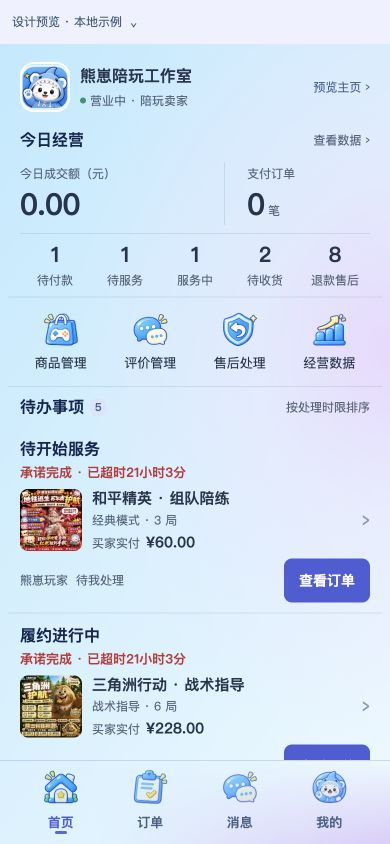

# 熊崽电竞用户端 UI

本次提交保存当前买家端、卖家端界面及其依赖代码，供 GitHub 查看和继续开发。没有部署网站或执行真实资金操作。

## 主要入口

- 买家端：`http://127.0.0.1:3001/`
- 卖家端：`http://127.0.0.1:3001/?preview=seller-workbench`
- 页面和导航：`app/page.tsx`
- 卖家工作台、商品管理和编辑：`app/seller-workbench/`
- 卖家公开主页和资料管理：`app/storefront/`
- 卡通图标和共享弹层：`app/ui/`
- 标准表情与熊崽动态表情：`app/chat-stickers/`
- 关联接口：`apps/api/`；共享业务与数据库：`packages/`

## 本地运行

使用 Node.js 22.13.0 或更高版本，以及项目指定的 pnpm 版本。

```bash
pnpm install --frozen-lockfile
pnpm dev
```

上述命令启动 UI。正式登录、商品资料、聊天、退款及资金等依赖后端接口和独立配置；打开本地预览不代表这些真实业务已经接通。

后端配置参见项目已有环境模板及本地测试说明。实际 `.env`、数据库、登录信息和上传服务凭据不随此提交上传。数据库变更包含 `0010_order_rule_version.sql` 和 `0011_bear_sticker_messages.sql`，应在开发环境按既有迁移流程执行，不能直接用于生产部署。

## 表情素材

- 224 枚标准 Emoji 的运行资源及两份 MIT 版权文件位于 `public/assets/standard-emoji/fluent-224-v1/`。
- 熊崽 V3 买家、卖家各 35 个透明动态 GIF 位于 `public/assets/chat-stickers/bear-v3/`。
- 为使已有资源核验测试及同步脚本可复现，同时保存它们实际使用的最终源图、GIF 和清单。旧版本、制作中间文件、大型 APNG、视频及打包文件没有上传。
- 资源以内容相同的 Git 对象保存，没有重新绘制或转换 GIF。

## 界面记录

以下为此前验收时的本地预览截图，示例信息不代表真实经营数据。实际界面以代码运行结果为准。




## 验证范围

上传前检查资源路径、Git 差异、明显的凭据特征和资源大小。Web 生产构建通过，用户端界面和表情专项测试通过。

全量根目录测试共 236 项：225 项通过，11 项未通过，未跳过。失败涉及本地运行测试缺少 `TEST_DATABASE_URL`、沙箱禁止监听端口，以及部分旧页面文案、源码结构、迁移数量和退款分组断言尚未随此前实现更新。此轮上传没有更改业务行为来迎合旧断言，也未声称全量测试通过。

素材授权文件的原始末尾空行被保留，以维持字节一致性。真实接口的配置、原生移动端接入和生产环境验收仍需按既有交付记录分别核实，不能把代码上传等同于生产交易闭环完成。
