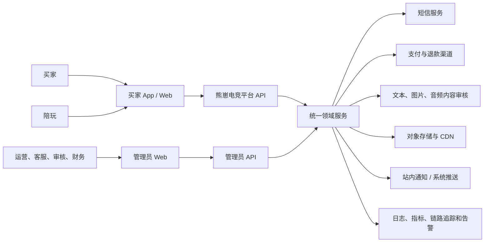
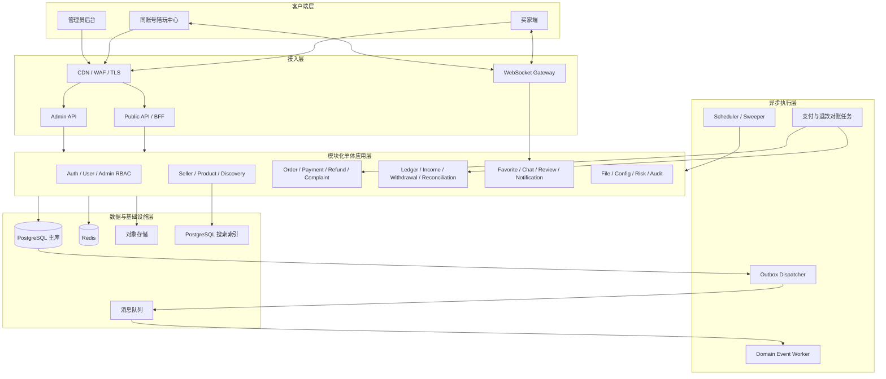
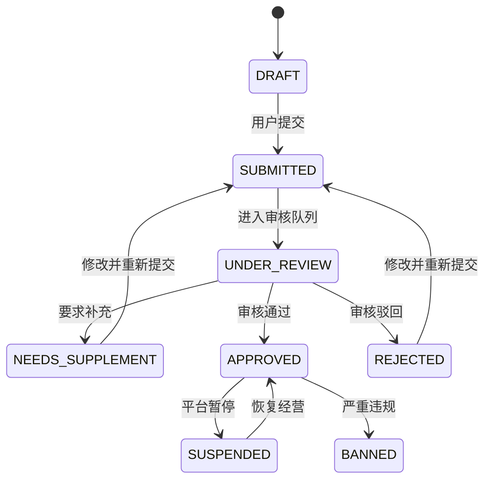
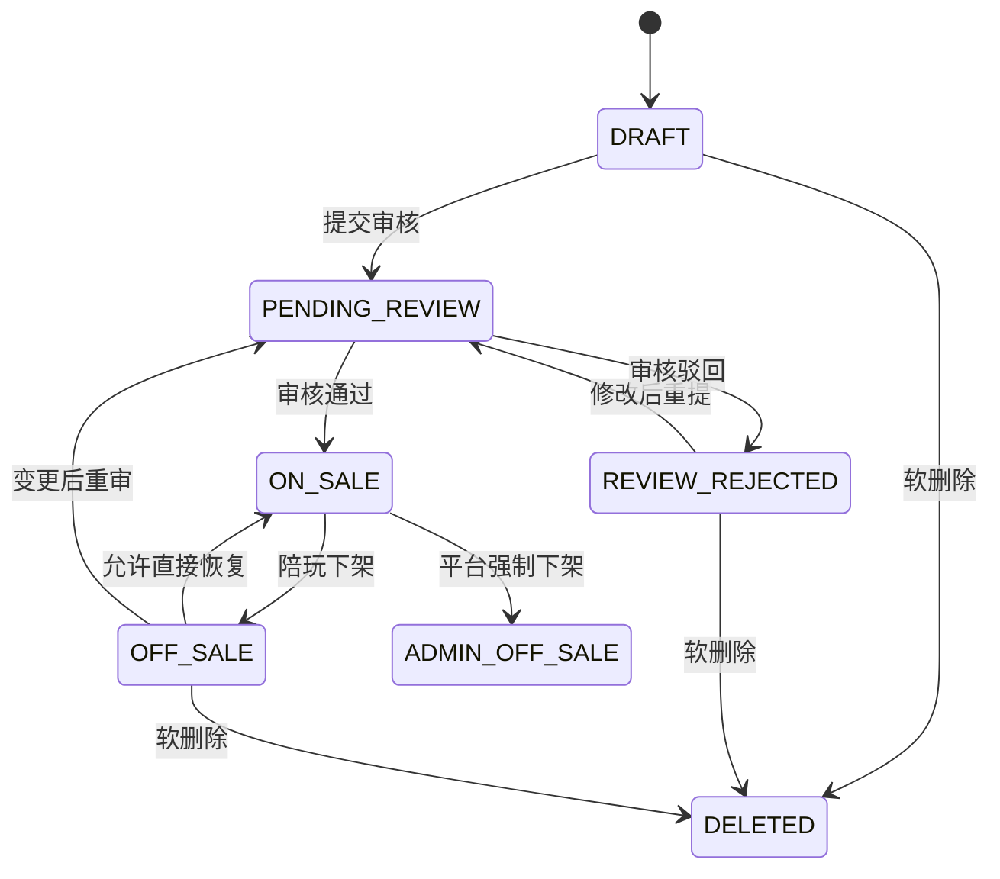
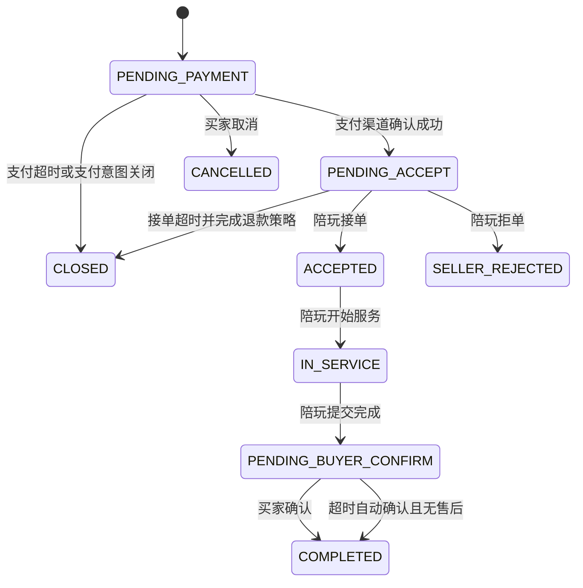
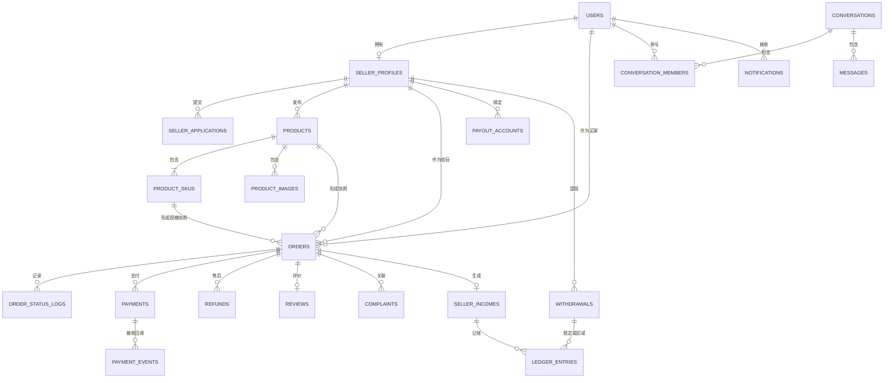
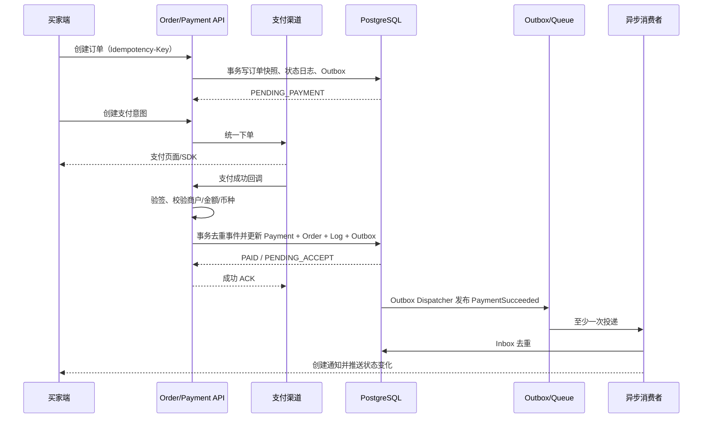
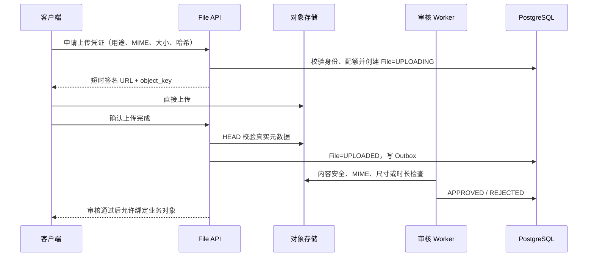
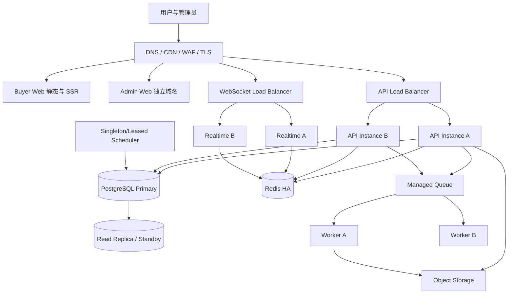

# 熊崽电竞｜和平精英 C2C 游戏陪玩交易平台

## 技术架构设计文档 V1.0

| 文档项 | 内容 |
|---|---|
| 产品名称 | 熊崽电竞 |
| 文档名称 | 技术架构设计文档 |
| 文档版本 | V1.0 |
| 产品阶段 | 第一阶段 MVP |
| 输入基线 | 《熊崽电竞｜和平精英 C2C 游戏陪玩交易平台 PRD V2.0》 |
| UI 基线 | 当前用户端 UI、同账号陪玩中心 UI、管理员 Web 后台 UI |
| 技术基线 | React 19、Vinext、Cloudflare Worker 原型、Drizzle ORM 空 Schema |
| 文档状态 | 技术评审候选版 |
| 编制日期 | 2026-08-20 |

> 本文档用于把 PRD、用户端 UI、陪玩中心 UI 和管理员后台 UI 转换为可落地的生产技术架构。文档中的状态、金额、权限和数据一致性规则优先于当前原型中的本地模拟状态。正式开发时，所有接口 Schema、数据库迁移、状态枚举和测试用例必须与本文档及已冻结 PRD 版本保持一致。

---

# 1. 文档目的

## 1.1 目标

本文档解决以下问题：

- 明确熊崽电竞 MVP 的系统边界、模块边界和数据归属。
- 将买家端、陪玩中心和管理员后台连接到同一套业务事实。
- 给出订单、支付、退款、账务、提现、聊天和审核的可靠实现方式。
- 约束数据库、API、异步事件、权限、审计和文件存储设计。
- 为后端、前端、测试、运维和安全团队提供共同开发基线。
- 给出从当前 UI 原型迁移到生产系统的实施路径。

## 1.2 适用范围

第一阶段仅覆盖《和平精英》陪玩 C2C 服务交易：

- 手机号登录、用户资料和隐私安全。
- 同账号申请成为陪玩。
- 陪玩公开主页、声音名片、服务和 SKU。
- 发现、搜索、收藏和文字咨询。
- 下单、支付、接单、服务履约、确认完成和评价。
- 退款、投诉、平台介入和证据管理。
- 佣金、陪玩收益、结算、收款账户和提现。
- 管理后台审核、治理、客服、财务、配置和审计。
- 站内通知、WebSocket 实时消息和异步任务。

## 1.3 不在本文档范围内

- 多游戏、多地区或多币种交易。
- 社区、动态、短视频、直播、语音房和音视频通话。
- 俱乐部、公会、粉丝、等级、会员、积分和礼物。
- AI 推荐、AI 客服和复杂推荐算法。
- 和平精英官方数据同步。
- 自建支付清算系统或把业务账本描述为真实资金账户。

---

# 2. 输入基线与现状评估

## 2.1 PRD 关键约束

架构必须满足以下产品事实：

1. 买家和陪玩使用同一个 `User`，陪玩是用户审核通过后增加的经营身份。
2. 管理员使用独立的 `AdminAccount`，不能由普通用户角色提升获得。
3. 买家端和陪玩中心展示不同视角，但底层读取同一条 `Order`。
4. 服务必须包含一个或多个有效 SKU，订单保存服务、SKU、陪玩和佣金快照。
5. 订单主状态、支付状态和售后状态相互关联但不能混用。
6. 支付回调、退款、收益入账和提现必须可幂等、可审计、可对账。
7. 所有核心状态以服务端和关系型数据库为唯一事实来源。
8. 后台风险操作必须二次确认、填写原因并记录管理员操作日志。
9. 聊天第一阶段仅支持文字；消息必须先持久化后 ACK。
10. 文件上传必须经过权限校验、元数据校验和内容安全审核。

## 2.2 当前用户端 UI 观察

当前用户端已经覆盖：

- 买家首页的推荐、陪玩和服务分栏。
- 陪玩主页、服务详情、SKU 选择、预约时间和确认订单。
- 支付处理中、支付成功/失败/取消/关闭等全状态。
- 买家订单、退款、投诉、评价、消息、通知和客服。
- 用户资料、收藏、隐私安全、数据下载和注销入口。
- 陪玩申请、陪玩中心、服务经营、卖家订单、收益和提现。
- Loading、Empty、Error、Offline、权限限制和媒体上传等全局状态。

当前实现将页面、模拟数据和页面跳转集中在单个客户端组件中，适合作为交互原型，不适合作为生产数据架构。生产实现必须把页面状态替换为路由状态、服务端查询状态和领域状态。

## 2.3 当前管理员后台 UI 观察

后台 UI 已覆盖：

- 账号密码、MFA、登录失败锁定和会话超时演示。
- 数据总览、用户、陪玩审核/管理、服务审核/管理。
- 订单、退款、投诉、客服、评价、财务、提现和平台配置。
- 高风险操作确认、原因输入、详情抽屉、会话取证和操作日志。
- 加载、空数据、错误和断网状态。

当前登录、数据筛选、审核结果和操作日志均为浏览器内存模拟。生产后台不得直接修改前端数组或数据库字段，必须通过受控的管理员命令接口执行领域动作。

## 2.4 当前仓库技术现状

| 项目 | 当前状态 | 生产差距 |
|---|---|---|
| 用户端 | React/Vinext 高保真原型 | 缺少真实路由、API Client、认证和服务端数据 |
| 管理后台 | `/admin` 下的客户端原型 | 缺少独立部署、管理员认证、RBAC 和审计后端 |
| 数据库 | Drizzle Schema 为空 | 缺少 PostgreSQL 表、约束、索引和迁移 |
| Worker | 页面和图片处理入口 | 缺少领域服务、任务消费者和实时通信 |
| D1/R2 | 当前未绑定 | 生产数据库和对象存储尚未确定 |
| 测试 | UI 渲染测试为主 | 缺少领域、事务、API 合约、安全和端到端测试 |

## 2.5 迁移原则

- 保留当前视觉设计、页面状态覆盖和交互文案。
- 不把当前前端状态名直接当作数据库更新权限。
- 不在现有巨型页面组件中继续堆叠业务逻辑。
- 首先建立共享状态枚举、数据库约束和 API 合约，再接入页面。
- 采用纵向业务切片逐步替换模拟数据，避免一次性重写全部 UI。

---

# 3. 架构目标与质量属性

## 3.1 业务目标

- 跑通买家、陪玩和平台三方完整交易闭环。
- 三端读取同一份用户、服务、订单、支付、退款和财务事实。
- 所有状态变化可解释、可追踪、可重放、可对账。
- MVP 能快速交付，同时保留未来拆分服务和扩展游戏的能力。

## 3.2 非功能目标

| 维度 | MVP 目标 |
|---|---|
| 可用性 | 核心服务月度目标不低于 99.9% |
| API 性能 | 非第三方依赖接口 P95 小于 800ms |
| 实时消息 | 在线消息端到端 P95 小于 2 秒 |
| 数据准确性 | 订单与财务金额差异为 0 |
| 幂等性 | 支付、退款、结算、提现和核心写接口重复执行不产生重复业务结果 |
| 可追踪性 | 每个请求、业务命令和异步事件都携带 `request_id`/`trace_id`/`event_id` |
| 安全性 | 服务端资源归属鉴权、敏感数据加密、后台 MFA 和高风险审计 |
| 恢复能力 | 数据库定期备份并验证恢复；消息失败可重试并进入死信处理 |
| 兼容性 | 用户端适配 375/390/430px 和安全区；后台适配常见桌面宽度 |

## 3.3 架构原则

1. **模块化单体优先**：MVP 不立即拆微服务，减少分布式事务和运维成本。
2. **数据库事实优先**：核心业务事实只存在于 PostgreSQL，不以缓存或前端状态为准。
3. **领域服务独占写入**：模块只能通过领域服务修改本模块的核心状态。
4. **同步保证核心事务，异步完成副作用**：状态和账务在本地事务中完成；通知、审核、统计等通过事件异步执行。
5. **至少一次投递 + 消费端幂等**：不假设消息只投递一次或严格有序。
6. **快照保护交易历史**：服务和 SKU 后续变化不能改变已创建订单的事实。
7. **不可变账务**：账务通过追加与冲正表达，禁止覆盖历史金额。
8. **最小权限**：用户、陪玩、客服、审核、财务和超级管理员权限分离。
9. **API First**：OpenAPI、状态枚举和错误码是三端共同契约。
10. **可观测性内建**：日志、指标、追踪和审计不是上线后的补丁。

---

# 4. 关键架构决策

| 编号 | 决策 | 结论 | 原因 |
|---|---|---|---|
| ADR-001 | 后端形态 | 模块化单体 + 独立异步 Worker | MVP 领域关联紧密，先保证一致性和交付速度 |
| ADR-002 | 核心数据库 | PostgreSQL | 适合强事务、约束、账务、并发控制和复杂查询 |
| ADR-003 | D1 使用范围 | 不作为核心订单/财务主库 | 当前产品需要关系约束、事务、锁和可靠对账；D1 可用于非核心边缘读取或原型 |
| ADR-004 | 缓存 | Redis 仅用于缓存、限流、在线状态和短期协调 | 防止缓存成为不可审计的业务事实 |
| ADR-005 | 异步一致性 | Transactional Outbox + 消息队列 | 防止数据库提交成功但消息丢失 |
| ADR-006 | 管理后台 | 与用户端独立应用、独立认证域和独立发布 | 降低普通用户身份越权到后台的风险 |
| ADR-007 | 金额 | `BIGINT` 整数分，币种显式存储 | 避免浮点误差，便于对账 |
| ADR-008 | 搜索 | MVP 使用 PostgreSQL 搜索能力 | 数据规模和检索复杂度尚不需要 Elasticsearch |
| ADR-009 | 实时消息 | 独立 WebSocket 网关，消息先落库后 ACK | 支持横向扩展、多设备和可靠未读同步 |
| ADR-010 | 客户端形态 | API 与 UI 解耦 | 当前 Web 原型可保留；最终选择 PWA 或原生 App 不影响后端契约 |
| ADR-011 | 后台业务动作 | 命令式接口，不提供任意状态编辑 | 保证状态机、权限、审计和副作用完整执行 |
| ADR-012 | 配置 | 版本化、延迟生效、可回滚 | 防止佣金和超时配置变更污染历史订单 |

---

# 5. 系统上下文



## 5.1 外部参与者

| 参与者 | 能力边界 |
|---|---|
| 买家 | 浏览、咨询、购买、支付、确认、退款、投诉、评价 |
| 陪玩 | 保留买家能力，并增加申请、经营、接单、履约、收益和提现能力 |
| 客服 | 处理咨询和业务引导，不得绕过订单/退款状态机 |
| 审核人员 | 审核陪玩和服务，处理内容风险 |
| 财务人员 | 查看账务、对账和提现，不得伪造支付成功 |
| 超级管理员 | 管理角色和关键配置，仍受审计和高风险操作约束 |

## 5.2 外部系统

- 短信验证码服务。
- 微信支付、支付宝或后续确定的支付服务商。
- 支付服务商的退款、分账或资金管理能力。
- 文本、图片、音频内容安全服务。
- 对象存储和 CDN。
- 错误监控、日志、指标和链路追踪平台。

---

# 6. 总体逻辑架构



## 6.1 运行单元

MVP 推荐部署以下运行单元：

1. `buyer-web`：当前用户端 UI，或作为原生 App 的 Web 原型基线。
2. `admin-web`：管理员后台，独立域名和安全策略。
3. `api`：模块化单体 HTTP API，可水平扩展。
4. `realtime`：WebSocket 网关，可独立扩容。
5. `worker`：异步事件、通知、审核、统计和结算消费者。
6. `scheduler`：超时取消、自动完成、结算和对账调度器。

API、Worker 和 Scheduler 复用相同 Domain/Application 包，但使用不同启动入口和数据库权限。

## 6.2 推荐技术栈

| 层级 | 首选技术 | 说明 |
|---|---|---|
| 用户端 Web/PWA | React + TypeScript + Vinext | 最大化复用当前 UI；客户端最终形态变化不影响 API |
| 管理后台 | React + TypeScript + Vinext | 从当前 `/admin` 拆为独立应用和独立部署 |
| 原生 App（如确认需要） | React Native + TypeScript | 复用契约、领域枚举和部分非视觉逻辑，不强制复用 DOM 组件 |
| HTTP API | Node.js + TypeScript + NestJS（Fastify Adapter） | 适合模块化单体、守卫、OpenAPI、事务用例和依赖注入 |
| 数据访问 | Drizzle ORM + PostgreSQL Driver | 延续当前 Drizzle 技术方向，同时使用 PostgreSQL 能力 |
| 数据库 | 托管 PostgreSQL | 唯一核心业务事实、事务和账务主库 |
| 缓存/限流 | Redis | 缓存、验证码限流、在线状态和短期协调 |
| 消息队列 | 托管消息队列/RabbitMQ；Cloudflare 路径可用 Queues | 统一通过 Outbox 发布，业务代码不绑定特定 Broker 语义 |
| 实时网关 | 标准 WebSocket；可用 Socket.IO 实现连接管理 | Redis 负责跨实例分发，PostgreSQL 保存消息事实 |
| 对象存储 | S3 兼容存储/R2/OSS | 使用预签名直传、公开/私有 Bucket 和 CDN |
| 合约 | OpenAPI + 生成式 TypeScript Client | 用户端、后台和测试复用同一接口定义 |
| 数据校验 | 服务端 Schema Validator + 数据库约束 | 请求校验不能代替数据库约束 |
| 自动化测试 | Node Test/Vitest + Testcontainers + Playwright | 覆盖 Domain、PostgreSQL 集成、API 和三端 E2E |
| 可观测性 | OpenTelemetry + 结构化日志 + Metrics + Error Tracking | 统一 request、trace 和 event 上下文 |

核心 API 推荐独立部署，不把支付、退款、账务和后台命令长期放在前端应用的 Route Handler 中。前端可以在同域通过反向代理访问 API，以减少 CORS 和 Cookie 配置复杂度。

## 6.3 为什么 MVP 不拆微服务

- Order、Payment、Refund 和 Finance 在 MVP 阶段共享大量强一致事务边界。
- 当前团队和容量尚未证明需要独立服务的运维复杂度。
- 模块化单体仍然可以按模块定义代码所有权、Repository 和领域事件。
- Realtime、Worker 和 Scheduler 已按运行特征独立部署，能够先解决长连接和异步扩容问题。
- 后续拆分时以 Outbox 事件和现有模块接口作为边界，避免提前承担分布式事务。

---

# 7. 推荐工程结构

```text
apps/
  buyer-web/                  # 当前买家端与同账号陪玩中心
  admin-web/                  # 管理员 Web 后台
  api/                        # Public API + Admin API
  realtime/                   # WebSocket 网关
  worker/                     # 领域事件和外部投递消费者
  scheduler/                  # 超时、自动完成、结算、对账任务

packages/
  contracts/                  # OpenAPI、DTO、错误码、事件 Schema
  domain/                     # 实体、值对象、状态机、金额规则
  application/                # 用例、命令、查询和事务边界
  database/                   # Drizzle PostgreSQL Schema、Repository、迁移
  infrastructure/             # Redis、MQ、支付、短信、存储、审核适配器
  auth/                       # Token、Session、RBAC、策略守卫
  observability/              # Logger、Metrics、Tracing、Audit helpers
  ui/                         # 可复用 UI、设计令牌、API Client
  testing/                    # Fixtures、Mock Provider、测试工具

infra/
  docker/                     # 本地 PostgreSQL、Redis、MQ
  deployment/                 # 各环境部署配置
  monitoring/                 # Dashboard、告警规则

docs/
  api/                        # OpenAPI 与接口说明
  adr/                        # 架构决策记录
  runbooks/                   # 支付异常、对账差异、消息堆积等处置手册
```

## 7.1 前端拆分建议

当前 `app/page.tsx` 应按业务路由拆分：

```text
buyer-web/app/
  auth/
  home/
  companions/
  services/
  checkout/
  orders/
  refunds/
  complaints/
  messages/
  account/
  seller-center/
```

当前 `/admin` 应迁移至独立 `admin-web`：

```text
admin-web/app/
  login/
  dashboard/
  users/
  seller-reviews/
  sellers/
  service-reviews/
  services/
  orders/
  refunds/
  complaints/
  support/
  reviews/
  finance/
  withdrawals/
  configs/
  audit-logs/
```

前端组件只负责展示和发起命令。状态转换是否合法、金额如何计算、是否允许查看资源，全部由服务端决定。

---

# 8. 领域模块设计

## 8.1 模块总览

| 模块 | 核心职责 | 主要拥有数据 | 主要事件 |
|---|---|---|---|
| Auth | 短信、登录、刷新、登出、设备和会话撤销 | `sms_codes`、`auth_sessions`、`user_devices` | `UserLoggedIn`、`SessionRevoked` |
| User | 用户资料、状态、隐私设置、注销申请 | `users`、`user_profiles`、`privacy_settings` | `UserProfileUpdated`、`UserDisabled` |
| Seller | 陪玩申请、审核、公开主页、经营状态 | `seller_profiles`、`seller_applications`、审核日志 | `SellerApplicationSubmitted`、`SellerApproved`、`SellerSuspended` |
| Product | 服务、SKU、图片、版本、审核和上下架 | `products`、`product_skus`、`product_images`、版本表 | `ProductSubmitted`、`ProductApproved`、`ProductOffSale` |
| Discovery | 首页、陪玩/服务列表、排序和推荐位 | 推荐配置、聚合读取模型 | `DiscoveryIndexRequested` |
| Favorite | 陪玩和服务收藏 | `favorites` | `FavoriteChanged` |
| Chat | 会话、文字消息、未读游标、多设备同步 | `conversations`、`conversation_members`、`messages` | `MessageCreated`、`ConversationRead` |
| Order | 报价、订单快照、状态机、履约和超时 | `orders`、`order_status_logs` | `OrderCreated`、`OrderAccepted`、`OrderCompleted` |
| Payment | 支付意图、回调、关闭和渠道状态查询 | `payments`、`payment_events` | `PaymentSucceeded`、`PaymentFailed` |
| Refund | 退款申请、卖家处理、平台介入、渠道退款 | `refunds`、`refund_logs` | `RefundRequested`、`RefundSucceeded` |
| Complaint | 投诉、证据、指派和治理结果 | `complaints`、`complaint_evidences`、处理日志 | `ComplaintSubmitted`、`ComplaintResolved` |
| Review | 一单一评、展示审核和评分聚合 | `reviews`、`rating_aggregates` | `ReviewSubmitted`、`RatingRecalculationRequested` |
| Finance | 佣金、账本、收益、结算和冲正 | `ledger_entries`、`seller_incomes` | `IncomeCreated`、`IncomeAvailable`、`LedgerReversed` |
| Withdrawal | 收款账户、提现、额度锁定和打款 | `payout_accounts`、`withdrawals` | `WithdrawalRequested`、`WithdrawalCompleted` |
| Reconciliation | 支付/退款/订单/账务日对账 | `reconciliation_runs`、`reconciliation_items` | `ReconciliationMismatchFound` |
| Notification | 站内通知、未读和投递日志 | `notifications`、`delivery_logs` | `NotificationCreated` |
| File | 上传凭证、元数据、引用和访问控制 | `files`、`file_usages` | `FileUploaded`、`FileModerated` |
| Config | 平台参数、推荐位、规则和灰度发布 | `platform_configs`、`policy_versions` | `ConfigPublished` |
| Admin | 管理员账号、角色、权限和 MFA | 管理员 RBAC 表 | `AdminLoggedIn`、`AdminPermissionChanged` |
| Audit/Risk | 高风险操作审计、风控命中和安全事件 | `admin_operation_logs`、`security_logs`、`risk_events` | `RiskDetected` |

## 8.2 模块依赖规则

- `Order` 可读取 `Seller`、`Product` 和 `Config`，但订单创建后必须保存快照。
- `Payment` 只能通过 `Order` 暴露的受控方法推进订单状态。
- `Finance` 只消费已确认的订单/退款事实，不根据前端页面状态记账。
- `Withdrawal` 通过 `Finance` 锁定可提现账务额度，不能直接扣减一个余额字段。
- `Notification`、统计聚合、内容审核和搜索索引是异步副作用，不阻塞核心交易事务。
- `Admin` 负责鉴权和命令入口，具体业务规则仍由目标领域模块执行。
- 模块之间禁止跨 Repository 直接更新对方表。

---

# 9. 身份、认证与权限架构

## 9.1 用户与陪玩统一身份

```text
User
  ├─ 默认拥有 Buyer 能力
  └─ SellerProfile.status = APPROVED 时增加 Seller 能力
```

- 同一个 access token 对应同一个 `user_id`。
- 服务端根据 SellerProfile 状态授予陪玩中心接口权限。
- 陪玩被暂停或封禁时，用户仍可按规则保留买家能力。
- 买家订单通过 `buyer_id` 查询；卖家订单通过 `seller_id` 查询。

## 9.2 App 登录

- 手机号 + 短信验证码。
- Access Token 建议短有效期，Refresh Token 可撤销。
- Refresh Token 仅存哈希，并绑定会话、设备、过期时间和撤销状态。
- 验证码按手机号哈希、设备和 IP 多维限流。
- 用户禁用、注销或风险冻结时立即撤销相关会话。
- Token、验证码和完整手机号禁止写入普通日志。

## 9.3 管理后台认证

- 管理员账号与普通用户账号物理分表。
- 账号密码 + MFA，支持失败锁定、会话超时和登录日志。
- Web 后台优先使用 `HttpOnly + Secure + SameSite` 会话 Cookie。
- 修改关键配置、退款介入、封禁、提现审核等操作支持 Step-up MFA。
- 后台与用户端使用独立域名、Cookie、CSP 和发布流水线。

## 9.4 RBAC 权限建议

| 角色 | 典型权限 |
|---|---|
| CUSTOMER_SERVICE | 客服会话、用户/订单只读、创建业务关联，不可处理财务 |
| SELLER_REVIEWER | 陪玩申请审核、补充资料、查看审核证据 |
| CONTENT_REVIEWER | 服务和评价审核、内容治理 |
| DISPUTE_OPERATOR | 退款、投诉和有限聊天取证 |
| FINANCE_VIEWER | 财务报表和对账只读 |
| FINANCE_OPERATOR | 提现审核、对账差异处理，不可修改角色 |
| PLATFORM_OPERATOR | 推荐位、普通配置和规则草稿 |
| SECURITY_ADMIN | 管理员账号、角色和安全策略 |
| SUPER_ADMIN | 全局管理，但关键动作仍要求原因、审计和必要的双人复核 |

权限校验必须同时包含：管理员权限、资源范围、业务前置条件和审计原因。

---

# 10. API 架构与契约

## 10.1 API 边界

| 接口族 | 基础路径 | 使用者 | 鉴权 |
|---|---|---|---|
| Public API | `/api/v1` | 买家端和陪玩中心 | User Access Token |
| Admin API | `/admin-api/v1` | 管理员后台 | Admin Session + MFA + RBAC |
| WebSocket | `/realtime/v1` | 买家端和陪玩中心 | 短时 WS Ticket |
| Provider Webhook | `/webhooks/v1/{provider}` | 支付/退款等服务商 | 签名、时间窗、商户身份、事件去重 |
| Internal | `/internal/v1` | Worker、Scheduler | 服务身份、私网或 mTLS |

## 10.2 通用协议

- HTTPS + UTF-8 JSON。
- 时间使用 UTC 存储，ISO 8601 输出。
- 金额使用 `*_cent: integer`，币种使用 `currency: "CNY"`。
- 列表使用 Cursor 分页，不使用易漂移的页码作为主 API。
- 写接口接收 `Idempotency-Key`，服务端保存请求摘要与结果引用。
- 核心资源返回 `version` 或 `updated_at`，更新时支持乐观并发控制。
- 所有响应返回或响应头携带 `request_id`。
- OpenAPI 是接口契约唯一来源，由其生成 TypeScript Client 和测试 Schema。

## 10.3 错误格式

```json
{
  "code": "ORDER_STATE_CONFLICT",
  "message": "订单状态已变化，请刷新后重试",
  "request_id": "req_01...",
  "field_errors": [],
  "details": {
    "current_status": "ACCEPTED",
    "current_version": 4
  }
}
```

错误码按领域前缀管理，例如 `AUTH_`、`SELLER_`、`PRODUCT_`、`ORDER_`、`PAYMENT_`、`REFUND_`、`FINANCE_`、`ADMIN_`。

## 10.4 Public API 核心清单

### 认证与用户

- `POST /auth/sms/send`
- `POST /auth/sms/login`
- `POST /auth/token/refresh`
- `POST /auth/logout`
- `GET /me`
- `PATCH /me/profile`
- `GET /me/security`
- `GET /me/devices`
- `DELETE /me/devices/{device_id}`
- `GET/PATCH /me/privacy-settings`

### 发现、陪玩和服务

- `GET /home/recommendations`
- `GET /companions`
- `GET /companions/{seller_id}`
- `GET /companions/{seller_id}/services`
- `GET /companions/{seller_id}/reviews`
- `GET /services`
- `GET /services/{product_id}`
- `GET /services/{product_id}/reviews`
- `GET /search/companions`
- `GET /search/services`
- `PUT/DELETE /favorites/{target_type}/{target_id}`
- `GET /favorites`

### 陪玩中心

- `POST /seller/applications`
- `GET /seller/application/current`
- `GET/PATCH /seller/profile`
- `POST /seller/services`
- `PATCH /seller/services/{id}`
- `POST /seller/services/{id}/submit-review`
- `POST /seller/services/{id}/off-sale`
- `GET /seller/orders`
- `GET /seller/earnings/summary`
- `GET /seller/earnings/records`
- `GET /seller/payout-accounts`
- `POST /seller/payout-accounts`
- `PATCH /seller/payout-accounts/{id}`
- `DELETE /seller/payout-accounts/{id}`
- `POST /seller/payout-accounts/{id}/set-default`
- `POST /seller/withdrawals`
- `GET /seller/withdrawals`

### 交易、售后和评价

- `POST /orders/quote`
- `POST /orders`
- `GET /orders/bought`
- `GET /orders/{order_no}`
- `POST /orders/{order_no}/cancel`
- `POST /orders/{order_no}/accept`
- `POST /orders/{order_no}/reject`
- `POST /orders/{order_no}/start-service`
- `POST /orders/{order_no}/complete-service`
- `POST /orders/{order_no}/confirm`
- `POST /payments`
- `GET /payments/{payment_id}`
- `POST /orders/{order_no}/refunds`
- `GET /refunds/{refund_no}`
- `POST /refunds/{refund_no}/seller-approve`
- `POST /refunds/{refund_no}/seller-reject`
- `POST /refunds/{refund_no}/escalate`
- `POST /complaints`
- `GET /complaints/{complaint_no}`
- `POST /complaints/{complaint_no}/evidence`
- `POST /orders/{order_no}/reviews`
- `GET /orders/{order_no}/review`

### 聊天和通知

- `POST /conversations/open`
- `GET /conversations`
- `GET /conversations/{id}/messages`
- `POST /conversations/{id}/messages`
- `POST /conversations/{id}/read`
- `POST /realtime/tickets`
- `GET /notifications`
- `GET /notifications/{id}`
- `POST /notifications/{id}/read`
- `POST /notifications/read-all`

## 10.5 Admin API 核心清单

### 登录与权限

- `POST /auth/login`
- `POST /auth/mfa/verify`
- `POST /auth/logout`
- `GET /me`
- `GET /me/permissions`

### 总览和查询

- `GET /dashboard/summary`
- `GET /dashboard/trends`
- `GET /dashboard/todos`
- `GET /search`
- `GET /users`
- `GET /users/{id}`
- `GET /sellers`
- `GET /products`
- `GET /orders`
- `GET /orders/{order_no}`
- `GET /refunds`
- `GET /complaints`
- `GET /reviews`
- `GET /finance/reports`
- `GET /withdrawals`
- `GET /audit-logs`

### 受控命令

- `POST /seller-applications/{id}/approve`
- `POST /seller-applications/{id}/reject`
- `POST /seller-applications/{id}/request-supplement`
- `POST /sellers/{id}/suspend`
- `POST /sellers/{id}/restore`
- `POST /sellers/{id}/ban`
- `POST /products/{id}/approve`
- `POST /products/{id}/reject`
- `POST /products/{id}/force-off-sale`
- `POST /refunds/{refund_no}/approve`
- `POST /refunds/{refund_no}/reject`
- `POST /complaints/{complaint_no}/assign`
- `POST /complaints/{complaint_no}/resolve`
- `POST /reviews/{id}/hide`
- `POST /withdrawals/{id}/approve`
- `POST /withdrawals/{id}/reject`
- `POST /configs/{key}/publish`
- `POST /evidence-access-grants`

受控命令必须接收 `reason`；高风险命令还应接收当前资源 `version` 和 Step-up MFA 凭证引用。

---

# 11. 核心状态机设计

## 11.1 状态机通用要求

每次状态转换必须：

1. 校验操作者身份和资源归属。
2. 校验当前状态和目标动作是否合法。
3. 校验资源 `version`，防止并发覆盖。
4. 在数据库事务中更新主记录。
5. 写状态日志、审计上下文和 Outbox 事件。
6. 返回转换后的服务端事实。
7. 重复调用时返回相同结果或明确的幂等响应。

## 11.2 陪玩申请



每次提交创建新的 application version 和资料快照，不覆盖历史审核版本。

## 11.3 服务状态



创建订单时必须重新校验：陪玩已通过且可接单、服务 `ON_SALE`、SKU `ACTIVE`、预约时间仍可用。

## 11.4 订单状态



订单另有：

- `payment_status`：支付维度状态。
- `after_sale_status`：`NONE / IN_PROGRESS / RESOLVED`。
- `refund_summary`：累计申请、批准和已退款金额摘要。

售后不能抹掉订单履约历史；退款和投诉使用独立子状态机。

## 11.5 支付状态

```text
CREATED → PAYING → PAID
                 ├→ REFUNDING → PARTIALLY_REFUNDED
                 └→ REFUNDING → REFUNDED

CREATED / PAYING → FAILED
CREATED / PAYING → CLOSED
```

支付成功必须满足：

- 回调签名有效。
- 商户身份、订单号、币种和金额一致。
- `provider_event_id` 未被处理。
- 支付记录尚未成功或重复事件内容完全一致。
- 订单处于允许接收支付成功的状态。

## 11.6 退款状态

```text
REQUESTED
  ├→ SELLER_APPROVED → REFUND_PROCESSING → REFUNDED
  ├→ SELLER_REJECTED → PLATFORM_REVIEW
  ├→ NEGOTIATING → SELLER_APPROVED / SELLER_REJECTED
  └→ CANCELLED

PLATFORM_REVIEW
  ├→ REFUND_PROCESSING → REFUNDED
  └→ REJECTED
```

部分退款必须校验：累计退款金额不超过订单实付金额；账务冲正金额与渠道成功退款金额一致。

## 11.7 投诉状态

```text
SUBMITTED → ACCEPTED → PROCESSING
                      ├→ NEED_MORE_EVIDENCE → PROCESSING
                      ├→ COMPLETED
                      └→ CLOSED
```

封禁用户、暂停陪玩、下架服务和处理投诉是不同治理动作，每个动作分别鉴权和审计。

## 11.8 收益与提现状态

收益：

```text
PENDING_SETTLEMENT → AVAILABLE → WITHDRAWAL_LOCKED → WITHDRAWN
        └──────────────退款/纠纷──────────────→ REVERSED
```

提现建议状态：

```text
CREATED → RISK_REVIEW → APPROVED → PAYOUT_PROCESSING → COMPLETED
                  └→ REJECTED
PAYOUT_PROCESSING → FAILED → RISK_REVIEW / CLOSED
```

提现失败后必须解除或重新建立资金锁定，不能既恢复可提现又继续保留有效打款任务。

---

# 12. 数据架构

## 12.1 数据库选择

核心业务数据库采用 PostgreSQL。原因包括：

- 订单、支付、退款和账务需要明确事务边界。
- 需要唯一约束、检查约束、外键、行锁和并发控制。
- 后台存在跨业务条件查询和财务聚合。
- 可使用只读副本、备份恢复和成熟的监控工具。

当前 Cloudflare D1 使用 SQLite 语义，可保留用于原型或非核心边缘读取，但不作为核心交易和账务主库。

## 12.2 通用数据规范

- 主键优先使用 UUIDv7 或其他有序全局 ID。
- 订单号、支付号、退款号和提现号使用独立、不可猜测、全局唯一的外部编号。
- 核心表包含 `created_at`、`updated_at`；软删除使用 `deleted_at`。
- 时间存储为 `timestamptz`，统一 UTC。
- 金额使用 `BIGINT` 整数分；佣金比例使用 bps。
- 枚举在数据库和共享契约中保持同名。
- 敏感字段拆分为密文、哈希检索值和脱敏展示值。
- JSON 仅用于不可变快照、外部原始摘要和灵活配置，不能代替核心关系字段。
- 每个核心状态表包含 `version`，更新时执行 Compare-And-Set。

## 12.3 核心表分组

### 身份与用户

| 表 | 关键用途 |
|---|---|
| `users` | 用户身份、手机号密文/哈希、状态和资料初始化状态 |
| `user_profiles` | 昵称、头像和普通公开资料 |
| `auth_sessions` | Refresh Token 哈希、设备、IP、过期和撤销 |
| `sms_codes` | 验证码哈希、用途、过期和尝试次数 |
| `user_devices` | 多设备会话和推送标识 |
| `privacy_settings` | 在线状态、公开资料和个性化设置 |

### 陪玩与服务

| 表 | 关键用途 |
|---|---|
| `seller_profiles` | 当前有效陪玩身份和公开主页 |
| `seller_applications` | 每次申请版本和审核快照 |
| `seller_review_logs` | 审核动作、原因和管理员 |
| `products` | 服务当前版本、状态和聚合指标 |
| `product_versions` | 提交审核时的不可变服务版本 |
| `product_skus` | 自定义规格和整数分价格 |
| `product_images` | 服务图片顺序和封面关系 |
| `favorites` | 用户收藏陪玩或服务 |

### 聊天与通知

| 表 | 关键用途 |
|---|---|
| `conversations` | 会话类型、关联服务/订单和最后消息摘要 |
| `conversation_members` | 成员、角色、最后已读游标和未读数 |
| `messages` | 文字消息、客户端消息 ID、序号和审核状态 |
| `notifications` | 站内通知、结构化关联对象和已读状态 |
| `delivery_logs` | 通知/短信/推送投递结果 |

### 交易与售后

| 表 | 关键用途 |
|---|---|
| `orders` | 交易快照、金额、订单/支付/售后状态和时间点 |
| `order_status_logs` | 每次订单转换的前后状态和操作者 |
| `payments` | 支付意图、渠道交易号、金额和状态 |
| `payment_events` | 渠道回调事件、签名校验和处理结果 |
| `refunds` | 退款申请、处理意见、金额和渠道退款号 |
| `refund_logs` | 退款状态历史 |
| `complaints` | 投诉对象、订单、类型、指派和结果 |
| `complaint_evidences` | 投诉证据和文件引用 |
| `complaint_logs` | 投诉处理历史 |
| `reviews` | 一单一评、评分、内容和展示状态 |
| `rating_aggregates` | 陪玩/服务评分和有效评价数聚合 |

### 财务与提现

| 表 | 关键用途 |
|---|---|
| `ledger_entries` | 不可变借贷方向账务明细 |
| `seller_incomes` | 每个完成订单对应的陪玩收益 |
| `payout_accounts` | 令牌化收款账户及脱敏展示 |
| `withdrawals` | 提现、额度锁定、审核和打款状态 |
| `reconciliation_runs` | 每日对账任务和统计 |
| `reconciliation_items` | 支付/退款/订单/账务差异明细 |

### 文件、配置与治理

| 表 | 关键用途 |
|---|---|
| `files` | 对象键、MIME、大小、哈希、审核和可见性 |
| `file_usages` | 文件和业务对象之间的引用 |
| `platform_configs` | 版本化配置、状态和生效时间 |
| `policy_versions` | 协议、规则和版本确认依据 |
| `admin_accounts` | 独立管理员账号和 MFA 状态 |
| `roles`、`permissions` | RBAC 定义 |
| `admin_roles`、`role_permissions` | RBAC 关联 |
| `admin_operation_logs` | 后台高风险操作审计 |
| `security_logs` | 登录、越权、限流和安全事件 |
| `risk_events` | 风控命中、对象和处理状态 |

### 技术一致性表

| 表 | 关键用途 |
|---|---|
| `outbox_events` | 与业务事务同时写入的待发布事件 |
| `inbox_events` | 消费端事件去重和处理结果 |
| `idempotency_keys` | 写接口幂等请求摘要和结果引用 |
| `scheduled_jobs` | 延迟任务的业务兜底记录 |

## 12.4 高层实体关系



## 12.5 必须落到数据库的约束

- `users.phone_hash` 唯一。
- `seller_profiles.user_id` 唯一。
- `buyer_id != seller_user_id`。
- `order_no`、`payment_no`、`refund_no`、`withdrawal_no` 全局唯一。
- `product_skus.price_cent > 0`。
- 订单所有金额非负，`paid_amount_cent <= payable_amount_cent`。
- 累计成功退款金额不超过实付金额。
- 每个订单最多一条有效评价。
- 每个订单最多一条主 `seller_income`。
- `provider_event_id` 在支付渠道范围内唯一。
- `sender_id + client_message_id` 唯一。
- `event_id + consumer_name` 在 Inbox 中唯一。
- 一个陪玩同类型只允许一个未删除的默认收款账户。

## 12.6 关键索引

- `orders(buyer_id, created_at desc)`。
- `orders(seller_id, created_at desc)`。
- `orders(status, created_at)`。
- `orders(payment_status, created_at)`。
- `products(status, approved_at desc)`。
- `products(seller_id, status)`。
- `products(min_price_cent)`、`products(sold_count desc)`、`products(rating_avg desc)`。
- `messages(conversation_id, sequence_no)`。
- `notifications(user_id, read_status, created_at desc)`。
- `refunds(status, created_at)`、`complaints(status, created_at)`。
- `ledger_entries(account_type, account_id, occurred_at)`。
- `outbox_events(status, available_at)`。

---

# 13. 交易一致性与并发控制

## 13.1 创建报价

`POST /orders/quote` 不创建订单，只返回短期报价：

- 服务和 SKU 当前版本。
- SKU 单价、数量和小计。
- 优惠金额；未实现优惠券时固定为 0。
- 佣金比例只用于服务端内部计算，不向买家展示敏感结算细节。
- 报价过期时间和 `quote_token`。

确认订单页必须展示报价结果，不能使用前端自行相乘的金额作为支付依据。

## 13.2 创建订单事务

```text
BEGIN
  校验 Idempotency-Key
  校验 User、SellerStatus、accepting_orders
  锁定或读取 Product/SKU 当前有效版本
  校验预约时间
  重新计算金额
  创建 Order 和全部交易快照
  创建 OrderStatusLog
  创建 OutboxEvent(OrderCreated)
  保存幂等结果引用
COMMIT
```

如果前端报价与服务端最新价格不一致，返回 `ORDER_QUOTE_CHANGED`，由 UI 进入 PRD 的支付异常/价格变化状态。

## 13.3 支付回调事务



客户端从支付渠道返回后，应轮询或订阅支付状态；客户端回跳结果不能作为支付成功依据。

## 13.4 订单状态并发

- 使用 `WHERE id = ? AND status = ? AND version = ?` 更新。
- 同一状态动作并发重复时，一个成功，其余返回当前事实。
- 接单、拒单、买家取消和支付回调冲突时，按数据库实际提交顺序与允许转换判断。
- 需要精确控制的交易使用 `SELECT ... FOR UPDATE`。
- 高风险财务事务如采用 Serializable，应用必须捕获序列化失败并有限次重试。

## 13.5 订单完成和收益

订单进入 `COMPLETED` 时，同一事务内：

1. 写订单完成时间和状态日志。
2. 按订单佣金快照计算平台佣金与陪玩收益。
3. 创建唯一 `seller_income`，状态为 `PENDING_SETTLEMENT`。
4. 追加对应 `ledger_entries`。
5. 写 `OrderCompleted` 和 `IncomeCreated` Outbox 事件。

结算等待期结束后，Scheduler 只投递候选任务；Worker 再次校验订单无进行中售后，才将收益变为 `AVAILABLE`。

## 13.6 退款和冲正

- 渠道退款成功后才把 Refund 更新为 `REFUNDED`。
- 退款成功事务同时更新支付退款摘要、订单售后摘要和账务冲正。
- 如果收益尚未结算，取消或冲正待结算收益。
- 如果收益已可提现，追加负向账务；是否允许负余额或抵扣后续收益由财务规则确定。
- 如果收益已进入提现锁定或已提现，进入人工财务风险流程，不能静默修改历史。

## 13.7 提现一致性

创建提现时：

1. 验证陪玩、会话和必要的二次验证。
2. 验证收款账户有效且只返回脱敏数据。
3. 在事务中选择并锁定足额 `AVAILABLE` 收益。
4. 创建 Withdrawal 和锁定账务记录。
5. 事务提交后异步发起渠道打款。

渠道回调或财务确认完成后才把提现改为 `COMPLETED`。所有手工结果必须携带管理员、原因和外部凭证引用。

## 13.8 Outbox 与 Inbox

`outbox_events` 建议字段：

```text
id, event_id, aggregate_type, aggregate_id, event_type,
schema_version, payload_json, trace_id, status,
available_at, attempts, published_at, created_at
```

消费者处理流程：

```text
BEGIN
  INSERT inbox_events(event_id, consumer_name) ON CONFLICT DO NOTHING
  如果已存在则直接 ACK
  执行业务副作用
  标记 Inbox 完成
COMMIT
ACK Queue
```

---

# 14. 账务、财务报表与对账

## 14.1 账务模型

业务账本用于解释平台内部业务金额，不代表支付机构真实资金账户。核心规则：

- 每笔账务记录不可变。
- 冲正通过新增反向记录完成。
- 每条记录必须关联业务来源，如订单、退款或提现。
- `idempotency_key` 唯一，防止重复入账。
- 后台展示的 GMV、实收、退款、佣金、待结算、可提现和已提现由账务明细聚合。

## 14.2 建议账户类型

- `PLATFORM_RECEIVABLE`：平台业务实收视角。
- `PLATFORM_COMMISSION`：平台佣金。
- `SELLER_PENDING`：陪玩待结算。
- `SELLER_AVAILABLE`：陪玩可提现。
- `SELLER_WITHDRAWAL_LOCKED`：提现锁定。
- `SELLER_WITHDRAWN`：已提现。
- `REFUND_CLEARING`：退款处理中的业务清算视角。

具体会计科目和借贷方向必须由财务确认，技术侧保持可追溯、平衡校验和不可变。

## 14.3 日对账

每日执行：

1. 获取支付渠道交易和退款账单。
2. 与 `payments`、`payment_events`、`refunds` 比对。
3. 与 `orders`、`ledger_entries` 比对。
4. 生成 `reconciliation_run` 和差异项。
5. 差异进入后台待办与告警。

至少识别：

- 渠道成功、平台支付未成功。
- 平台显示成功、渠道无成功记录。
- 金额或币种不一致。
- 渠道退款成功、平台退款未完成。
- 订单完成但收益未生成。
- 退款完成但账务未冲正。

---

# 15. 聊天与实时通信

## 15.1 会话模型

- 咨询会话可关联 Product。
- 履约会话可关联 Order。
- Conversation Member 保存成员角色、最后已读消息和未读计数。
- 客户端使用 `client_message_id` 实现弱网重试去重。
- 每个会话内由服务端分配递增 `sequence_no`。

## 15.2 消息发送流程

```text
客户端发送 client_message_id + content
→ 服务端鉴权会话成员
→ 文本长度与内容风险预检
→ 数据库持久化 Message
→ 更新 Conversation 最后消息
→ 写 MessageCreated Outbox
→ 返回服务端 message_id/sequence_no ACK
→ WebSocket 向在线设备推送
→ 离线设备通过站内未读/推送感知
```

只有数据库写入成功后才能返回“已送达服务端”。“已读”由接收方提交 read cursor 后产生。

## 15.3 WebSocket 连接

- 客户端先通过 HTTP 获取短时、一次性或短期有效的 WS Ticket。
- 建立连接后绑定 `user_id` 和 `device_id`。
- 支持心跳、断线重连、事件 ACK 和服务器时间同步。
- 多设备按 `user_id` 分发；已读游标跨设备同步。
- 在线连接和路由可放 Redis，但消息内容和未读事实落 PostgreSQL。
- Redis 不可用时允许降级为 HTTP 拉取，不丢失持久化消息。

## 15.4 内容和证据访问

- 第一阶段只支持文字消息。
- 消息正文需要文本审核和站外交易关键词风控。
- 管理员聊天取证必须创建短时 Evidence Access Grant。
- 取证操作记录管理员、理由、订单/投诉、时间范围和查看范围。

---

# 16. 文件、媒体与内容安全

## 16.1 Bucket 规划

| Bucket | 内容 | 访问方式 |
|---|---|---|
| Public Media | 公开头像、陪玩封面、服务图片、审核通过的声音名片 | CDN 读取，使用派生缩略图 |
| Private Upload | 新上传待审核媒体 | 短时签名 URL，仅拥有者/审核系统访问 |
| Private Evidence | 投诉证据、支付原始载荷和管理员证据 | 授权签名 URL，严格审计 |

## 16.2 上传流程



## 16.3 安全规则

- object key 不使用原始文件名、手机号或用户昵称。
- 服务端校验真实 MIME、大小、图片尺寸、音频时长和哈希。
- 图片生成缩略图和 WebP/AVIF 等派生版本；列表不直接加载原图。
- 声音名片限制 10–30 秒并进行音频内容审核。
- 删除业务对象先软删除引用，再由生命周期任务清理无引用对象。
- 私有证据 URL 短时有效，不进入普通日志和分析平台。

---

# 17. 发现、搜索与缓存

## 17.1 首页和列表

首页返回服务端组合结果：

- 推荐 Banner 和运营位。
- 热门陪玩。
- 热门服务。
- 推荐配置版本和生成时间。

第一阶段综合排序采用可解释公式：运营权重、有效评分、完成订单数、审核状态和接单状态。排序权重由版本化配置控制。

## 17.2 搜索

MVP 使用 PostgreSQL：

- 标题、昵称和标签建立全文/模糊搜索索引。
- 陪玩和服务分别查询，不把两类结果混在一个不可解释的排名中。
- 搜索结果只读取公开、审核通过且允许展示的数据。
- 输入防抖属于客户端体验，服务端仍需限流。

当数据量、检索语言或排序复杂度达到明确瓶颈后，再将 Discovery 读取模型同步到独立搜索引擎。

## 17.3 缓存

适合缓存：

- 首页推荐结果。
- 陪玩公开主页和服务详情的公开部分。
- 平台公开配置和规则版本。
- 短期搜索结果。
- 限流计数和 WebSocket 在线状态。

禁止仅存于缓存：

- 订单、支付、退款和提现状态。
- 未读游标唯一事实。
- 可提现余额。
- 管理员操作日志。

缓存采用短 TTL + 领域事件失效；缓存失效失败不能影响数据库事实正确性。

---

# 18. 管理后台架构

## 18.1 前后端边界

后台页面分为两类请求：

- Query：列表、详情、聚合和只读取证。
- Command：审核、暂停、封禁、下架、退款处理、提现审核和配置发布。

Command 不接受任意 `status` 字段，而接受具体动作。示例：

```text
ApproveSellerApplication
RejectProduct
SuspendSeller
ForceOffSaleProduct
ApproveRefund
ResolveComplaint
ApproveWithdrawal
PublishPlatformConfig
```

## 18.2 后台总览

- 统计口径由服务端返回，前端不得对列表自行累加。
- 指标响应包含 `metric_key`、值、时间范围、数据更新时间和口径版本。
- 实时性要求低的指标由异步聚合读取模型生成。
- 财务指标必须从账务明细或经核验的财务聚合表生成。

## 18.3 审核与治理

- 审核列表使用数据库状态和游标分页。
- 点击处理前获取详情和当前 `version`。
- 提交时携带版本、原因和幂等键。
- 版本冲突返回新事实，要求管理员重新确认。
- 通过/驳回同时写审核记录、操作日志和通知事件。

## 18.4 高风险操作

以下操作要求加强控制：

- 禁用/封禁用户。
- 暂停/封禁陪玩。
- 强制下架服务。
- 查看聊天取证。
- 平台介入退款。
- 财务导出。
- 提现批准或手工结果确认。
- 佣金、结算期和提现额度配置发布。

控制措施包括：独立权限、原因必填、Step-up MFA、短时授权、修改前后快照、必要时双人复核。

## 18.5 导出

- 导出由异步任务生成，不在 HTTP 请求内同步拼装大文件。
- 导出申请记录筛选条件、申请人、权限、用途和有效期。
- 导出文件放私有对象存储，使用短时签名下载地址。
- 手机号和收款账户默认脱敏；明文导出需要更高权限和单独审计。

---

# 19. 异步任务与调度

## 19.1 事件消费者

| 消费者 | 处理事件 | 主要动作 |
|---|---|---|
| Notification Consumer | 订单、退款、审核、提现变化 | 创建站内通知和投递任务 |
| Moderation Consumer | 文件、评价、服务、聊天内容 | 调用内容审核并更新审核结果 |
| Rating Consumer | 评价公开/隐藏 | 重算陪玩和服务评分 |
| Discovery Consumer | 服务/陪玩变化 | 失效缓存、更新搜索读取模型 |
| Finance Consumer | 订单完成、退款成功 | 校验并生成/冲正账务 |
| Analytics Consumer | 业务事件 | 写匿名化分析事件或聚合表 |
| Risk Consumer | 退款、聊天、提现等事件 | 执行规则并产生风险事件 |

## 19.2 调度任务

- 待付款订单超时关闭。
- 待接单提醒和超时处理。
- 待确认订单自动完成。
- 待结算收益转为可提现。
- 支付/退款状态主动查询补偿。
- 支付、退款、订单和账务日对账。
- 失败消息重试和死信扫描。
- 无引用文件生命周期清理。
- 会话和安全日志保留策略处理。

## 19.3 调度可靠性

- 延迟任务必须包含业务对象 ID 和预期版本/状态。
- 到期执行时重新读取数据库，不相信创建任务时的旧状态。
- 定时 Sweeper 扫描数据库候选记录，补偿消息丢失或调度延迟。
- 每个任务具有幂等键、最大重试次数、指数退避和死信队列。

---

# 20. 安全、隐私与风控

## 20.1 API 安全

- 全部资源查询基于当前身份和资源归属，防止 IDOR。
- 参数使用 Schema 校验；数据库使用参数化查询。
- 写接口校验 CSRF/Token 类型、Origin、幂等键和请求大小。
- 登录、短信、搜索、聊天、文件和高风险动作分别限流。
- 支付 Webhook 校验签名、时间窗、防重放、商户身份和请求原始体。
- 内部接口使用服务身份，不复用普通用户 Token。

## 20.2 敏感数据

| 数据 | 存储策略 | 返回策略 |
|---|---|---|
| 手机号 | KMS/应用层加密 + 哈希检索 | 默认脱敏 |
| Refresh Token | 只保存哈希 | 不回显 |
| 验证码 | 保存哈希和过期时间 | 不回显、不入日志 |
| 收款账户 | 渠道令牌或加密密文 | 只返回脱敏值 |
| 支付原始载荷 | 私有加密存储或受控引用 | 仅财务/审计授权访问 |
| 投诉证据 | 私有 Bucket | 短时授权访问 |
| 聊天正文 | 数据库受控访问 | 普通后台不可任意检索 |

## 20.3 密钥管理

- 数据库、Redis、MQ、支付证书、短信和对象存储凭证使用 Secret Manager/KMS。
- 禁止把密钥写入仓库、前端 bundle、日志或构建产物。
- 支付证书和 Webhook Secret 支持版本轮换。
- 开发、测试、预发布和生产使用不同凭证和商户环境。

## 20.4 风控基础规则

MVP 可采用可解释规则，不引入复杂模型：

- 短信频率、设备/IP 异常和登录失败。
- 同设备多账号、异地登录和短期频繁换绑。
- 高频创建/取消订单、频繁退款和异常退款比例。
- 聊天中的站外交易、联系方式和违规内容。
- 提现前账号安全变化、异常设备和异常金额。
- 同买卖双方异常重复交易。

风控结果应为 `ALLOW / CHALLENGE / REVIEW / BLOCK`，并记录规则版本和证据，不允许只有一个不可解释的布尔值。

## 20.5 隐私与数据生命周期

- 分析平台使用匿名化 ID，不发送手机号、聊天正文和支付敏感数据。
- 用户注销不物理删除依法或业务必须保留的交易和财务记录，而是停止使用并去标识化可删除资料。
- 审计、聊天、投诉证据和文件保留周期需要产品、法务和安全共同冻结。
- 数据下载任务需要身份再验证、异步生成和短时下载地址。

---

# 21. 可观测性与运维

## 21.1 统一上下文

每个入口生成或接收：

- `request_id`：单次 HTTP/WS 请求。
- `trace_id`：跨 API、数据库、队列和外部服务调用。
- `event_id`：领域事件。
- `actor_id`、`actor_type`：操作者。
- `aggregate_type`、`aggregate_id`：业务对象。

日志不得包含 Token、验证码、完整手机号、完整收款账户和私有证据 URL。

## 21.2 指标

### API

- 请求量、成功率、P50/P95/P99。
- 按错误码和接口分组的错误率。
- 数据库连接池、慢查询、锁等待和事务重试。

### 交易

- 创建订单成功率。
- 支付意图创建和回调成功率。
- 支付成功到订单推进延迟。
- 状态机冲突数量。
- 退款成功率和渠道处理时长。
- 订单完成到收益生成延迟。

### 实时与异步

- WebSocket 在线连接数、重连率和消息 ACK 延迟。
- Queue 堆积、最老消息年龄、消费失败和死信数量。
- Outbox 未发布数量和最长滞留时间。

### 财务

- 对账差异数量和金额。
- 订单完成但未生成收益数量。
- 退款完成但未冲正数量。
- 提现锁定金额和异常状态数量。

## 21.3 核心告警

- 支付渠道成功但订单 1 分钟内未进入 `PENDING_ACCEPT`。
- 同一渠道事件内容冲突。
- 订单完成但收益未生成。
- 退款完成但账务未冲正。
- 提现完成但锁定账务未释放/扣减。
- Outbox、Queue 或死信超过阈值。
- PostgreSQL 连接池耗尽、复制延迟或备份失败。
- 管理员连续登录失败或高风险操作异常增长。

## 21.4 Runbook

上线前至少准备：

- 支付成功但订单未推进。
- 重复支付回调或金额不一致。
- 退款渠道成功但平台状态未更新。
- 对账差异处理。
- 队列堆积和死信恢复。
- Redis 故障降级。
- WebSocket 大量断连。
- 数据库恢复和只读降级。
- 管理员账号疑似泄露。

---

# 22. 部署架构

## 22.1 推荐生产拓扑



## 22.2 国内与 Cloudflare 两种部署路径

### 推荐路径：面向中国大陆用户的区域化部署

- 前端静态资源使用国内可用 CDN。
- API、WebSocket、PostgreSQL、Redis 和消息队列部署在用户主要区域附近。
- 使用托管 PostgreSQL、Redis、MQ 和对象存储。
- 支付回调入口拥有稳定公网域名、证书和固定安全策略。
- 具体云厂商和地域在确认用户地区、备案、合规和支付合作方后冻结。

### 兼容路径：继续使用当前 Cloudflare 前端

- Buyer/Admin 前端可继续部署在 Worker/Vinext。
- 核心数据库仍使用 PostgreSQL，可通过 Hyperdrive 连接。
- 异步任务可使用 Cloudflare Queues，但消费者必须幂等且不能假设顺序。
- WebSocket 与调度不能依赖 Hyperdrive 不支持的 PostgreSQL `LISTEN/NOTIFY` 或 advisory lock。
- 是否适合作为正式生产路径取决于主要用户地区、网络质量和支付回调要求。

## 22.3 环境

| 环境 | 用途 | 数据 |
|---|---|---|
| Local | 本地开发 | Docker/本地模拟数据，支付和短信 Mock |
| Test | 自动化测试 | 每次流水线隔离数据库 |
| Staging | 产品验收和沙箱支付 | 脱敏/构造数据，接第三方 Sandbox |
| Production | 正式业务 | 严格访问控制、审计、备份和告警 |

禁止复制生产敏感数据到开发和普通测试环境。

## 22.4 高可用和恢复

- PostgreSQL 启用自动备份、时间点恢复和跨故障域 Standby。
- 定期执行恢复演练，而不是只检查“备份成功”。
- Redis 使用高可用模式；Redis 故障不能导致订单和账务事实丢失。
- 消息队列使用持久化、重试和死信能力。
- 对象存储开启版本/生命周期策略，私有证据按保留策略管理。
- RPO/RTO 在生产评审时冻结；支付和账务恢复优先级最高。

---

# 23. 性能与容量设计

## 23.1 性能策略

- 首页使用组合 API，避免客户端串行请求多个模块。
- 列表使用 Cursor 和默认 20 条；消息每次 30–50 条。
- 图片使用 CDN、缩略图、懒加载和现代格式。
- 公开详情允许短 TTL 缓存；用户私有订单不做共享缓存。
- 数据库查询必须有索引和超时；慢查询进入监控。
- 后台大报表与导出异步生成。
- 外部短信、支付和审核调用设置超时、重试边界和熔断/降级。

## 23.2 容量基线需要的输入

上线前必须补充：

- 日活、峰值 QPS 和活动峰值倍数。
- 同时在线 WebSocket 数。
- 每用户日均消息数。
- 每日订单、支付、退款和文件上传量。
- 图片和声音平均大小、保留周期。
- 后台同时在线人数和导出频率。

没有这些输入前，不承诺具体机器规格。架构通过 API/Realtime/Worker 独立扩容、托管数据库和队列提供扩展路径。

## 23.3 扩容和拆分触发条件

不要按计划日期拆微服务，按指标拆分：

- Chat 的长连接和消息吞吐明显影响 API 时，先独立扩容 Realtime/Chat。
- Discovery 搜索复杂度超过 PostgreSQL 能力时，引入专用搜索引擎。
- 后台报表影响主库时，引入只读副本或分析库。
- 单个领域的部署频率、团队所有权或资源模型与主应用显著不同，再拆服务。
- Payment/Finance 即使后期拆分，也必须保留明确幂等、账本和对账边界。

---

# 24. 测试策略

## 24.1 测试金字塔

| 层级 | 内容 |
|---|---|
| Domain Unit | 状态转换、金额、佣金、退款上限、权限和校验器 |
| Property/Fuzz | 金额不为负、累计退款不超实付、重复事件不重复入账 |
| Repository Integration | PostgreSQL 约束、事务、锁、并发和迁移 |
| Provider Contract | 支付、退款、短信、对象存储和内容审核适配器 |
| API Contract | OpenAPI 请求响应、错误码、分页和幂等 |
| Event Integration | Outbox/Inbox、重复投递、乱序、重试和死信 |
| E2E | 买家、陪玩、管理员三端完整链路 |
| Security | 越权、重放、注入、限流、敏感数据和后台权限 |
| Performance | 首页、搜索、订单、支付回调、聊天和后台报表 |
| Visual Regression | PRD 编号对应的关键页面和全局状态 |

## 24.2 必测交易场景

- 同一 Idempotency-Key 重复创建订单。
- 不同请求体复用同一 Idempotency-Key。
- 同一支付回调重复到达。
- 支付回调与订单超时关闭并发。
- 陪玩接单与拒单并发。
- 买家确认与自动确认并发。
- 订单完成事件重复消费。
- 部分退款后再次退款。
- 退款成功事件重复消费。
- 收益结算和退款并发。
- 两个提现请求同时竞争同一可提现金额。
- 队列乱序和消费者中途崩溃。

## 24.3 UI—接口—测试追踪

PRD 页面编号作为追踪主键：

```text
B16-S04
  → GET /api/v1/orders/{order_no}
  → Order.status = PENDING_BUYER_CONFIRM
  → CTA = ConfirmOrder
  → E2E-B16-S04-confirm
  → Visual-B16-S04
```

Figma Frame、路由、接口文档、测试用例、埋点和缺陷单都引用同一编号。

---

# 25. CI/CD、迁移与发布

## 25.1 持续集成

每个 Pull Request 至少执行：

1. TypeScript 类型检查和 Lint。
2. Domain 单元测试。
3. 数据库迁移在空库和上一版本快照上验证。
4. API OpenAPI 兼容性检查。
5. 集成测试和关键 E2E。
6. 前端构建和关键页面视觉回归。
7. 依赖和密钥扫描。

## 25.2 数据库迁移

- 所有 Schema 修改通过版本化迁移。
- 禁止生产环境手工改表后不回写迁移。
- 大表变更采用 Expand → Migrate → Contract。
- 先发布兼容旧字段的新代码，再回填数据，最后删除旧字段。
- 状态枚举删除或重命名必须先迁移历史数据。
- 每次生产迁移准备回退或前滚方案。

## 25.3 发布

- Buyer、Admin、API、Realtime 和 Worker 可独立发布。
- API 先保持向后兼容，再发布客户端。
- 高风险功能使用配置开关和灰度范围。
- 平台配置发布与代码发布分离，但都需版本、审计和回滚。
- 支付/退款变更先在 Sandbox 和 Staging 验证重复回调、超时和签名异常。

---

# 26. 实施路线

## 阶段 0：技术基线

交付：

- Monorepo 目录拆分。
- PostgreSQL、Redis、MQ 本地环境。
- OpenAPI、统一错误码、共享状态枚举。
- Drizzle PostgreSQL 迁移框架。
- 日志、request ID、trace 基础设施。
- CI 基线。

退出条件：应用可连接本地 PostgreSQL；迁移、测试和 API 骨架在 CI 通过。

## 阶段 1：身份、陪玩与服务

交付：

- 手机号 Mock/Sandbox 登录、会话和用户资料。
- 陪玩申请及后台审核。
- 公开主页、服务、SKU、图片上传和服务审核。
- 首页、陪玩/服务列表和详情真实 API。

退出条件：同一用户可申请陪玩，管理员审核后发布服务并在买家端发现。

## 阶段 2：订单与模拟支付闭环

交付：

- Quote、订单快照和订单状态机。
- Idempotency、Order Log、Outbox/Inbox。
- Mock Payment Provider 和回调。
- 陪玩接单、开始服务、提交完成、买家确认。
- 三端显示同一订单事实。

退出条件：刷新或重启后状态不丢失；重复请求和重复回调不产生重复结果。

## 阶段 3：真实支付、退款与账务

交付：

- 真实支付适配器、签名和主动查询补偿。
- 退款状态机、平台介入和渠道退款。
- Ledger、SellerIncome、结算和日对账。
- 财务后台和核心告警。

退出条件：支付、退款、收益和对账的金额差异为 0；异常可在后台追踪。

## 阶段 4：聊天、通知、投诉和评价

交付：

- 会话、文字消息、WebSocket、未读同步。
- 站内通知和深链。
- 投诉证据、客服关联、评价和评分聚合。
- 内容审核和基础风控。

退出条件：消息持久化可靠、多设备未读一致、管理员取证受权限和审计保护。

## 阶段 5：提现、安全和上线加固

交付：

- 收款账户、提现锁定、审核和打款适配。
- MFA/RBAC、Step-up、审计和风险规则。
- 性能测试、容灾恢复、Runbook 和发布演练。
- 全量 PRD E2E、异常场景和视觉回归。

退出条件：P0 E2E 100% 通过，支付/退款/收益幂等测试通过，备份恢复演练完成。

---

# 27. UI 与后端模块对应关系

## 27.1 买家端

| 页面范围 | 主要模块 | 核心数据/API |
|---|---|---|
| B01–B03 启动、登录、资料 | Auth/User/Config | 登录、Session、用户资料、规则版本 |
| B04–B07 首页和搜索 | Discovery/Seller/Product | 推荐、陪玩/服务列表、搜索 |
| B08–B10 陪玩、服务、SKU | Seller/Product/Review/Favorite | 公开主页、服务、SKU、评价、收藏 |
| B43 预约时间 | Seller/Product/Order | 可接单时间、服务有效性、预约校验 |
| B11–B14 确认和支付 | Order/Payment/Config | Quote、Order、Payment、支付状态查询 |
| B15–B16 买家订单 | Order/Payment/Refund | 买家维度订单列表、快照和状态日志 |
| B17–B20 退款与投诉 | Refund/Complaint/File | 退款、平台介入、投诉和证据 |
| B21–B23/B46 评价 | Review | 一单一评、展示审核、全部评价 |
| B24–B27/B47 消息通知 | Chat/Notification | 会话、消息、已读、通知和深链 |
| B28–B39 个人中心 | User/Auth/Privacy | 收藏、资料、设备、隐私、数据下载、注销 |
| B40 客服 | Support/Chat/Order | 客服会话和业务对象关联 |
| B41–B45 协议/拦截/异常 | Config/Auth/Order/Payment | 规则版本、登录恢复、价格变化和服务失效 |

## 27.2 陪玩中心

| 页面范围 | 主要模块 | 核心数据/API |
|---|---|---|
| S01–S02 申请与状态 | Seller/File/Notification | 申请版本、媒体、审核记录和通知 |
| S03–S05 概览和主页 | Seller/Order/Finance | 经营聚合、公开主页和接单状态 |
| S06–S08/S17 服务经营 | Product/File/Admin | 服务、SKU、审核版本和上下架 |
| S09–S11/S19 卖家订单 | Order/Refund/Chat | 卖家维度订单、履约动作和退款处理 |
| S12–S13 收益 | Finance | 收益聚合和 Ledger 明细 |
| S14–S16/S18 提现 | Withdrawal/Finance/Security | 收款账户、额度锁定、提现和详情 |

## 27.3 管理后台

| 后台模块 | 领域模块 | 关键约束 |
|---|---|---|
| 数据总览 | Analytics/Finance/Order | 服务端统计口径、更新时间和范围 |
| 用户管理 | User/Auth/Audit | 手机号脱敏、禁用撤销 Session |
| 陪玩审核 | Seller/File/Notification | 版本化申请、原因、二次确认和通知 |
| 陪玩管理 | Seller/Product/Order/Risk | 暂停/封禁影响范围清晰 |
| 服务审核/管理 | Product/File/Moderation | SKU 全量审核、强制下架审计 |
| 订单管理 | Order/Payment/Refund/Chat | 不允许任意改状态，取证需授权 |
| 退款管理 | Refund/Payment/Finance | 可退金额、渠道结果和账务冲正 |
| 投诉管理 | Complaint/Risk/Audit | 各治理动作分别执行和审计 |
| 客服中心 | Support/Chat | 关联业务对象，不越权代办状态 |
| 评价管理 | Review/Moderation | 隐藏原因和异步重算评分 |
| 财务数据 | Finance/Reconciliation | 从账务明细聚合，导出单独权限 |
| 提现管理 | Withdrawal/Finance/Risk | 额度锁定、双重确认或分权预留 |
| 平台配置 | Config | 版本、校验、灰度、生效时间和回滚 |
| 操作日志 | Audit | 追加写、普通后台不可删除 |

---

# 28. 数据分析与埋点

## 28.1 埋点来源

- 客户端行为事件：浏览、点击、搜索、选择 SKU、进入结算。
- 服务端事实事件：订单创建、支付成功、接单、完成、退款和提现。
- 交易成功类指标必须以服务端事实事件为准，不能只依赖客户端埋点。

## 28.2 关键事件

- `auth_sms_sent`、`login_success`、`profile_initialized`。
- `home_view`、`home_tab_switched`、`search_submitted`。
- `companion_view`、`voice_played`、`companion_favorited`、`consult_clicked`。
- `service_view`、`sku_selected`、`checkout_started`。
- `order_created`、`payment_started`、`payment_success`。
- `seller_order_accepted`、`seller_service_started`、`seller_service_completed`。
- `buyer_order_confirmed`、`refund_requested`、`refund_escalated`。
- `review_submitted`、`seller_application_submitted`、`product_submitted`。
- `withdrawal_requested`、`withdrawal_completed`。

## 28.3 数据保护

- 使用匿名化用户 ID。
- 禁止发送手机号、聊天正文、验证码、Token、收款账户和支付原始载荷。
- 事件包含 `source_page`、PRD 页面编号、position、sort_type、app_version 和 device_type。
- 事件 Schema 版本化，服务端事实事件携带 `event_id` 去重。

---

# 29. Definition of Done

任一核心功能只有同时满足以下条件才视为完成：

- 对应 PRD 页面及全部 Loading/Empty/Error/Offline/权限状态已实现。
- OpenAPI、共享状态枚举和错误码已更新。
- 数据库迁移、约束和索引已提交并验证。
- 权限在服务端校验，不依赖前端隐藏按钮。
- 写接口具有幂等、并发控制和审计上下文。
- 状态变更写状态日志和必要的 Outbox 事件。
- 单元、集成、合约和关键 E2E 测试通过。
- 日志不包含敏感数据；指标和告警已接入。
- 后台可以查询业务事实和必要审计信息。
- 回滚/补偿方案与故障处置方式明确。

---

# 30. 待冻结的业务与基础设施决策

以下事项不阻塞本架构的基础开发，但必须在真实支付和生产部署前确定：

1. 用户主要地区、服务器地域、域名和相关合规要求。
2. 用户端最终形态：响应式 Web/PWA、原生 App 或其他客户端。
3. 支付渠道、商户模式、退款、分账/结算和提现合作方式。
4. 陪玩实名与收款账户验证方式。
5. 文本、图片和音频内容安全服务商。
6. 收益结算等待期、退款后的负向余额处理规则。
7. 提现是否需要双人复核，以及不同金额的审批级别。
8. 聊天、投诉证据、审计和注销后数据的保留周期。
9. 上线容量预估：DAU、峰值 QPS、同时在线连接、每日订单和文件量。
10. RPO、RTO、备份地域和灾难恢复等级。

这些决策应形成单独 ADR 或产品/财务/法务确认记录，不能以口头约定替代。

---

# 31. 推荐的首个开发切片

第一条生产级纵向链路应为：

```text
手机号 Mock 登录
→ 管理员审核一个陪玩
→ 陪玩发布并审核一个服务和 SKU
→ 买家查询服务并创建订单
→ Mock 支付回调确认成功
→ 陪玩接单并开始服务
→ 陪玩提交完成
→ 买家确认完成
→ 创建待结算收益和账务记录
→ 管理后台查看完整订单、支付、状态日志和收益关系
```

首个切片必须同时验证：

- 数据持久化，刷新和重启后不丢失。
- 买家端、陪玩中心和后台读取同一条订单。
- 重复创建订单、重复支付回调和重复完成事件不会重复产生结果。
- 订单快照不因服务和 SKU 后续修改而变化。
- 每次状态转换都有日志、request ID 和 Outbox 事件。
- 订单完成只生成一条主收益和可追溯账务。

完成该切片后，再扩展真实支付、退款、聊天、投诉和提现，能显著降低返工和资金风险。

---

# 32. 参考资料

- 产品基线：《熊崽电竞｜和平精英 C2C 游戏陪玩交易平台 PRD V2.0》。
- PostgreSQL Transaction Isolation：https://www.postgresql.org/docs/current/transaction-iso.html
- Cloudflare D1 Overview：https://developers.cloudflare.com/d1/
- Cloudflare Hyperdrive Supported Databases and Features：https://developers.cloudflare.com/hyperdrive/reference/supported-databases-and-features/
- Cloudflare Queues Delivery Guarantees：https://developers.cloudflare.com/queues/reference/delivery-guarantees/

---

# 33. 评审结论建议

本架构建议在 MVP 技术评审中冻结以下结论：

1. 采用模块化单体，不立即拆微服务。
2. PostgreSQL 是订单、支付、退款、账务和提现的唯一核心主库。
3. 当前 React/Vinext UI 作为交互和视觉基线，生产业务状态由 API 驱动。
4. 用户与陪玩同账号，管理员使用独立账号、认证域和 RBAC。
5. 所有核心写接口具备幂等、版本控制、状态日志和审计。
6. 支付成功只认渠道回调/主动查询确认，客户端结果页不推进订单。
7. 账务只追加和冲正，财务报表从账务事实聚合。
8. 数据库事务 + Outbox 保证核心事实和异步事件最终一致。
9. WebSocket 消息先持久化后 ACK，Redis 不保存唯一消息事实。
10. 先打通首个纵向交易切片，再接真实支付和扩展功能。
