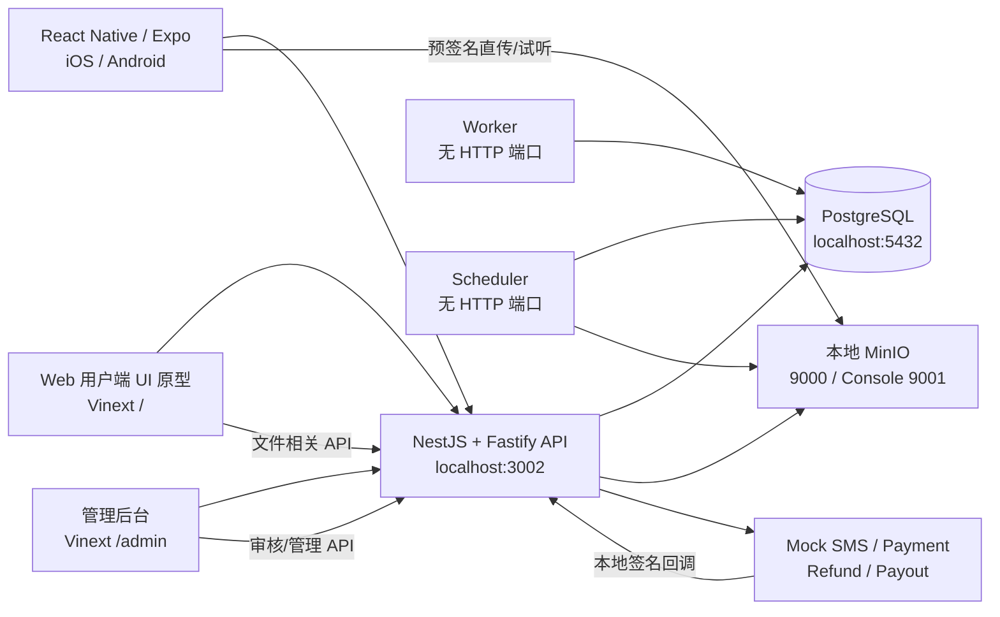
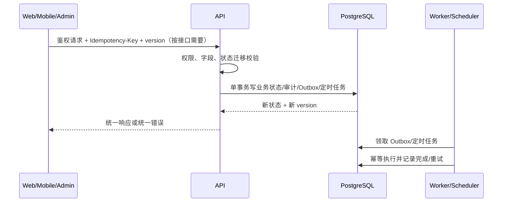
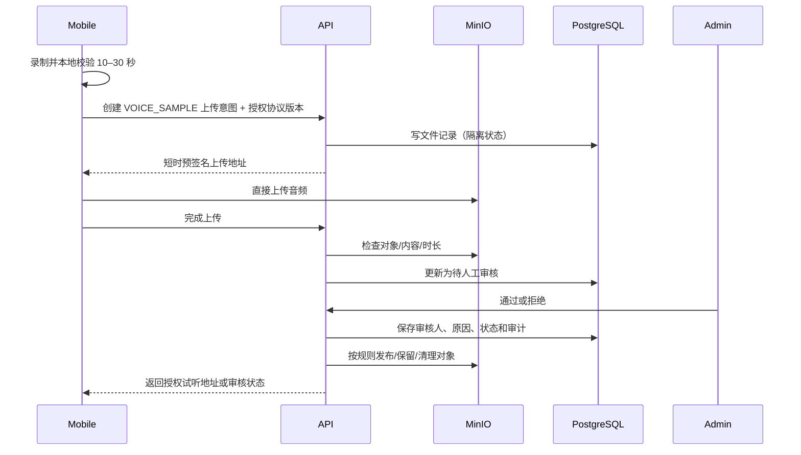

# 熊崽电竞｜本地完整测试版技术架构 V2.0

> 文档状态：当前有效（Canonical）
>
> 复核日期：2026-08-27
>
> 适用阶段：本地完整测试版
>
> 适用仓库：`/Applications/c2c游戏服务软件`
>
> 事实优先级：当前代码与数据库迁移 > 本文档 > 历史复核/阶段报告 > 旧生产设想
>
> 变更限制：本文只定义架构边界和交接约定，不授权修改业务页面或生产配置。

---

## 1. 结论

熊崽电竞当前不是生产系统，也不以生产部署为本阶段目标。当前正式目标调整为：

> 在一台开发机及受控的本地网络内，使用本地 PostgreSQL、本地 MinIO 和全部 Mock Provider，完整验证用户端、管理后台、API、数据库、文件存储、Worker、Scheduler 之间的业务闭环。

当前代码已经形成可运行的本地模块化单体架构：

- Vinext Web 应用同时承载 Web 用户端 UI 原型和管理后台；
- React Native/Expo 应用是原生用户端及本地原生验收主体；
- NestJS 11 + Fastify 5 API 承载业务接口；
- PostgreSQL + Drizzle 承载交易数据、状态机、任务、审计和幂等记录；
- MinIO 承载本地 S3 兼容对象存储；
- Worker 消费 PostgreSQL Outbox；
- Scheduler 消费 PostgreSQL 定时任务；
- 短信、支付、退款、提现/打款全部使用本地 Mock Provider。

截至本次只读复核，本地开发数据库迁移状态为 `expectedCount=7`、`appliedCount=7`、`pendingCount=0`。这只证明数据库迁移一致，不代表本地完整测试版已经达到 Definition of Done。

---

## 2. 本阶段产品边界

### 2.1 固定业务范围

- 中国区一对一游戏陪玩平台；
- 用户与陪玩之间只提供一对一文字聊天；
- 声音名片为 10–30 秒的录制、上传、人工审核和公开试听链路；
- 用户支付的业务渠道固定为 `WECHAT_APP`、`ALIPAY_APP`，本阶段均由 Mock 实现；
- 陪玩收款账户与提现渠道固定为 `WECHAT`、`ALIPAY`；
- 不支持银行卡收款或银行卡提现；
- 实名使用人工测试实名；
- 协议只记录本地测试环境中的“在线确认并同意”，不生成正式签章。

### 2.2 本阶段冻结，不建设

以下能力在“本地完整测试版”中冻结，不得作为当前阻塞项，也不得为其创建云资源或购买服务：

| 类别 | 冻结内容 | 本地替代 |
|---|---|---|
| 短信 | 真实短信供应商、真实下发 | Development/Mock SMS，开发验证码 |
| 支付 | 微信、支付宝真实支付 | `WECHAT_APP`、`ALIPAY_APP` Mock Payment |
| 退款 | 真实原路退款 | Mock Refund |
| 提现/打款 | 微信、支付宝真实打款 | Mock Payout |
| 实名 | 付费实名接口 | 人工测试实名 |
| 文件基础设施 | 云 OSS、云对象存储、CDN | 本地 MinIO |
| 推送 | APNs、FCM、厂商推送 | App 内轮询和页面刷新 |
| 生产入口 | 生产网关、WAF、负载均衡、DNS、TLS 证书 | 本地 API 地址 |
| 发布合规 | 备案、应用市场发布、正式隐私合规审核 | 本地测试标识和草案协议 |
| 电子签 | 第三方电子签、正式签章 | 协议版本和接受记录 |

### 2.3 明确不做

下列能力不是“以后补一个 Provider”的关系，而是当前产品边界明确排除：

- 实时语音通话；
- 实时视频通话；
- 语音房、多人房间或多人群聊；
- RTC、SFU、媒体信令服务；
- 银行卡收款账户和银行卡提现；
- 以声音名片代替通话功能；
- 在未完成正式法律审核前宣称测试协议已通过正式法律审核；
- 在本地阶段模拟正式电子签章或出具具有正式签章含义的文件。

---

## 3. 当前真实架构

### 3.1 仓库和运行拓扑



默认本地端口：

| 组件 | 默认地址/端口 | 说明 |
|---|---|---|
| Vinext Web | `http://localhost:3001` | `/` 为 Web 用户原型，`/admin` 为管理后台 |
| API | `http://localhost:3002` | `/api/v1` 为用户业务接口，`/admin-api/v1` 为后台接口，`/callbacks/v1` 为 Mock 回调入口 |
| PostgreSQL | `localhost:5432` | 业务数据、任务、审计和事务一致性 |
| MinIO S3 API | `http://127.0.0.1:9000` | 本机默认对象存储端点 |
| MinIO Console | `http://127.0.0.1:9001` | 仅本地管理 |
| Worker | 无 HTTP 端口 | 轮询 PostgreSQL Outbox |
| Scheduler | 无 HTTP 端口 | 轮询 PostgreSQL `scheduled_jobs` |
| Expo/Metro | 开发工具分配 | 原生 App 构建与调试入口 |

当前架构不包含 Redis、独立消息队列、CDN、WebSocket 网关、RTC 服务或云端反向代理。不得在文档或测试报告中把这些组件描述成已实现。

Mobile 当前默认使用 iOS 回环地址和 Android 模拟器的 `10.0.2.2` 访问 API；这只解决 API 可达性，不自动解决 MinIO 预签名 URL 中主机名的可达性。Android/局域网文件链路仍按第 6.4 节作为本地待补项处理。

### 3.2 技术栈事实

| 模块 | 当前实现 | 定位 |
|---|---|---|
| Web 用户端原型 | Vinext、React 19，根目录 `app/page.tsx` | 快速交互、接口烟测和桌面浏览器展示，不作为原生 UI E2E 的替代 |
| 原生用户端 | Expo 57、React Native 0.86、Expo Router、TanStack Query | 用户端完整业务验收主体 |
| 管理后台 | 与 Web 原型同一 Vinext 进程，目录 `app/admin/**` | 审核、治理、财务与业务状态查看 |
| API | NestJS 11、Fastify 5 | REST API、鉴权、业务事务、回调入口和文件授权 |
| 数据库 | PostgreSQL、Drizzle | 持久化、约束、CAS/version、幂等、Outbox、定时任务 |
| 文件存储 | MinIO/S3 兼容接口 | 隔离区、公开区、私有区对象及预签名访问 |
| Worker | Node.js/TypeScript | 领取和处理数据库 Outbox；当前发布器只记录本地日志 |
| Scheduler | Node.js/TypeScript | 领取并执行超时、自动确认、收益可用和文件清理任务 |
| 外部能力 | Mock Provider | 不发起真实第三方网络请求 |

### 3.3 各模块代码位置和职责

#### Web 用户端 UI 原型

位置：`app/page.tsx`、`app/globals.css` 及相关根目录测试。

职责：

- 展示 Web 交互原型；
- 调用真实本地 API 完成可支持的接口烟测；
- 用于快速验证字段、状态展示和错误反馈；
- 明确标识未开放能力，不伪造成功结果。

非职责：

- 不承诺与原生 App 完全同构；
- 不承载生产用户流量；
- 不定义数据库或后端状态机；
- 不承担原生摄像头、录音、权限和设备生命周期验收。

#### React Native/Expo 用户端

位置：`apps/mobile/**`。

职责：

- 登录、用户资料、陪玩发现、下单、Mock 支付、订单履约；
- 一对一文字聊天和通知轮询；
- 售后、投诉、评价、收益、提现等用户交互；
- 使用设备能力录制 10–30 秒声音名片；
- 调用文件 API 获取上传授权，再向 MinIO 预签名地址直传；
- 对本地完整流程执行 iOS/Android 原生 UI E2E。

当前聊天传输为 HTTP 轮询，不是 WebSocket。消息类型边界为文字/系统消息，不存在音视频通话传输。

#### 管理后台

位置：`app/admin/**`。

职责：

- 管理员登录、MFA 和 RBAC 驱动的页面访问；
- 查看并处理用户、陪玩入驻、实名、服务、订单、售后、投诉、财务和文件审核；
- 审核声音名片及其他受管文件；
- 查看新增业务申请的真实后端状态、失败原因和审计信息；
- 所有管理操作通过 Admin API，不直接连接 PostgreSQL 或 MinIO 管理接口。

#### NestJS/Fastify API

位置：`apps/api/src/**`。

职责：

- 认证、授权、请求校验和统一 HTTP 错误；
- 编排身份、用户、卖家、服务、订单、支付、售后、聊天、通知、财务、协议和后台治理；
- 在数据库事务内推进状态、写审计、写 Outbox/定时任务；
- 校验 `Idempotency-Key`、资源 `version` 和资源归属；
- 通过 Provider 接口访问短信、支付、退款、打款和对象存储；
- 接受并验证本地 Mock 回调；
- 不在 Controller 中复制前端状态，不允许客户端任意提交目标状态。

#### PostgreSQL/Drizzle

位置：`packages/database/**`。

职责：

- 定义表、枚举、索引、唯一约束、外键和检查约束；
- 保证金额、状态、账户类型和业务绑定等数据库不变量；
- 保存幂等请求、审计日志、协议接受记录、Outbox 和定时任务；
- 使用迁移文件进行可重复演进，不通过手工改库代替迁移；
- 用 `version` 支持并发更新的 CAS/乐观锁。

当前迁移基线为 7 个已应用迁移，最新迁移已包含协议版本绑定及数据库侧约束。

#### 本地 MinIO/S3 兼容文件存储

核心位置：

- `apps/api/src/object-storage-provider.ts`
- `apps/api/src/file-storage.controllers.ts`
- `apps/api/src/file-storage.service.ts`
- `apps/api/src/file-inspector.ts`
- `apps/api/src/file-lifecycle.service.ts`
- `apps/api/src/preview-concurrency-limiter.ts`
- `apps/api/scripts/*minio*`

职责：

- 将对象按隔离、公开、私有三类 bucket 管理；
- 由数据库文件记录保存业务归属、用途、状态、哈希和审核信息；
- 生成短时预签名上传/下载地址；
- 上传后执行文件完成确认、真实内容检测、生命周期转换和人工审核；
- 仅将审核通过且允许公开的声音名片暴露为可试听对象；
- 不把 bucket 管理凭证返回给客户端。

声音名片与实时通话的边界：声音名片是一个有时长上限、可审核、可撤回、可审计的静态音频文件。它不创建房间、呼叫、媒体会话、长连接或实时音频流。

#### Worker

位置：`apps/worker/**`。

职责：

- 通过 `FOR UPDATE SKIP LOCKED` 竞争领取 PostgreSQL Outbox；
- 按租约、重试和幂等约定处理事件；
- 当前只使用本地 Logging Publisher，不连接消息队列、推送或云事件服务；
- 不负责业务状态的任意推进，业务真相仍在 API 事务和数据库中。

#### Scheduler

位置：`apps/scheduler/**`。

职责：

- 竞争领取 PostgreSQL `scheduled_jobs`；
- 执行支付超时、接单超时、自动确认、收益转可用、文件清理等延迟任务；
- 对任务使用租约、有限重试和幂等执行；
- 后续本地补齐数据导出、账号注销冷静期任务时，继续复用此任务模型；
- 不依赖云定时器。

#### Mock Provider

| Provider | 当前渠道/用途 | 约束 |
|---|---|---|
| Mock SMS | 开发验证码 | 不发送真实短信，不记录明文敏感信息到非安全日志 |
| Mock Payment | `WECHAT_APP`、`ALIPAY_APP` | 两个业务渠道分别注册；Mock 是实现方式，不是公开支付渠道 |
| Mock Refund | 本地退款结果和回调 | 不请求真实支付机构 |
| Mock Payout | `WECHAT`、`ALIPAY` | 不允许 `BANK`，不执行真实打款 |

数据库可能保留兼容历史数据所需的内部值，但公开合同、新业务记录、用户选择和管理后台不得把 `MOCK` 暴露成支付渠道，也不得把 `BANK` 暴露成收款/提现选项。

---

## 4. 数据流和调用关系

### 4.1 通用命令流



约束：

- 查询接口可返回状态；命令接口只能表达业务动作，不能接受客户端任意指定目标状态；
- 涉及金额、订单、退款、收益、提现和协议绑定的写入必须由后端事务完成；
- 同一业务动作的网络重试复用同一 `Idempotency-Key`；
- 更新已有聚合时使用客户端最近读取的 `version`；
- `409` 用于状态冲突、版本冲突或幂等键载荷冲突，客户端必须刷新而不是盲目重试。

### 4.2 登录和开发验证码

1. Web/Mobile 请求验证码；
2. API 进行用途、频率和手机号格式校验；
3. Development SMS Provider 生成本地测试验证码，不请求外网；
4. 客户端提交验证码；
5. API 创建/更新用户与会话，返回访问凭据；
6. 协议接受必须绑定登录场景所需的具体协议类型与版本，不能用一个总勾选框替代。

手机号换绑已实现独立本地状态机：旧号验证、新号验证、完成和取消均经过专用 API、幂等键与 `version`，完成时由服务端更新号码并撤销旧会话；客户端和管理员都不能直接覆盖手机号。

### 4.3 下单、支付和账务

1. 客户端读取服务和价格快照，提交创建订单命令；
2. API 以最小货币单位整数计算订单金额，写订单与价格快照；
3. 客户端明确选择 `WECHAT_APP` 或 `ALIPAY_APP`；
4. API 绑定订单支付/退款规则的有效协议版本，创建支付单；
5. 对应 Mock Payment Provider 产生本地支付结果；
6. Mock 回调进入 `/callbacks/v1`，API 验证签名、时间窗口和重复回调；
7. API 事务推进支付与订单状态，并创建账务/Outbox/定时任务；
8. Scheduler 处理支付超时、接单超时、自动确认和收益转可用。

金额统一约定：

- 所有金额使用人民币最小货币单位“分”的整数；
- API/数据库字段使用 `*_amount` 或明确标注单位的命名，不用浮点元进行运算；
- 前端只负责格式化展示，不重新计算后端账务；
- 订单、支付、退款、收益、提现通过各自记录关联，禁止通过直接覆盖余额完成补偿。

当前执行状态机以 `packages/contracts/src/commerce.ts`、`finance.ts`、`state-machines.ts` 和数据库约束为事实来源。当前主要枚举与迁移如下：

```text
ORDER
PENDING_PAYMENT --PAYMENT_SUCCEEDED--> PENDING_ACCEPT
PENDING_PAYMENT --BUYER_CANCEL--> CANCELLED
PENDING_PAYMENT --PAYMENT_TIMEOUT--> CLOSED
PENDING_ACCEPT --SELLER_ACCEPT--> ACCEPTED
PENDING_ACCEPT --SELLER_REJECT--> SELLER_REJECTED
PENDING_ACCEPT --ACCEPT_TIMEOUT--> CLOSED
ACCEPTED --SELLER_START--> IN_SERVICE
IN_SERVICE --SELLER_COMPLETE--> PENDING_BUYER_CONFIRM
PENDING_BUYER_CONFIRM --BUYER_CONFIRM/AUTO_CONFIRM--> COMPLETED

PAYMENT
CREATED --PROVIDER_INTENT_CREATED--> PAYING
CREATED --PROVIDER_INTENT_FAILED--> FAILED
CREATED/PAYING --CLOSE--> CLOSED
PAYING --PAYMENT_SUCCEEDED--> PAID
PAYING --PAYMENT_FAILED--> FAILED
PAID/PARTIALLY_REFUNDED --REFUND_SUBMITTED--> REFUNDING
REFUNDING --REFUND_FAILED_WITH_ZERO_COMPLETED--> PAID
REFUNDING --PARTIAL_REFUND_SUCCEEDED--> PARTIALLY_REFUNDED
REFUNDING --FULL_REFUND_SUCCEEDED--> REFUNDED

REFUND
REQUESTED --SELLER_APPROVE--> SELLER_APPROVED
REQUESTED --SELLER_REJECT--> SELLER_REJECTED
SELLER_APPROVED --PROVIDER_REFUND_CREATED--> REFUND_PROCESSING
SELLER_REJECTED/NEGOTIATING --BUYER_ESCALATE--> PLATFORM_REVIEW
SELLER_REJECTED/NEGOTIATING/PLATFORM_REVIEW --ADMIN_APPROVE--> REFUND_PROCESSING
SELLER_REJECTED/NEGOTIATING/PLATFORM_REVIEW --ADMIN_REJECT--> REJECTED
REFUND_PROCESSING --REFUND_SUCCEEDED--> REFUNDED
REFUND_PROCESSING --REFUND_FAILED--> PLATFORM_REVIEW

SELLER_INCOME
PENDING_SETTLEMENT --SETTLEMENT_AVAILABLE--> AVAILABLE
PENDING_SETTLEMENT --FULL_REFUND--> REVERSED
AVAILABLE --WITHDRAWAL_LOCK--> WITHDRAWAL_LOCKED
AVAILABLE --FULL_REFUND_OR_LIABILITY_OFFSET--> REVERSED
WITHDRAWAL_LOCKED --PAYOUT_SUCCEEDED--> WITHDRAWN
WITHDRAWAL_LOCKED --PAYOUT_RELEASED--> AVAILABLE
部分提现或仍有其他锁定时允许合同中定义的同状态迁移

WITHDRAWAL
CREATED --ADMIN_APPROVE_AND_SUBMIT--> PAYOUT_PROCESSING
CREATED --ADMIN_REJECT--> REJECTED
PAYOUT_PROCESSING --PAYOUT_SUCCEEDED--> COMPLETED
PAYOUT_PROCESSING --PAYOUT_FAILED--> FAILED

LEDGER_TRANSACTION
PENDING --BALANCED_POST--> POSTED
POSTED --APPEND_REVERSAL--> REVERSED
```

合同中还保留 `NEGOTIATING`、`CANCELLED`、`RISK_REVIEW`、`APPROVED`、`CLOSED` 等枚举值，用于兼容领域表达或预留受控状态；当前没有对应 transition 的值不能由客户端、后台或任务直接写入。任何新增迁移必须先修改共享合同和 transition 测试，再同步数据库约束，不能只依据中文状态名称创建第二套枚举。

### 4.4 提现

1. 陪玩先创建收款账户，类型只允许 `WECHAT` 或 `ALIPAY`；
2. API 校验实名、账户归属、可提现余额、风控/冻结状态和协议版本；
3. API 创建提现申请并冻结相应余额；
4. 后台按权限审核；
5. Mock Payout 返回本地处理结果；
6. API 以账务分录结算或解冻，不直接修改余额掩盖失败；
7. Worker 记录本地事件处理，后台展示最终状态。

数据库约束、API DTO、共享合同、Mobile 选项和 Admin 展示都必须拒绝 `BANK`。

### 4.5 声音名片



必须满足：

- 时长小于 10 秒或大于 30 秒不能进入公开试听；
- 客户端 MIME 声明不能替代服务端真实内容检查；
- 上传成功不等于审核通过；
- 审核通过前不能生成公开试听能力；
- 删除/替换声音名片必须同步撤销业务绑定并由生命周期任务清理对象；
- 不存在实时音频会话、呼叫或语音房数据结构。

### 4.6 一对一文字聊天

1. Mobile 轮询会话、消息和通知；
2. API 校验会话参与者和订单关系；
3. 发送命令带幂等键，API 写消息和通知/Outbox；
4. 对端下一次轮询取得新消息；
5. 内容治理和投诉仍通过现有后台与投诉流程处理。

本地完整测试版不要求 WebSocket、离线系统推送或音视频媒体传输。轮询的可用性、断网恢复、重复提交和分页一致性必须进入测试范围。

### 4.7 投诉补充证据

数据库和后端已经存在投诉证据记录及 `POST /api/v1/complaints/:complaintId/evidences`。当前缺口主要在 Mobile 接入和端到端验证：

1. Mobile 从投诉详情选择并上传私有证据；
2. 文件完成检测并获得可绑定状态；
3. Mobile 使用投诉 `version` 提交补充证据；
4. API 校验投诉归属、文件归属和状态；
5. 对需要补充证据的投诉推进到处理中并记录审计；
6. Admin 在投诉详情看到新增证据和最新状态。

因此该项不得被误报为“数据库和 API 都未建设”，也不得在另一个聊天框重复创建第二套投诉证据表或接口。

---

## 5. 状态分类

### 5.1 已完成的架构基座

这里的“已完成”表示当前代码中已经存在对应实现和结构，不等于已经通过最终全量 E2E：

- pnpm monorepo 和统一本地启动脚本；
- Vinext Web 用户端原型与 `/admin` 管理后台；
- Expo/React Native 原生用户端工程；
- NestJS/Fastify API 及主要业务模块；
- PostgreSQL/Drizzle Schema 和 7/7 本地迁移；
- 订单、支付、退款、收益、提现、投诉、评价、聊天、通知和审计的核心数据结构；
- `WECHAT_APP`、`ALIPAY_APP` 两个支付业务渠道；
- `WECHAT`、`ALIPAY` 两个收款/提现渠道及禁止银行卡的约束；
- 本地 MinIO 三类 bucket、预签名直传、文件检测、人工审核和生命周期；
- 10–30 秒声音名片链路的后端/存储基座；
- PostgreSQL Outbox Worker；
- PostgreSQL Scheduler 及现有延迟任务；
- Mock SMS、Payment、Refund、Payout；
- 协议类型、版本、接受记录和主要业务版本绑定；
- 一对一文字聊天的 HTTP 轮询实现；
- 投诉补充证据的数据库与后端接口。

### 5.2 本地同步能力现状

以下项目属于本地完整测试版 DoD，不能推迟到生产阶段：

| 项目 | 当前事实 | 本地需要补齐 |
|---|---|---|
| 手机号换绑 | 数据库约束、双号码验证、取消、会话撤销、Mobile/Web 页面和 Admin 只读记录已接通 | 实体手机上人工验证开发验证码输入、网络切换和新号码重新登录 |
| 个人数据导出 | 任务创建/查询、私有文件、受控下载、过期处理、Mobile/Web 页面和 Admin 只读监控已接通 | 实体手机上人工验证下载体验；上线前另接合规审批与生产存储 |
| 账号注销申请与撤销 | 阻塞检查、冷静期、撤销、版本/幂等控制、Mobile/Web 页面和 Admin 治理已接通 | 实体手机上人工验证完整冷静期展示和撤销体验 |
| 投诉详情补充证据 | 数据库/API 已存在，Mobile 未接入 | Mobile 上传和提交、版本冲突处理、Admin 联调、E2E |
| Android 模拟器访问 MinIO | 当前脚本使用回环地址 | 固化 `adb reverse` 或等价本地配置并自动验收 |
| 局域网真机访问 MinIO | 已提供只接受私有 IPv4 的 `LOCAL_LAN_HOST` 配置，API/MinIO 监听与签名地址使用同一可达主机 | 仍需使用实体手机完成上传、预览、下载和客服闭环人工验收 |
| 本地原生 UI E2E | 有单元/领域测试和人工报告，无完整原生 UI 自动化基线 | 选择并固定本地 E2E 工具、测试账户/夹具、iOS/Android 核心流程、失败截图/日志 |
| Admin 新增业务状态 | 已增加换绑、导出、注销、站内通知只读列表/详情并执行 RBAC；注销仅保留现有安全治理动作 | 实体手机提交真实记录后的人工可见性验收 |

### 5.3 生产阶段暂缓

- 真实短信 Provider；
- 微信/支付宝真实支付、退款、签名和对账；
- 微信/支付宝真实打款；
- 正式实名、电子签、税务和付费内容审核；
- 云服务器、托管数据库、云对象存储、CDN；
- APNs、FCM 或厂商推送；
- 生产网关、WAF、负载均衡、DNS、TLS、备案；
- App Store/应用市场构建、签名和发布；
- 生产级高可用、跨区容灾、备份恢复、集中日志和告警；
- 正式供应商选型、容量和成本方案。

本文件不指定生产云厂商和真实接口供应商。将来进入生产准备阶段时，必须另立经过安全、合规和成本评审的生产架构文档，不能直接把本地配置改名后上线。

### 5.4 明确不做

- 实时语音/视频通话、RTC 和语音房；
- 多人聊天；
- 银行卡收款或银行卡提现；
- 本地阶段连接任何收费接口；
- 把 Mock 成功当作真实资金成功；
- 把协议测试草案描述成已经正式法律审核或正式签章。

---

## 6. 本地待补功能的架构约定

本节定义跨模块契约，具体字段名最终由共享合同和数据库迁移同步固化。各聊天框不得分别创造不兼容的状态。

### 6.1 手机号换绑

建议聚合：`phone_change_request`，一个用户同时只能有一个活动申请。

```text
PENDING_OLD_PHONE_VERIFICATION
  -> PENDING_NEW_PHONE_VERIFICATION
  -> READY_TO_CONFIRM
  -> COMPLETED

任一未完成阶段 -> CANCELLED / EXPIRED
风控或尝试次数超限 -> LOCKED
```

关键约束：

- 旧手机号和新手机号必须使用不同用途的开发验证码；
- 新手机号不能与现有有效用户冲突；
- 只保存规范化手机号/哈希及必要掩码，遵循现有敏感数据约定；
- 验证步骤和最终确认分别幂等；
- 最终确认使用最新 `version`；
- 完成换绑后撤销该用户全部会话，包括当前会话，并要求重新登录；
- API 记录安全审计和 Outbox；
- Admin 默认只读查看，不允许管理员直接写手机号绕过验证；
- 本地使用 Development SMS，不增加真实短信依赖。

### 6.2 个人数据导出

建议聚合：`data_export_request`，文件用途单独枚举并强制私有访问。

```text
REQUESTED -> GENERATING -> READY -> DOWNLOADED
                         \-> EXPIRED
REQUESTED/GENERATING -> FAILED
REQUESTED -> CANCELLED（仅在任务未执行前）
```

关键约束：

- 创建申请后由 Scheduler/受控后台任务生成，不在 HTTP 请求中同步构建大文件；
- 导出范围由服务端白名单定义，排除密码摘要、访问令牌、内部风控密钥、他人隐私和对象存储凭证；
- 导出对象存入私有 MinIO bucket；
- 下载必须二次鉴权，并返回短时预签名地址；
- 保存文件哈希、大小、生成时间、过期时间和下载审计；
- 过期后由 Scheduler 清理对象并更新状态；
- 失败可有限重试，不允许产生多个无主对象。

### 6.3 账号注销申请与撤销

建议聚合：`account_cancellation_request`。

```text
REQUESTED -> COOLING_OFF -> COMPLETED
REQUESTED/COOLING_OFF -> REVOKED
REQUESTED -> BLOCKED（存在未完结订单、售后、投诉、余额或提现等阻塞）
```

关键约束：

- 服务端统一计算并返回阻塞原因，不由客户端猜测；
- 冷静期时长写入配置并在申请记录上固化截止时间；
- 冷静期内允许本人撤销，命令需要幂等键和 `version`；
- Scheduler 到期后再次检查阻塞条件，再完成注销；
- 完成后撤销全部会话并禁止正常登录；
- 不物理删除订单、支付、退款、账务、协议接受和审计等必须保留的记录；
- 对可删除/匿名化数据使用单独的、可测试的数据策略；
- Admin 可查看状态和阻塞原因，不得通过页面绕过阻塞条件直接删除用户。

### 6.4 Android 模拟器与局域网真机 MinIO

本地网络至少定义三个互斥配置档，禁止把一个地址同时假设为所有设备可达：

| 配置档 | API/MinIO 可达方式 | 适用范围 |
|---|---|---|
| `LOOPBACK` | `127.0.0.1`/`localhost` | Web、iOS 模拟器及本机工具 |
| `ANDROID_EMULATOR` | `adb reverse tcp:3002 tcp:3002`、`adb reverse tcp:9000 tcp:9000`，App 仍使用回环地址 | Android 模拟器 |
| `TRUSTED_LAN` | API 和 MinIO 显式绑定开发机私网地址，预签名 URL 使用同一真机可达主机 | 同一受信任局域网的物理设备 |

`TRUSTED_LAN` 的最低安全要求：

- 只绑定明确的私有网卡地址，不绑定公网地址；
- MinIO Console 不作为真机业务依赖；
- 不把 root/access secret 写入 Mobile 包、页面或日志；
- 防火墙只允许受控局域网；
- API 返回的预签名 URL 主机必须从设备可达，不能仍为 `127.0.0.1`；
- 健康检查同时验证 API、上传、完成确认、试听/下载和清理；
- 网络改变后重新生成预签名地址，不缓存失效主机。

本地脚本已支持显式 `TRUSTED_LAN`：`LOCAL_LAN_HOST` 只接受 RFC1918 私有 IPv4，并同步生成 API 监听与 MinIO 真机可达地址；移动端缺少 `EXPO_PUBLIC_API_BASE_URL` 时不会静默退回模拟器地址。该能力已完成配置和自动化契约验证，但本轮未操作实体手机，因此不能宣称真机文件与客服闭环已经通过。

### 6.5 本地原生 UI E2E

原生 E2E 必须运行实际 iOS/Android App，不得用 Web 原型或仅 API 测试替代。至少覆盖：

- 开发验证码登录和协议分项同意；
- 陪玩浏览、服务详情、下单；
- `WECHAT_APP` 和 `ALIPAY_APP` 两个 Mock 支付分支；
- 接单、服务开始、文字聊天、服务完成和评价；
- 退款/投诉主流程和投诉补充证据；
- 声音名片录制、直传、待审核、后台审核和试听；
- 收益和 `WECHAT`/`ALIPAY` 提现，确认 UI 中不存在银行卡；
- 手机号换绑；
- 数据导出下载；
- 账号注销申请、撤销及阻塞状态；
- 网络断开、重复点击、幂等重试、版本冲突和重新登录；
- Android 模拟器和至少一个受控局域网真机文件链路。

测试框架选择属于 Mobile 实施细节，但配置、测试账户、可重复清库/造数方式、失败截图和运行命令必须进入仓库，不能只保留人工口头结果。

---

## 7. 跨模块统一约定

### 7.1 合同与字段

共享 API 请求、响应、枚举和错误码的源码归属为 `packages/contracts/**`。客户端可以生成本地 ViewModel，但不得复制一套不同含义的业务枚举。

统一字段原则：

| 领域 | 约定 |
|---|---|
| ID | 不向客户端暴露数据库自增语义；保持现有公共 ID 格式 |
| 时间 | API 使用带时区的 ISO 8601；数据库使用带时区时间类型 |
| 金额 | 人民币分、整数；禁止浮点元参与账务 |
| 渠道 | 支付仅 `WECHAT_APP`/`ALIPAY_APP`；收款提现仅 `WECHAT`/`ALIPAY` |
| 幂等 | 创建/支付/退款/提现/文件完成等命令按合同要求携带 `Idempotency-Key` |
| 并发 | 更新聚合携带 `version`；成功后返回递增后的版本 |
| 分页 | 使用现有合同规定的游标/页大小，不由各 UI 自创 |
| 错误 | 统一 HTTP 状态、稳定业务错误码、用户可读消息和可追踪 request ID |
| 审计 | 管理动作、安全动作、资金动作、协议接受和文件审核必须留审计 |

### 7.2 权限

- 用户 API：访问令牌 + 资源本人/订单参与方校验；
- 陪玩能力：除用户身份外校验陪玩状态和相应业务资格；
- 管理 API：管理员会话、MFA、RBAC 权限点和审计；
- Worker/Scheduler：仅使用本地服务配置访问数据库，不模拟管理员用户；
- MinIO：客户端只获取针对单个对象和短时间窗口的预签名权限；
- 所有权校验必须在 API 内完成，隐藏按钮不是权限控制。

### 7.3 协议

协议至少覆盖当前接口约定中的 14 类：

1. 用户服务协议；
2. 隐私政策；
3. 个人信息收集清单；
4. 第三方 SDK 及共享清单；
5. 系统权限说明；
6. 未成年人保护说明；
7. 订单支付退款规则；
8. 聊天和内容管理规则；
9. 陪玩入驻协议；
10. 陪玩履约规则；
11. 服务费、结算和提现规则；
12. 实名信息处理单独同意；
13. 声音名片公开试听授权；
14. 投诉与争议处理规则。

规则：

- 登录、陪玩入驻、声音名片上传和支付分别解析本场景所需协议；
- 接受记录绑定协议类型、版本、场景、用户、时间和必要审计信息；
- 不能用一个总勾选框替代多个强制接受；
- 新版本是否强制重新同意由协议版本的 reacceptance 规则决定；
- 业务记录绑定当时生效的协议版本，不能只查询“当前最新版”倒推历史；
- 所有文本标记为本地测试草案，不宣称已经正式法律审核。

### 7.4 Provider 边界

Provider 接口用于隔离本地 Mock 与未来真实实现，但当前只允许本地实现：

- 业务服务只依赖 Provider 接口；
- 公开渠道枚举不能包含 `MOCK`；
- Mock 回调必须经过与真实回调同类的签名、幂等和状态检查；
- 禁止在业务代码中通过环境变量误连真实服务；
- 不在本阶段增加具体云厂商或真实供应商 SDK；
- 仓库中即使存在未启用的兼容适配代码，也不代表该供应商已被选定或处于本阶段架构内。

---

## 8. 各聊天框责任与目录所有权

### 8.1 总原则

一个业务逻辑只有一个实现所有者。其他聊天框通过“合同/迁移/接口交接单”提出需求，不直接跨目录代改。跨模块修改必须先由所有者完成上游，再由消费者接入。

生成文件 `dist/**` 不作为人工修改目标。依赖锁文件和根配置属于集成所有，不随某个功能顺手修改。

### 8.2 允许修改的目录

| 聊天框 | 允许修改 | 主要责任 |
|---|---|---|
| 技术架构 | `docs/熊崽电竞-本地完整测试版技术架构-V2.0.md`；相关旧架构文档的状态提示 | 架构事实、阶段边界、目录所有权、DoD；不改业务代码 |
| 数据库 | `packages/database/**`、`docs/数据库设计-V1.0.md` 及数据库专项报告 | Schema、迁移、约束、索引、DB 测试；不定义 UI |
| 后端与共享合同 | `apps/api/src/**`（文件存储专属文件除外）、`apps/api/tests/**`（文件测试除外）、`packages/application/**`、`packages/auth/**`、`packages/contracts/**`、`packages/observability/**`、`apps/worker/**`、`apps/scheduler/**` | API、鉴权、状态机编排、Mock Provider、Worker/Scheduler 和共享合同 |
| 文件存储 | `apps/api/src/file-inspector.ts`、`file-lifecycle.service.ts`、`file-storage.controllers.ts`、`file-storage.service.ts`、`object-storage-provider.ts`、`preview-concurrency-limiter.ts`、`apps/api/scripts/*minio*`、对应文件存储测试与 `docs/文件存储*` | MinIO、对象生命周期、预签名、检测、审核、网络配置 |
| 用户端 | `apps/mobile/**`、`app/page.tsx`、用户端专属样式/测试 | Expo 原生用户端及 Web UI 原型；消费合同，不改 API/DB |
| 管理后台 | `app/admin/**`、后台专属测试 | 管理 UI、状态查看和管理动作接入；不改 API/DB/Mobile |

根目录 `app/globals.css` 是 Web 原型和 Admin 的共享样式文件。需要修改时必须先指定单一所有者并说明影响，不能由用户端和后台聊天框同时编辑。

### 8.3 集成所有文件

以下文件容易产生跨项目冲突，只允许在明确交接后由“后端/集成”负责人修改：

- 根 `package.json`；
- `pnpm-lock.yaml`、`pnpm-workspace.yaml`；
- `config/**`；
- `scripts/**`；
- `apps/api/src/app.module.ts`；
- `apps/api/src/config.ts`；
- 共享测试启动和全仓验证脚本。

文件存储聊天框若需要在 `app.module.ts` 注册新 Provider，提交需要注册的 token、类和配置字段，由后端/集成负责人完成最小接线；不要同时编辑。

### 8.4 禁止跨模块修改的边界

- 数据库聊天框不得修改 API Controller、Mobile 或 Admin 来“顺便适配”；
- 后端聊天框不得修改 `app/page.tsx`、`apps/mobile/**` 或 `app/admin/**`；
- 文件存储聊天框不得重写订单、支付、投诉或用户业务状态机；
- 用户端和管理后台不得直接修改 Schema、迁移、共享合同或后端状态机；
- 任一 UI 不得通过本地硬编码伪造后端成功状态；
- Worker/Scheduler 不得另建一套与 API 不一致的状态枚举；
- 技术架构聊天框不得直接修业务页面；
- 任一聊天框不得创建云资源、加入真实供应商密钥、修改生产配置或执行破坏性 Git 操作。

### 8.5 交接单最小内容

每次跨模块交接至少包含：

- 业务动作和不变量；
- 请求/响应字段及示例；
- 状态枚举和允许迁移；
- 数据库迁移编号与回滚/兼容说明；
- 权限点、幂等键、`version` 和错误码；
- 金额单位和时间格式；
- 审计/Outbox/Scheduler 需求；
- 上游测试结果；
- 下游允许修改的文件清单。

---

## 9. 修改执行顺序

为避免多个聊天框反复改同一逻辑，按以下顺序执行：

### 第 0 步：冻结架构和接口边界

- 以本文为当前阶段架构基线；
- 保持真实支付、云资源、推送和生产能力冻结；
- 为四个本地缺失业务流分别形成跨模块交接单；
- 不先写页面占位成功逻辑。

### 第 1 步：共享合同

后端/合同负责人先固化换绑、导出、注销和投诉补证所需：

- DTO；
- 状态枚举；
- 稳定错误码；
- 权限点；
- 幂等和 `version` 规则。

此步只定义合同，不同时实现所有 UI。

### 第 2 步：数据库

- 增加换绑、导出、注销所需表和约束；
- 扩展必要的验证码用途、文件用途、任务类型和审计关联；
- 不重复创建已有投诉证据结构；
- 编写迁移、Schema 测试、PostgreSQL 集成测试；
- 交付迁移状态和字段清单。

### 第 3 步：API、Worker 和 Scheduler

- 按合同实现命令/查询；
- 在事务中写状态、审计、Outbox 和任务；
- 实现导出生成/过期、注销冷静期等任务；
- 保持全部外部 Provider 为 Mock；
- 完成 API 单元与 PostgreSQL 集成测试。

### 第 4 步：本地文件存储网络链路

- 固化 LOOPBACK、ANDROID_EMULATOR、TRUSTED_LAN 三个配置档；
- 验证预签名主机对目标设备可达；
- 为数据导出定义私有对象生命周期；
- 验证投诉证据和声音名片没有权限回归；
- 不接云 OSS/CDN。

### 第 5 步：React Native/Expo 用户端

- 按共享合同接入换绑、导出、注销、投诉补证；
- 保留未完成状态的真实提示，移除功能完成后的“暂未开放”；
- 完成幂等、版本冲突和会话失效处理；
- 不修改后端状态机。

### 第 6 步：管理后台

- 查看换绑、导出、注销和投诉证据的新增状态；
- 只提供合同允许的管理动作；
- 验证 MFA、RBAC 和管理审计；
- 不直接连接数据库或 MinIO Console 完成业务操作。

### 第 7 步：本地集成和原生 E2E

- 统一构建、类型检查、单元测试和 PostgreSQL 集成测试；
- 启动 PostgreSQL、MinIO、API、Worker、Scheduler、Web/Admin 和 Mobile；
- 从空库迁移并验证迁移数一致；
- 执行 Web/Admin API 联调；
- 执行 iOS/Android 原生 UI E2E；
- 验证 Android 模拟器和受控局域网真机 MinIO；
- 生成可追踪的失败截图、日志和最终验收报告。

---

## 10. 本地完整测试版 Definition of Done

只有以下条件全部满足，才可称为“本地完整测试版完成”。Mock 结果不得描述为真实支付或生产上线完成。

### 10.1 构建和数据基线

- [ ] 根项目、API、Mobile、Worker、Scheduler 构建/类型检查全部通过；
- [ ] 所有单元测试和 PostgreSQL 集成测试通过，不跳过 PostgreSQL；
- [ ] 从空本地数据库可以按迁移顺序完整建立 Schema；
- [ ] `expectedCount=appliedCount` 且 `pendingCount=0`；
- [ ] 本地测试夹具和账户可重复生成，测试间可控清理；
- [ ] 无生产密钥、真实手机号服务或云端凭据进入仓库。

### 10.2 服务可运行性

- [ ] Web `/`、Admin `/admin`、API、PostgreSQL、MinIO、Worker、Scheduler 和 Expo App 均可按手册启动；
- [ ] 健康检查能区分数据库、存储、Worker/Scheduler 失败；
- [ ] Worker 可领取、完成、重试和恢复 Outbox 租约；
- [ ] Scheduler 可领取、完成、重试和恢复定时任务租约；
- [ ] 关闭任何一个依赖时，页面/API 返回受控错误，不出现未处理崩溃或伪成功。

### 10.3 用户业务闭环

- [ ] 开发验证码登录和分场景协议接受通过；
- [ ] 陪玩入驻、人工测试实名、服务发布和后台审核通过；
- [ ] 浏览、下单、`WECHAT_APP`/`ALIPAY_APP` Mock 支付、履约、完成和评价通过；
- [ ] 一对一文字聊天通过，且代码/页面不存在实时语音、视频或语音房入口；
- [ ] 退款、售后、投诉及投诉补充证据通过；
- [ ] 收益、结算、`WECHAT`/`ALIPAY` 收款账户和 Mock 提现通过；
- [ ] API、数据库、Mobile、Admin 中均不存在可用的 `BANK` 选项；
- [ ] 手机号换绑通过，完成后全部会话失效；
- [ ] 个人数据导出生成、下载、过期和清理通过；
- [ ] 账号注销申请、阻塞、撤销、冷静期完成和会话失效通过。

### 10.4 文件闭环

- [ ] 三类 bucket 和权限隔离正确；
- [ ] 声音名片录制、10–30 秒校验、上传、真实内容检测、人工审核、试听、替换/清理通过；
- [ ] 审核前声音名片不可公开试听；
- [ ] 投诉证据和数据导出只能由有权用户短时访问；
- [ ] Android 模拟器可上传/下载 MinIO 对象；
- [ ] 至少一个受控局域网物理设备可完整访问本机 API 与预签名 MinIO 地址；
- [ ] 客户端、日志和错误响应不泄露 MinIO 管理凭证或对象内部密钥。

### 10.5 管理和安全

- [ ] Admin 能查看并处理现有审核/治理状态；
- [ ] Admin 能查看换绑、数据导出、账号注销和投诉新增证据状态；
- [ ] 管理动作经过 MFA/RBAC 并写审计；
- [ ] 越权访问、对象归属、重复回调、重复点击、幂等冲突和版本冲突测试通过；
- [ ] 敏感字段在日志和 UI 中按约定脱敏；
- [ ] 所有协议明确为本地测试草案，没有正式法律审核或正式签章表述。

### 10.6 原生和全链路验收

- [ ] iOS 与 Android 原生 UI E2E 核心流程通过；
- [ ] Web 用户原型完成接口烟测，但不用于替代原生验收；
- [ ] Admin UI 与真实 API/权限/状态联调通过；
- [ ] 关键流程同时验证 API、数据库、Outbox、Scheduler、MinIO 和 Admin 可见状态；
- [ ] 测试报告记录代码版本、迁移数、启动配置、测试设备、通过/失败项和复现步骤；
- [ ] 报告结论使用“本地 Mock 完成”，不使用“真实支付完成”“生产可上线”等表述。

### 10.7 阶段完成后的准确结论

达到上述 DoD 后，只能得出：

> 熊崽电竞已完成本地 PostgreSQL、本地 MinIO 和 Mock Provider 条件下的完整功能测试，可进入独立的生产准备评审。

不能直接得出：

- 已具备生产环境；
- 已接通真实支付、短信、退款或打款；
- 已满足正式上架、备案、法律合规或资金合规；
- 已通过生产容量、安全或灾备验收。

---

## 11. 当前交接摘要

| 接收方 | 立即接收的事项 | 不应接收的事项 |
|---|---|---|
| 数据库 | 换绑、导出、注销的数据模型与约束；复用投诉证据 | UI、真实供应商、云部署 |
| 后端/合同 | 四项本地缺口合同、状态机、任务和错误码 | 业务页面、云网关 |
| 文件存储 | 三种本地网络配置、导出私有文件生命周期、回归声音/投诉文件 | 订单/财务状态机、云 OSS/CDN |
| 用户端 | 四项功能接入和原生 E2E | Schema、API 内部状态推进 |
| 管理后台 | 新增业务状态查看、允许的管理动作、RBAC/审计联调 | 直接改库、直接用 MinIO Console 代替业务 API |
| Worker/Scheduler | 导出、过期清理、注销冷静期任务；现有任务回归 | 真实推送、云定时器、任意改业务状态 |

本文是当前阶段架构和目录边界的唯一基线。接口字段和精确状态枚举以当前 `packages/contracts/**`、数据库 Schema 及其后续经交接更新的版本为执行依据；发现冲突时先更新交接单和本文状态，不允许各模块静默分叉。
