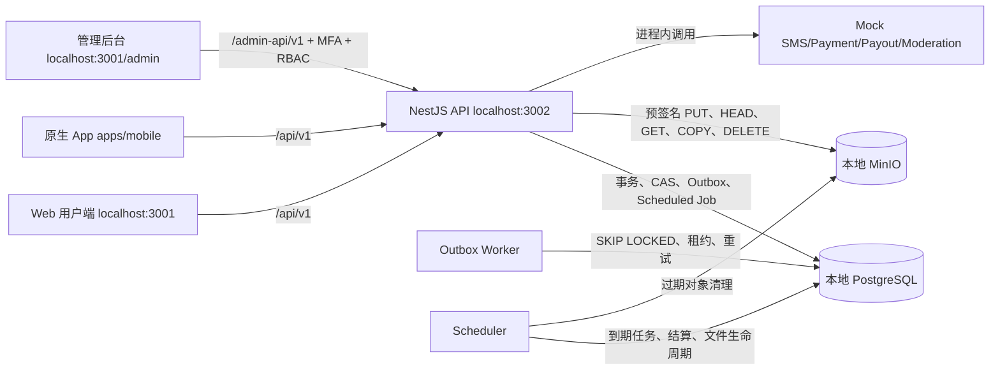

# 熊崽电竞本地测试接口与状态约定 V1.0

> 整改日期：2026-08-26  
> 适用范围：本地 PostgreSQL、本地 MinIO、开发验证码、人工测试实名、Mock 支付与 Mock 提现  
> 法律状态：本文及数据库中的协议正文均为本地测试草案，未经正式法律审核，不构成正式法律意见、正式签约文件或上线承诺。

## 1. 整改结论

本轮已将会被用户端、后台、API、数据库、文件存储、Worker 和 Scheduler 共同消费的枚举、协议场景和状态转换收敛到共享契约，并完成以下实际整改：

- 用户支付公共渠道固定为 `WECHAT_APP`、`ALIPAY_APP`，两个渠道在本轮都路由到 Mock Payment Provider。
- 陪玩收款账户固定为 `WECHAT`、`ALIPAY`；API 与 PostgreSQL 均拒绝 `BANK`。
- 新增 14 个正式命名的协议类型、7 个接受场景和唯一确认方式 `ONLINE_CONFIRM`。
- 登录页不再用一个总勾选框代替全部协议，而是逐份展示版本并逐份勾选。
- 支付、陪玩入驻、人工测试实名和声音名片上传分别读取并确认自己的当前协议版本。
- 数据库迁移 `0005_policy_acceptance_context.sql` 与 `0006_policy_version_bindings.sql` 已建立接受上下文、版本生效时间、不可变历史和业务版本绑定，迁移状态为 7/7。
- 14 份 V1 本地测试协议草案已幂等发布到本地开发库；每份均明确“未经正式法律审核、无电子签名或签章”。
- 修复“陪玩拒绝退款即把售后标为已解决”的状态错误；买家仍可升级为平台介入。
- 修复部分提现成功后整笔收益被错误标成 `WITHDRAWN` 的问题；剩余可提现金额继续保留为 `AVAILABLE`。
- 手机号换绑、数据导出和账号注销的后端生命周期已完成；Web、原生 App 和后台页面尚未接入前继续显示“暂未开放”，不得伪造成功。

本轮没有购买、开通或调用任何云服务及真实第三方接口，也没有添加实时语音、视频通话或语音房模块。

## 2. 固定产品边界

| 领域 | 本地测试唯一约定 |
|---|---|
| 市场 | 中国区一对一游戏陪玩平台 |
| 用户沟通 | 仅一对一文字聊天和系统消息 |
| 明确禁止 | 实时语音、实时视频、语音房、RTC、拨号能力 |
| 音频 | 仅 10–30 秒声音名片：录制/选择、上传、人工审核、受控试听 |
| 用户支付 | `WECHAT_APP`、`ALIPAY_APP`；本轮全部 Mock，不真实扣款 |
| 收款与提现 | `WECHAT`、`ALIPAY`；本轮全部 Mock，不真实打款；禁止银行卡 |
| 验证码 | Development SMS Provider，本地开发验证码 |
| 实名 | 人工测试实名，不连接真实实名渠道；使用虚构测试资料 |
| 数据 | 本地 PostgreSQL 是业务事实源；本地 MinIO 保存文件对象 |
| 后端已完成、客户端待接入 | 手机号换绑、数据导出、账号注销 |
| 暂不接入 | 真实支付、短信、实名、打款、电子签、税务、推送、付费内容审核 |

## 3. 权威契约与调用关系

### 3.1 权威来源

| 契约 | 权威文件 |
|---|---|
| 订单、支付、退款、售后枚举 | `packages/contracts/src/commerce.ts` |
| 支付渠道 | `packages/contracts/src/commerce.ts` 的 `paymentChannels` |
| 收款账户、提现、收益、账务枚举 | `packages/contracts/src/finance.ts` |
| 状态转换矩阵 | `packages/contracts/src/state-machines.ts` |
| 协议类型、场景和版本集合 | `packages/contracts/src/policies.ts` |
| 公共错误结构与通用错误码 | `packages/contracts/src/errors.ts` |
| PostgreSQL 类型与约束 | `packages/database/src/enums.ts`、`schema.ts` 和 migrations |

任何客户端、后台筛选器或新增接口都必须从共享契约导入枚举，不得在各项目复制另一份“相似但不同”的字符串列表。

### 3.2 组件调用图



调用原则：客户端和后台不直接访问数据库；对象上传只允许使用 API 发放的短时预签名 URL；Worker 与 Scheduler 不接收公网业务命令，只消费 PostgreSQL 中已提交的 Outbox 或 Scheduled Job。

## 4. 通用接口字段约定

### 4.1 JSON 与命名

| 类型 | 约定 |
|---|---|
| JSON 字段 | `snake_case` |
| 主键 | UUID 字符串；新记录优先 UUIDv7 |
| 时间 | UTC ISO 8601 字符串，例如 `2026-08-26T18:00:00.000Z` |
| 金额 | 人民币分；请求和响应均为十进制字符串 `*_cent` |
| 比例 | 基点 `*_bps`，10000 bps = 100% |
| 乐观锁 | 非负整数 `version`；修改成功后服务端 `+1` |
| 分页 | `{ items, next_cursor }`，Cursor 由服务端签名，客户端不得解析或修改 |
| 可执行动作 | 以服务端 `available_actions` 为准，客户端不得自行推导危险操作 |

禁止使用浮点数表示金额，禁止把“元”写入 `_cent` 字段，禁止让前端自行计算最终应付、可退、可提现或手续费金额。

### 4.2 错误响应

```json
{
  "code": "RESOURCE_VERSION_CONFLICT",
  "message": "数据已被其他操作更新，请刷新后重试",
  "request_id": "request-id",
  "field_errors": [],
  "details": {}
}
```

| 条件 | HTTP | 固定错误码/处理 |
|---|---:|---|
| 字段或枚举错误 | 400 | `VALIDATION_FAILED`，读取 `field_errors` |
| 未登录/Session 无效 | 401 | `AUTH_REQUIRED` / `AUTH_SESSION_INVALID` |
| 用户资源无权访问 | 404 | 使用领域 `*_NOT_FOUND`，避免泄露对象存在性 |
| 管理员无权限 | 403 | `ADMIN_PERMISSION_DENIED` |
| 管理员未完成 MFA | 403 | `ADMIN_MFA_REQUIRED` |
| 幂等键与原请求冲突 | 409 | `IDEMPOTENCY_KEY_CONFLICT` |
| 幂等请求仍处理中 | 409 | `IDEMPOTENCY_REQUEST_IN_PROGRESS` |
| 资源版本过期 | 409 | `RESOURCE_VERSION_CONFLICT`，刷新后由用户重试 |
| 协议版本集合不匹配 | 409 | `POLICY_ACCEPTANCE_MISMATCH`，重新 GET 当前场景 |
| 业务动作尚未接受当前协议 | 409 | `POLICY_ACCEPTANCE_REQUIRED`，按 details 中版本确认后重试 |
| 场景缺少已发布协议 | 503 | `POLICY_CONFIGURATION_INCOMPLETE`，禁止继续该动作 |

所有错误响应必须返回 `request_id`；日志、操作记录、状态日志和 Outbox 应传递同一请求的 `request_id/trace_id`，不得记录短信验证码、Token、实名明文、收款账户明文、预签名 URL 或本地文件路径。

### 4.3 幂等键

以下创建接口必须携带 `Idempotency-Key`，长度 8–128：

| 接口 | 幂等意图 |
|---|---|
| `POST /api/v1/orders` | 同一订单草稿提交 |
| `POST /api/v1/payments` | 同一订单 + 同一支付渠道的支付意图 |
| `POST /api/v1/refunds` | 同一退款金额、原因和订单的退款意图 |
| `POST /api/v1/seller/withdrawals` | 同一提现账户和金额的提现意图 |

同一次网络重试复用原键；用户明确改变金额、渠道、原因或重新发起新意图时生成新键。客户端不得因超时自动创建第二个支付或提现意图，应先查询服务端状态。

### 4.4 `version` 与审计

- 修改既有订单、退款、投诉、陪玩资料、商品、隐私设置、收款账户和提现审批时必须提交当前 `version`。
- SQL 更新必须同时匹配 `id + current status + version`；受影响行数不为 1 时返回 `RESOURCE_VERSION_CONFLICT`。
- 管理员写操作必须记录 `admin_id`、权限、MFA、原因、目标、变更前后快照、IP、User-Agent、`request_id`、`trace_id`。
- 用户协议确认记录必须保存用户、协议版本、接受场景、确认方式、接受时间、IP 和 User-Agent；记录只追加，不覆盖历史版本。

## 5. 统一后的核心接口

### 5.1 协议接口

```http
GET /api/v1/policies/current?scene=LOGIN
```

返回该场景每个必需类型的最新 `PUBLISHED` 版本：

```json
[
  {
    "id": "uuid",
    "policy_type": "USER_SERVICE_AGREEMENT",
    "title": "用户服务协议（本地测试草案）",
    "content": "...",
    "version_no": 1,
    "published_at": "2026-08-26T18:00:00.000Z",
    "effective_at": "2026-08-26T18:00:00.000Z",
    "requires_reacceptance": false
  }
]
```

```http
POST /api/v1/policies/acceptances
```

```json
{
  "acceptance_scene": "LOGIN",
  "confirmation_method": "ONLINE_CONFIRM",
  "policy_version_ids": ["uuid-1", "uuid-2"]
}
```

服务端要求提交集合与该场景当前版本集合完全相等：不能缺少、不能夹带旧版本、不能用其他场景版本替代。`GET /api/v1/policies/acceptances` 返回 `acceptance_scene` 和 `confirmation_method`。

Web 与原生 App 的短信登录请求必须直接携带 `policy_version_ids`；验证码消费、用户创建、协议接受与 Session 创建位于同一事务。人工实名、陪玩入驻和支付创建是服务端硬门禁；陪玩存在声音名片时，入驻还必须有声音名片授权。支付创建会把交易规则与退款规则的实际 `policy_version_id` 同时写入订单，退款继续沿用该订单与原支付渠道。

后台协议管理使用 `/admin-api/v1/policies`，要求 MFA 与 `config.read/config.manage`。支持草稿创建/编辑、发布、停用和版本历史；后台响应的字符串 `version` 是 CAS 令牌。发布后正文不可覆盖，停用只改变状态，操作日志不复制协议正文。

### 5.2 支付接口

```http
POST /api/v1/payments
Idempotency-Key: payment-<uuid>
```

```json
{
  "order_id": "uuid",
  "payment_channel": "WECHAT_APP"
}
```

`payment_channel` 只允许 `WECHAT_APP | ALIPAY_APP`。`MOCK` 不是用户可选业务渠道；本轮 Provider 内部模式可为 `mock`，但记录仍保留用户所选业务渠道。退款必须沿原支付渠道处理，客户端不得选择退款渠道。

### 5.3 收款账户与提现接口

```http
POST /api/v1/seller/payout-accounts
```

```json
{
  "account_type": "WECHAT",
  "holder_name": "测试收款人",
  "account_token": "test-token",
  "is_default": true
}
```

`account_type` 只允许 `WECHAT | ALIPAY`。响应只返回 `display_mask`，不得返回姓名、账户 Token、密文或哈希。`BANK` 在 Zod 和 PostgreSQL 枚举层均被拒绝。

```http
POST /api/v1/seller/withdrawals/preview
POST /api/v1/seller/withdrawals
Idempotency-Key: withdraw-<uuid>
```

```json
{
  "payout_account_id": "uuid",
  "amount_cent": "5000"
}
```

预览和创建都必须由服务端校验账户归属、`VERIFIED`、余额、负债、风险、最小/最大金额和手续费。创建后锁定收益；只有管理员有 `withdrawal.manage`、MFA 且提交当前 `version + reason` 才可审批或驳回。

### 5.4 声音名片接口链路

1. 客户端先确认 `VOICE_SAMPLE_UPLOAD` 场景的当前协议版本。
2. `GET /api/v1/files/policies` 读取 `VOICE_SAMPLE` 策略。
3. 客户端录制或选择音频并本地预检 10–30 秒。
4. `POST /api/v1/files/uploads` 提交 `file_type=VOICE_SAMPLE`、MIME、字节数、SHA-256。
5. 客户端仅向返回的本地 MinIO 预签名 URL 执行一次 PUT，不携带登录 Authorization。
6. `POST /api/v1/files/{file_id}/complete` 由服务端读取对象并确认 MIME、音轨、真实时长和哈希。
7. 管理后台以 `file.read + file.review + MFA` 受控预览并调用 `/admin-api/v1/files/{file_id}/moderation` 人工审核。
8. 只有 `VERIFIED + APPROVED + SIGNED + duration_ms 10000..30000` 的文件才可绑定陪玩资料。
9. 公开陪玩主页通过 `GET /api/v1/companions/{seller_id}/voice` 获取短时受控试听地址。

声音名片不创建会话、房间、RTC Token、呼叫记录或在线音轨。麦克风权限只用于本地录制这段短音频；一对一聊天消息类型仍只允许 `TEXT | SYSTEM`。

## 6. 统一状态机

### 6.1 订单 `OrderStatus`

| 当前状态 | 动作 | 下一状态 |
|---|---|---|
| `PENDING_PAYMENT` | 支付成功 | `PENDING_ACCEPT` |
| `PENDING_PAYMENT` | 买家取消 | `CANCELLED` |
| `PENDING_PAYMENT` | Scheduler 支付超时 | `CLOSED` |
| `PENDING_ACCEPT` | 陪玩接单 | `ACCEPTED` |
| `PENDING_ACCEPT` | 陪玩拒单 | `SELLER_REJECTED` |
| `PENDING_ACCEPT` | Scheduler 接单超时 | `CLOSED` |
| `ACCEPTED` | 陪玩按允许时间开始 | `IN_SERVICE` |
| `IN_SERVICE` | 陪玩完成服务 | `PENDING_BUYER_CONFIRM` |
| `PENDING_BUYER_CONFIRM` | 买家确认或 Scheduler 自动确认 | `COMPLETED` |

`CANCELLED/CLOSED/SELLER_REJECTED/COMPLETED` 为订单主状态终点；退款不倒退订单主状态，而是使用 `payment_status + after_sale_status + refunded_amount_cent` 表示资金和售后事实。

### 6.2 支付 `PaymentStatus`

```text
CREATED -> PAYING -> PAID
   |         |       |
   +-> FAILED+       +-> REFUNDING -> PAID（退款失败且累计退款为 0）
   +-> CLOSED        |              -> PARTIALLY_REFUNDED
                     |              -> REFUNDED
PARTIALLY_REFUNDED --+
```

支付成功回调必须校验渠道、支付单号、渠道交易号、金额、签名和 Inbox 幂等。`order.payment_status` 是订单侧快照，`payments.status` 是支付单事实；两者必须在同一事务更新。

### 6.3 退款与订单售后

| 当前退款状态 | 动作 | 下一状态 |
|---|---|---|
| `REQUESTED` | 陪玩同意 | `SELLER_APPROVED` |
| `REQUESTED` | 陪玩拒绝 | `SELLER_REJECTED` |
| `SELLER_APPROVED` | 创建渠道退款 | `REFUND_PROCESSING` |
| `SELLER_REJECTED/NEGOTIATING` | 买家申请介入 | `PLATFORM_REVIEW` |
| `SELLER_REJECTED/NEGOTIATING/PLATFORM_REVIEW` | 管理员批准 | `REFUND_PROCESSING` |
| 同上 | 管理员拒绝 | `REJECTED` |
| `REFUND_PROCESSING` | 渠道成功 | `REFUNDED` |
| `REFUND_PROCESSING` | 渠道失败 | `PLATFORM_REVIEW` |

`CANCELLED` 和 `NEGOTIATING` 当前保留为兼容状态，本地运行路径不主动创建 `CANCELLED`，也没有从 `REQUESTED` 进入 `NEGOTIATING` 的动作。

订单售后状态：首次退款 `NONE -> IN_PROGRESS`；陪玩拒绝不代表终结，保持 `IN_PROGRESS`；只有管理员最终拒绝或渠道退款成功才进入 `RESOLVED`；历史错误记录在买家升级介入时允许 `RESOLVED -> IN_PROGRESS`。

### 6.4 收益 `SellerIncomeStatus`

每笔收益同时保存 `seller_amount_cent`、`available_amount_cent`、`locked_amount_cent`、`withdrawn_amount_cent`、`reversed_amount_cent`；状态只是这些余额的摘要，余额字段才是账务事实。

| 条件 | 状态 |
|---|---|
| 订单完成，等待结算时间 | `PENDING_SETTLEMENT` |
| 到达结算时间且有可用余额 | `AVAILABLE` |
| 部分提现锁定或完成后仍有可用余额 | 保持 `AVAILABLE` |
| 可用余额为 0 且仍有提现锁定 | `WITHDRAWAL_LOCKED` |
| 可用与锁定均为 0，已全部提现 | `WITHDRAWN` |
| 全额退款或负债冲抵后无可用金额 | `REVERSED` |

部分提现成功不得把仍有 `available_amount_cent > 0` 的收益标成 `WITHDRAWN`。

### 6.5 提现 `WithdrawalStatus`

当前本地可达路径：

```text
CREATED -> PAYOUT_PROCESSING -> COMPLETED
   |                   |
   +-> REJECTED        +-> FAILED
```

`RISK_REVIEW`、`APPROVED`、`CLOSED` 是数据库兼容/未来状态，本轮 Service 不产生这些状态。不得让客户端根据这些保留值开放动作。提现失败或管理员驳回必须在同一事务释放收益锁定并追加复式账务交易。

### 6.6 账务 `LedgerTransactionStatus`

```text
PENDING -> POSTED -> REVERSED
```

- `POSTED` 前借贷必须平衡且至少两条 Entry。
- 已入账交易和 Entry 不允许原地修改或删除。
- 冲正通过新增 `REVERSAL` 交易和反向 Entry 完成，再把原交易标为 `REVERSED`。
- 订单完成、退款、提现锁定、提现释放、提现完成、负债冲抵都必须有业务幂等键。

## 7. 协议类型、场景和重新同意

### 7.1 协议场景映射

| 接受场景 | 必需协议类型 | 触发点 |
|---|---|---|
| `LOGIN` | `USER_SERVICE_AGREEMENT`、`PRIVACY_POLICY`、`PERSONAL_INFORMATION_COLLECTION_LIST`、`THIRD_PARTY_SDK_SHARING_LIST`、`SYSTEM_PERMISSION_NOTICE`、`MINOR_PROTECTION_NOTICE` | 登录/注册请求逐份提交当前版本；服务端与 Session 同事务保存 |
| `ORDER_PAYMENT` | `ORDER_PAYMENT_REFUND_RULES` | 创建支付前，不在创建订单时提前代替 |
| `CHAT_ENTRY` | `CHAT_CONTENT_MANAGEMENT_RULES` | 首次进入或发起一对一文字聊天前 |
| `SELLER_ONBOARDING` | `SELLER_ONBOARDING_AGREEMENT`、`SELLER_FULFILLMENT_RULES`、`SERVICE_FEE_SETTLEMENT_WITHDRAWAL_RULES` | 提交陪玩入驻审核前 |
| `IDENTITY_VERIFICATION` | `IDENTITY_INFORMATION_SEPARATE_CONSENT` | 提交人工测试实名前 |
| `VOICE_SAMPLE_UPLOAD` | `VOICE_SAMPLE_PUBLIC_PLAYBACK_AUTHORIZATION` | 申请声音名片上传凭证前 |
| `COMPLAINT_SUBMISSION` | `COMPLAINT_DISPUTE_RULES` | 创建投诉前 |

登录、支付、入驻、实名、声音名片、聊天和投诉的协议集合互不替代。`LOGIN` 的六份协议也不能被一个总勾选框代替；UI 必须让用户逐份打开和逐份勾选当前版本。

### 7.2 版本与重新同意规则

1. 同一 `policy_type` 的 `version_no` 单调递增；只有 `PUBLISHED` 且 `effective_at <= now()` 的版本可被读取和接受。
2. 场景接口总是返回每个必需类型的最新已发布且已生效版本。
3. 新 V2 发布后，V1 接受记录永久保留，但不能满足新的 V2；用户下次触发该场景必须重新在线确认。
4. 提交接受记录时必须一次提交场景当前完整集合；服务端以 409 拒绝旧版本、缺少版本或夹带版本。
5. 本轮 `confirmation_method` 只能是 `ONLINE_CONFIRM`。不得保存“电子签名”“已签章”“第三方签约编号”等虚假字段。
6. 当前场景映射刻意不复用同一协议类型，因此现有主键 `(user_id, policy_version_id)` 可安全工作；未来若同一版本要在多个场景分别留证，必须先把主键扩展为包含 `acceptance_scene`。
7. 订单保存交易/退款规则版本，入驻申请保存入驻协议版本，存在声音名片时陪玩资料保存声音授权版本；数据库延迟约束会复核绑定版本确由对应用户、对应场景接受。

### 7.3 草案发布规则

本地 Seed：`pnpm policy:local:seed`。脚本只允许本机 `xiongzai_api_dev`，同类型同版本冲突时不覆盖已有内容。所有草案正文必须保留以下事实：

- 本地测试草案；
- 未经正式法律审核；
- 不构成正式法律意见或上线承诺；
- 仅在线确认；
- 无电子签名、签章或第三方电子签约凭证。

## 8. 权限边界

| 主体 | 权限约定 |
|---|---|
| 游客 | 只访问明确标记 `@Public` 的发现、协议和公开陪玩资料 |
| 用户 | 只能读写自己的 Session、订单、退款、投诉、文件、收款账户和提现；卖家能力还需已批准陪玩身份 |
| 管理员 | 独立管理员会话；敏感接口必须 MFA；每个路由使用细粒度 `*.read/*.manage/*.review` 权限 |
| 文件审核员 | `file.read + file.review + MFA` 才能预览声音名片和执行审核 |
| 财务管理员 | `finance.read/manage`、`withdrawal.read/manage + MFA`；审批必须提交原因和版本 |
| Worker/Scheduler | 使用本地后端数据库配置，不使用用户 Cookie，不开放业务写接口 |

身份实名、收款账户和后台文件预览只返回脱敏或受控内容。对象 URL 必须短时有效并标记 `no-store`；公开声音名片也不能把永久 MinIO 对象地址写进页面或数据库 API 响应。

## 9. 分阶段完成边界

### 9.1 本轮必须完成——已完成

- 共享支付、提现、协议和状态机契约。
- API 协议按场景读取、完整集合校验和接受上下文落库。
- 本地数据库 0005/0006 迁移与 14 份草案 Seed。
- 登录、人工实名、陪玩入驻、声音名片入驻授权和支付已升级为服务端硬门禁，并保存关键业务版本绑定。
- 后台协议草稿、编辑、发布、停用、版本历史、MFA/RBAC、CAS 与脱敏审计 API。
- Web/移动端登录逐份勾选，以及支付、入驻、测试实名、声音名片的独立场景调用。
- `WECHAT_APP/ALIPAY_APP`、`WECHAT/ALIPAY` 闭集验证，禁止银行卡。
- 退款售后状态和部分提现收益状态修复。
- 手机号换绑、数据导出、账号注销后端接口与任务已开放给本地联调；客户端未接入的页面仍需显示真实的待接入状态。
- 契约、移动端、数据库和构建验证。

### 9.2 进入完整人工测试前必须做

- 重启 API、Web、Worker、Scheduler，使进程加载最新构建和 Schema。
- 清理旧客户端缓存或重新登录，避免旧的协议列表和旧 Session 干扰。
- 按本文第 11 节顺序跑一遍跨项目联调，尤其验证协议缺失/旧版本/重复点击/版本冲突。
- Web 用户端仍不是声音名片上传验收主体；本轮声音名片录制上传应使用原生 App，Web 只验公开试听。

### 9.3 正式上线前再完成

- 由合格法律与合规人员审查并发布正式协议版本；补齐未成年人、个人信息、SDK、消费者权益和平台治理评估。
- 视正式合规结论决定是否把聊天首次进入、声音上传凭证和投诉创建也升级为独立服务端硬门禁；当前登录、实名、入驻和支付已加固。
- 实现手机号换绑、数据导出、账号注销的服务端任务、风控、冷静期、撤销和审计。
- 完成生产密钥、网络隔离、备份恢复、监控告警、容量、安全、灾备和发布回滚。
- 决定并实现保留状态 `RISK_REVIEW/APPROVED/CLOSED`，或在一次正式迁移中移除，不得长期保持“枚举存在但业务不可达”的含糊状态。

### 9.4 真实接口阶段再完成

- 微信 App 支付、支付宝 App 支付 SDK/下单、验签、查询、退款和真实对账。
- 微信/支付宝真实收款账户验证、打款、回调、失败重试和资金对账。
- 真实短信、实名、内容审核、推送、电子签和税务；每项都必须独立 Provider、独立密钥、沙箱验证和降级策略。
- 接入真实第三方后更新第三方 SDK 及共享清单、隐私政策和重新同意策略。

## 10. 各项目交接事项

| 项目 | 交接事项 | 优先级 |
|---|---|---:|
| 数据库 | 保持迁移 7/7；确认 14 个类型均有最新生效 `PUBLISHED`；不要删除 legacy 协议和旧接受记录 | P0 |
| 后端 API | 以共享契约为唯一枚举源；所有写接口继续保持幂等、CAS 和审计；不得暴露 `MOCK` 为用户支付渠道 | P0 |
| 用户端 Web | 登录逐份勾选；支付前接受 `ORDER_PAYMENT`；入驻和测试实名用各自场景；三项未开放能力不得出现成功提示 | P0 |
| 原生 App | 重新登录并验证分场景协议；声音名片上传前接受 `VOICE_SAMPLE_UPLOAD`；短时 URL 不落盘 | P0 |
| 管理后台 | 接入协议版本管理 API；提交后台响应的字符串 `version`；提现筛选使用共享状态；收款账户只显示微信/支付宝；文件预览和审核保留 MFA/RBAC/原因 | P0 |
| 文件存储 | `VOICE_SAMPLE` 保持隔离 Bucket -> 校验 -> 审核 -> 私有 Bucket -> SIGNED 试听；不添加 RTC | P0 |
| Worker | 仅发布 Outbox 的本地 Mock/日志事件；不要把“已发布”描述成真实短信或推送已送达 | P1 |
| Scheduler | 验证支付超时、接单超时、自动确认、收益可用和文件生命周期任务；任务重试保持幂等 | P0 |
| 合规/产品 | 正式上线前审阅并替换全部本地测试草案；确认重新同意和未成年人方案 | 上线前 |

## 11. 本地联调执行顺序

1. `pnpm db:migration:status`，必须显示 `expectedCount=7, appliedCount=7, pendingCount=0`（截至 2026-08-27 当前迁移基线；后续新增迁移时以 `expectedCount=appliedCount` 且 `pendingCount=0` 为准）。
2. `pnpm policy:local:seed`，必须显示 `published_count=14`、`formal_legal_review=false`、`electronic_signature=false`。
3. 启动本地 PostgreSQL 和 MinIO，执行 `pnpm db:local:verify`、`pnpm storage:local:verify`。
4. 启动 API，再启动 Worker 和 Scheduler；确认 Provider 模式是 development/mock/minio，绝不是真实渠道。
5. 启动 Web 和原生 App，使用开发验证码登录；逐份勾选 LOGIN 六份协议。
6. 验证陪玩人工测试实名；缺少单独同意时不得继续，提交后由后台人工审核。
7. 验证 10–30 秒声音名片：协议、上传、服务端真实时长、后台审核、绑定和受控试听；同时确认没有实时通话入口。
8. 验证陪玩入驻三份协议、资料完整性、版本冲突和后台审核。
9. 创建订单，支付前确认 `ORDER_PAYMENT_REFUND_RULES`，分别用 `WECHAT_APP` 和 `ALIPAY_APP` 跑 Mock 成功/失败/取消/超时。
10. 跑接单、开始、完成、买家确认、自动确认和收益结算；检查金额全部为分字符串。
11. 跑退款拒绝 -> 买家升级 -> 平台审批 -> Mock 退款回调，确认售后在最终处理前一直是 `IN_PROGRESS`。
12. 分别添加 `WECHAT`、`ALIPAY` 测试收款账户；提交 `BANK` 必须 400；跑部分提现、驳回、失败、成功和对账，确认剩余可用收益不丢失。
13. 验证手机号换绑、数据导出、账号注销均只显示“暂未开放”，不产生服务端状态或成功提示。
14. 最后检查管理员操作日志、状态日志、Outbox、Scheduled Job 和复式账务平衡。

## 12. 本轮验证记录

截至 2026-08-26：

- 共享契约测试：8/8 通过。
- 原生 App 测试：152/152 通过。
- API 集成测试：92/92 通过，包含本地 PostgreSQL、本地 MinIO、声音名片、支付、退款、收益、提现、权限和幂等链路。
- Worker 测试：6/6 通过；Scheduler 测试：8/8 通过，包含并发领取、租约恢复、幂等执行、有限重试和安全日志。
- 本地 MinIO 验证：预签名上传/下载、对象校验、隔离区转公开/私有、删除、CORS 和匿名访问拒绝全部通过。
- PostgreSQL 隔离测试：29/29 通过，包含空库全迁移、渠道闭集、声音名片、金额、幂等、账务和协议上下文。
- Drizzle Schema 检查：通过。
- Web Vinext 构建：通过。
- Contracts、Database、API、Mobile 类型检查：通过。
- 本地开发库迁移：7/7（2026-08-27 只读复核）。
- 本地已发布测试协议类型：14/14。

本记录只证明当前本地代码和本地基础设施的验证结果，不等同于真实渠道、生产安全、正式合规或上线验收完成。
