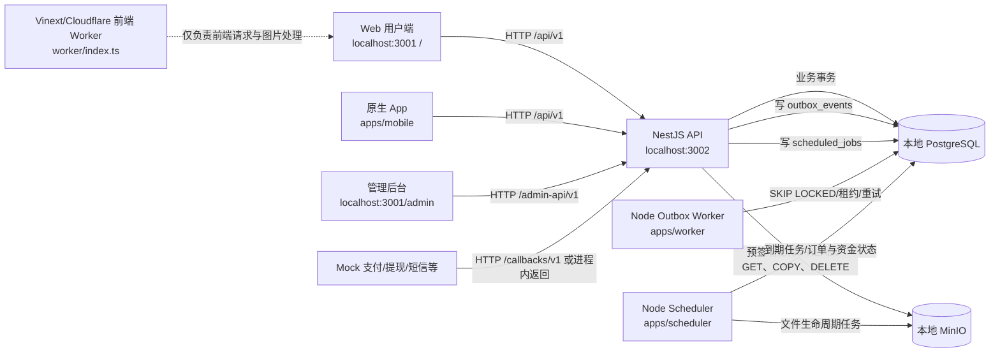

# 熊崽电竞本地测试阶段技术架构复核 V1.0

> **历史审计提示（2026-08-27）：** 本文记录 2026-08-26 时点的审计快照，其中迁移数量和待办结论可能已被后续代码取代。当前阶段边界、真实拓扑、目录所有权和 Definition of Done 统一以《[熊崽电竞-本地完整测试版技术架构-V2.0.md](./熊崽电竞-本地完整测试版技术架构-V2.0.md)》为准。

> 复核日期：2026-08-26  
> 复核目标：本地 PostgreSQL、本地 MinIO、Mock Provider 条件下的功能联调准备度  
> 复核方式：只读代码/文档/配置审计、类型检查、单元与集成测试、隔离测试库迁移验证；未修改业务代码，未购买、开通或调用任何云服务及真实第三方接口。

## 1. 结论摘要

当前架构可以继续用于本地开发，但应在完成本文 P0 项后再进入完整端到端验收，暂不应宣称“本地功能测试完成”。

已经具备且验证通过的核心能力：

- API 是 NestJS 模块化单体，用户端与后台管理端共享同一业务 API 进程，并通过 `/api/v1`、`/admin-api/v1`、`/callbacks/v1` 做边界隔离。
- PostgreSQL 是订单、支付、售后、钱包、提现、文件元数据、聊天、通知、Outbox 和 Scheduler 的唯一业务事实来源。
- 文件二进制使用本地 MinIO；数据库只保存对象键、哈希、审核状态、用途绑定和生命周期状态。
- 支付业务渠道已经收敛为 `WECHAT_APP`、`ALIPAY_APP`，API 通过 Provider Router 分发，当前两个渠道均绑定 Mock Provider。
- 提现账户类型严格为 `WECHAT`、`ALIPAY`，数据库和 API 均不接受银行卡。
- 声音名片后端链路完整，包含 10–30 秒校验、隔离区上传、服务端探测、人工审核、私有对象存储、受控试听和旧对象清理。
- 一对一聊天只支持 `TEXT`、`SYSTEM` 消息，当前使用 HTTP 轮询；项目中没有 WebRTC、实时语音、实时视频、声网、腾讯 TRTC、LiveKit 等通话模块。
- 金额统一采用“分”为单位，数据库使用 `bigint`，跨 API 边界用十进制字符串表达，手续费使用基点 `bps`。
- Worker 的 Outbox 抢占、重试、租约恢复以及 Scheduler 的到期任务并发抢占、幂等执行已经有 PostgreSQL 集成测试。

进入本地完整联调前的阻断项：

1. 当前本地业务数据库只应用了 2/5 个迁移，仍有 3 个迁移待应用。
2. Web 用户端创建支付时没有提交必填的 `payment_channel`。
3. Web 用户端把客服单和收藏分页响应误当成数组使用。
4. 必须明确本轮用户端验收主体：原生 App 已接通声音名片；`localhost:3001/` Web 用户端目前只有声音名片展示占位，不具备录制、上传和真实播放链路。

因此本次结论为：**有条件通过架构复核，完成 P0 清单后允许进入本地端到端联调；不允许进入真实渠道接入或生产部署。**

## 2. 固定产品边界

本轮所有实现、测试和接口决策都应遵守以下不可扩张边界：

| 范围 | 本轮约束 |
|---|---|
| 地域与业务 | 中国区、一对一游戏陪玩 C2C 平台 |
| 沟通方式 | 仅一对一文字聊天，不实现实时语音或视频通话 |
| 音频能力 | 仅保留 10–30 秒声音名片的录制、上传、审核、试听 |
| 用户支付 | 业务渠道固定为 `WECHAT_APP`、`ALIPAY_APP`；本轮均为 Mock |
| 陪玩提现 | 账户类型固定为 `WECHAT`、`ALIPAY`；禁止银行卡 |
| 外部能力 | 支付、短信、实名、电子签约、内容审核、推送均不调用真实付费接口 |
| 基础设施 | 本地 PostgreSQL、本地 MinIO、Mock Provider |
| 目标 | 本地功能测试，不做服务器部署和正式上线 |

任何文档或代码中出现 Redis、消息队列、CDN、R2、D1、WebSocket、真实支付 SDK、银行卡提现等内容，都只能作为未来设计候选，不得被当作本轮已实现依赖。

## 3. 审计基线与变更保护

审计开始时工作区已有大量未提交修改和未跟踪文件，属于现有开发成果。审计过程中工作区还发生过并发更新，因此测试结论以最终稳定快照为准，并对变化过的支付契约、身份审核错误码及迁移测试重新验证。

本次审计没有：

- 覆盖、回滚、格式化或重构任何现有业务代码；
- 执行当前业务数据库迁移；
- 清空数据库、MinIO Bucket 或用户数据；
- 启动或调用真实支付、短信、实名、签约、审核、推送服务；
- 修改本地密钥、Provider 模式或生产部署配置。

本文是本次新增的唯一审计产物。

## 4. 当前技术架构与调用关系



### 4.1 组件职责

| 组件 | 当前职责 | 本轮事实来源/依赖 | 复核结论 |
|---|---|---|---|
| Web 用户端 | 浏览、下单、订单、客服、收藏等 | `/api/v1` | 存在 P0 契约错配；声音名片是占位 |
| 原生 App | 用户完整流程、支付、聊天、声音名片录制上传试听 | `/api/v1`、MinIO 预签名 URL | 类型检查和 144 项测试通过 |
| 后台管理端 | 管理员登录、MFA、RBAC、审核、文件预览等 | `/admin-api/v1` | 权限与文件审核链路完整 |
| API | 认证、业务事务、Provider 路由、文件控制面 | PostgreSQL、MinIO、Mock Provider | 核心集成测试通过 |
| PostgreSQL | 全部业务事实、事务、锁、Outbox、定时任务 | 本地 PostgreSQL 16 | 空库迁移成功；当前业务库落后 3 个迁移 |
| MinIO | 图片、证据、声音名片对象 | 私有/隔离 Bucket | 真实本地 MinIO 全链路通过 |
| Outbox Worker | 抢占并发布 Outbox 事件 | PostgreSQL；本地 `LoggingPublisher` | 本地可验证队列语义，但不会真正推送消息 |
| Scheduler | 订单超时、自动确认、收入可用、文件生命周期 | PostgreSQL、MinIO | 并发、重试、幂等测试通过 |
| 前端 Worker | Vinext 页面与图片请求处理 | 前端构建产物 | 与业务 Outbox Worker 不是同一组件 |

### 4.2 必须避免的命名混淆

- `worker/index.ts` 是前端 Vinext/Cloudflare Worker。
- `apps/worker` 是后端 Outbox Worker。
- 本轮核心存储是 PostgreSQL + MinIO；Vite 配置中可选的 D1/R2 绑定不是当前业务数据库或文件源。
- Outbox Worker 当前使用 `LoggingPublisher`，事件被记为已发布只代表本地 Mock 发布成功，不代表真实推送、短信或消息队列已经送达。

## 5. 接口与约束复核

### 5.1 路由边界

| 路由前缀 | 调用方 | 认证/权限原则 | 结论 |
|---|---|---|---|
| `/api/v1` | Web 用户端、原生 App | 用户认证；仅发现页、公开策略等明确接口可匿名 | 通过 |
| `/admin-api/v1` | 管理后台 | 管理员会话 + MFA + 路由级 RBAC；写操作记录原因和审计日志 | 通过 |
| `/callbacks/v1` | Mock/未来渠道回调 | Provider 签名、渠道一致性、幂等收件箱 | Mock 阶段通过；真实渠道需独立验签实现 |
| `/health` | 本地进程检查 | 不承载业务数据 | 通过 |

默认认证守卫、管理员独立 Cookie/来源检查、MFA 及权限码均存在。文件预览不是普通静态 URL：后台预览同时需要文件读取和审核权限。

### 5.2 金额单位

金额约束一致：

- 字段统一使用 `_cent` 后缀，例如订单总额、支付金额、退款金额、钱包余额和提现金额。
- PostgreSQL 使用 `bigint`，避免浮点金额。
- JSON 接口用十进制字符串传输金额，避免 JavaScript `number` 超出安全整数范围。
- 手续费使用基点 `bps`，计算结果落为整数分。
- 数据库集成测试覆盖大整数、账本和余额一致性。

接口冻结规则：任何新增金额字段必须使用 `*_cent: string`；禁止元/分混传、浮点金额和前端自行计算最终应付金额。

### 5.3 错误码

API 错误响应结构已统一为：

```json
{
  "code": "DOMAIN_ERROR_CODE",
  "message": "可读消息",
  "request_id": "请求追踪 ID",
  "field_errors": [],
  "details": {}
}
```

现状问题是公共包只集中维护了通用错误码，部分领域错误码仍由各 Service 直接写字符串。原生 App 和管理后台已有较完整处理；Web 用户端通常只消费 `code/message`，会丢失 `request_id` 和字段级错误。

本轮应冻结一份“接口—HTTP 状态—领域错误码—客户端行为”矩阵，不要求大改异常体系，但禁止同一业务条件在不同路径返回不同错误码。

## 6. 支付渠道复核

### 6.1 当前正确约束

业务支付渠道的唯一公共定义位于 `packages/contracts/src/commerce.ts`：

```text
WECHAT_APP
ALIPAY_APP
```

创建支付接口应固定为：

```http
POST /api/v1/payments
Content-Type: application/json

{
  "order_id": "...",
  "payment_channel": "WECHAT_APP | ALIPAY_APP"
}
```

当前后端具备以下扩展点：

- `apps/api/src/payment-provider.ts` 的 Provider Router 按业务渠道选择 Provider。
- `apps/api/src/app.module.ts` 分别注册微信 App 支付 Mock Provider 和支付宝 App 支付 Mock Provider。
- 支付记录保存渠道，幂等键范围包含渠道。
- 回调路由包含支付渠道，并校验 URL 渠道、Provider 回调渠道和原支付记录渠道一致。
- 退款沿原支付渠道分发，不能由前端切换渠道。
- 合同测试验证公共渠道只包含上述两个值。

数据库 `payment_channel` 中保留 `MOCK` 只能视作内部兼容/测试值，不能出现在用户端选择器、公共创建支付契约或未来真实渠道业务统计中。

### 6.2 当前阻断问题

`app/page.tsx` 的 Web 用户端创建支付只发送 `{ order_id }`，没有发送后端必填的 `payment_channel`。页面虽然维护了“微信支付/支付宝支付”选择状态，但状态没有映射到 API 值。

影响：Web 用户端支付创建会收到 400 参数校验错误；原生 App 不受影响，其请求已经提交 `payment_channel`。

### 6.3 真实渠道阶段才能处理的事项

以下问题不是本地 Mock 阻断项，但在接真实微信/支付宝前必须完成：

1. Provider 请求必须携带平台级幂等键，并有支付单查询与主动对账。
2. 真实 Provider 已创建支付单但本地事务失败时，需要可恢复的“未知结果”状态，不能仅标记失败。
3. 微信/支付宝客户端拉起参数需要安全持久化或可重建；当前重放结果只有模式、渠道和支付单号。
4. `/payments/:id/query` 目前只返回 Provider 查询结果，不会用同一套幂等状态机推进本地支付和订单状态。
5. 退款 Provider 调用目前位于数据库事务附近；真实网络调用需要拆分为持久化命令、异步执行、回调/查询收敛。
6. 两个真实渠道必须分别实现验签、证书/密钥轮换、回调重放防护、金额和商户号校验、告警与人工补单。

## 7. 提现渠道复核

### 7.1 当前约束通过

提现账户类型在数据库、API、Provider 输入和原生 App UI 中均严格为：

```text
WECHAT
ALIPAY
```

未发现银行卡账户类型、银行卡字段、银行卡路由或银行 Provider。数据库测试明确验证 `BANK` 被拒绝。

接口冻结规则：

- 陪玩只能绑定微信或支付宝收款账户。
- 提现申请引用已保存的账户 ID；提交后应保留不可变快照，不能因后来修改账户而改变历史提现目标。
- 任何接口和文档不得加入 `BANK`、`BANK_CARD`、卡号、开户行等字段。

### 7.2 状态机待收敛

数据库提现状态包含：

```text
CREATED -> RISK_REVIEW -> APPROVED -> PAYOUT_PROCESSING
        -> COMPLETED | REJECTED | FAILED | CLOSED
```

但当前本地 API 的实际路径主要是：

```text
CREATED -> PAYOUT_PROCESSING -> COMPLETED | FAILED
CREATED -> REJECTED
```

`RISK_REVIEW`、`APPROVED`、`CLOSED` 当前没有稳定可达路径。这不阻止 Mock happy path，但会导致数据库、后台筛选、接口文档和未来真实打款流程理解不一致。

本轮先冻结实际状态和后台展示，不做大规模重构；上线前必须二选一：删除不使用的状态，或补齐每个状态的进入条件、操作者、事件、可逆性和超时恢复。

### 7.3 真实打款阶段事项

当前提现只有一个 Mock Payout Provider，回调路径也以 Mock 标识。接真实接口时应增加按 `WECHAT`、`ALIPAY` 路由的 Provider、独立回调身份、验签、幂等、主动查询和对账，仍然禁止加入银行卡。

## 8. 声音名片与聊天复核

### 8.1 声音名片完整链路

后端与原生 App 已形成以下链路：

1. 原生 App 录制音频，10 秒前不允许完成，约 29 秒自动停止，失败或取消后清理本地临时文件。
2. 客户端向 API 申请 `VOICE_SAMPLE` 上传。
3. API 返回本地 MinIO 隔离区预签名 PUT URL。
4. 客户端上传对象后通知 API 完成。
5. API 对对象执行 HEAD、读取、哈希和服务端媒体探测，不信任客户端声明的时长和 MIME。
6. 时长必须在 10–30 秒内；文件进入待审核状态。
7. 管理员通过受权限保护的预览接口试听并审核。
8. 审核通过后对象进入私有受控区，卖家资料只能绑定已验证、已审核、用途正确且属于本人的声音文件。
9. 发现页只为已审核陪玩返回短时有效的签名试听 URL。
10. 替换声音名片后，旧对象由生命周期任务延迟清理。

本地 MinIO 集成测试已经覆盖：10/30 秒边界、伪装视频、上传、隔离、服务端探测、审核、受控 Range 试听和替换清理。

### 8.2 Web 用户端差距

`localhost:3001/` 的声音名片按钮当前只切换播放图标或显示提示，没有真实音频 URL、录音、上传和审核状态接入。因此：

- 若本轮验收用户端是原生 App，声音名片可以进入本地联调；Web 必须标明为展示原型，不能列入通过项。
- 若本轮要求 Web 也通过完整用户功能，则这是 P0，必须补齐 Web 播放；卖家侧录制上传可根据产品定位决定是否只在原生 App 提供，但验收范围必须写清。

### 8.3 没有实时语音/视频通话

项目中没有实时通话信令、房间、媒体轨道、WebRTC、RTC Token 或通话计费模块。一对一聊天消息类型只有 `TEXT`、`SYSTEM`，当前前台通过 HTTP 轮询拉取消息。

这符合本轮固定范围。声音名片是异步文件，不得与实时语音房、连麦、视频通话混为一谈。未来即使优化文字消息实时性，也只能增加文字 WebSocket/SSE，不应顺带引入音视频能力。

## 9. 数据库、文件、Worker 与 Scheduler 复核

### 9.1 数据库

隔离测试库从空库应用全部 5 个迁移成功，28 项数据库测试全部通过，覆盖：

- 支付渠道和提现账户枚举；
- 声音名片时长/用途约束；
- 金额 `bigint` 和账本一致性；
- Outbox、定时任务和关键管理查询索引；
- 管理权限迁移。

但当前本地业务数据库的只读状态检查为：

```json
{
  "current": false,
  "expectedCount": 5,
  "appliedCount": 2,
  "pendingCount": 3,
  "migrationTablePresent": true
}
```

待应用迁移：

- `packages/database/migrations/0002_admin_stage2_permissions.sql`
- `packages/database/migrations/0003_admin_query_performance.sql`
- `packages/database/migrations/0004_payment_channels_voice_constraints.sql`

不得绕过迁移直接手改表。应用前应备份/快照本地数据，应用后再次执行只读迁移状态、Schema 合同和关键 API smoke test。

### 9.2 文件存储

当前文件控制面设计适合本地测试：

- MinIO 保存二进制；PostgreSQL 保存元数据和状态。
- 未审核对象在隔离区；批准后仍为私有/签名访问，不对声音名片开放公共 Bucket。
- 客户端直传只使用短期预签名 URL；完成时由服务端重新检查对象。
- 管理后台预览支持受控 Range，且经过 RBAC/MFA。
- Scheduler 负责过期、孤儿和替换对象清理。

本轮不需要 CDN、Cloudflare R2 或云内容审核。

### 9.3 Outbox Worker

PostgreSQL 测试验证了 `FOR UPDATE SKIP LOCKED`、租约、失败重试和多 Worker 抢占。当前发布器是 `LoggingPublisher`，适合作为 Mock Provider：它验证事件可以被可靠取出，但不产生真实推送或外部消息。

本轮验收只能检查：事件已入库、Worker 可抢占、失败可重试、最终状态正确。不得把日志发布成功解释为用户收到了推送。

### 9.4 Scheduler

Scheduler 覆盖订单支付/接单超时、自动确认、陪玩收入转可用以及文件生命周期任务。14 项 Worker/Scheduler PostgreSQL 测试通过，覆盖并发抢占、租约恢复、重试和幂等调度。

联调时每类任务都应采用可控的短测试时间或测试数据，不要修改生产语义常量来“等任务触发”。

## 10. 已发现问题与影响范围

| 优先级 | 阶段 | 问题 | 具体位置 | 影响范围 | 建议 |
|---|---|---|---|---|---|
| P0 | 本轮必须 | 当前业务库落后 3 个迁移 | `scripts/migration-status.mjs`、`packages/database/migrations/0002...0004` | DB/API/后台/支付/文件 | 备份后按迁移顺序应用并复验，禁止手改表 |
| P0 | 本轮必须 | Web 创建支付缺少 `payment_channel` | `app/page.tsx`；`apps/api/src/order-payment.controllers.ts` | Web 用户端、支付 API | 映射微信为 `WECHAT_APP`、支付宝为 `ALIPAY_APP`，补两渠道契约测试 |
| P0 | 本轮必须 | Web 客服单响应被当作数组 | `app/page.tsx`；`apps/api/src/chat-support-notification.service.ts` | Web 客服页 | 使用 `{items,next_cursor}` 分页结构 |
| P0 | 本轮必须 | Web 收藏响应被当作数组并回退演示数据 | `app/page.tsx`；`apps/api/src/seller-product.service.ts` | Web 收藏页、验收真实性 | 消费分页结构；API 失败显示错误，禁止静默展示 demo 数据 |
| P0 | 本轮决策 | Web 声音名片未真实接入 | `app/page.tsx`；原生实现位于 `apps/mobile` | 用户端、文件存储验收 | 立即冻结“原生 App 或 Web”为验收主体；若含 Web 则补真实播放/上传范围 |
| P1 | 本轮必须 | Web 用 `after_sale_status === REFUNDED` 判断退款 | `app/page.tsx`；`packages/contracts/src/commerce.ts` | 订单售后状态展示 | 售后进度看 `after_sale_status`，退款结果看 `payment_status` |
| P1 | 本轮必须 | 移动端客服优先级声明含 `LOW`、缺 `MEDIUM` | `apps/mobile/src/features/chat/chat-api.ts`；`packages/contracts/src/messaging.ts` | 移动端客服扩展 | 直接复用公共 `SupportPriority`，补 `MEDIUM` 测试 |
| P1 | 本轮必须 | 领域错误码未形成冻结矩阵 | `packages/contracts/src/errors.ts` 与各 Service | 全客户端联调 | 建立接口错误码表；统一同一条件的 HTTP 状态和 code |
| P1 | 上线前 | 提现枚举状态与实际迁移路径不一致 | `packages/database/src/enums.ts`；`apps/api/src/finance.service.ts` | 财务后台、提现、审计 | 简化状态或补齐风险审核/批准/关闭迁移规则 |
| P1 | 上线前 | Outbox 只写日志 | `apps/worker/src/main.ts`、`outbox-worker.ts` | 通知、异步集成 | 本轮保持 Mock；上线前决定真实消息/通知消费者和可观测性 |
| P2 | 上线前 | 技术文档仍把 WebSocket、独立实时服务、CDN 当作现状 | `docs/熊崽电竞-技术架构设计-V1.0.md` | 开发认知、部署清单 | 增加本地 Profile，明确文字轮询、私有 MinIO 和 Mock 边界 |
| P2 | 上线前 | 前端 Cloudflare Worker 缺明确兼容日期/可观测配置，Env 为手写 | `vite.config.ts`、`worker/index.ts` | 未来前端部署 | 部署阶段生成类型、固定兼容日期并启用日志；不影响本地测试 |
| R1 | 真实接口 | 支付查询未收敛本地状态，真实拉起参数未持久化/重建 | `apps/api/src/order-payment.service.ts` | 微信/支付宝真实支付 | 增加对账状态机、持久化命令、SDK 参数重放策略 |
| R1 | 真实接口 | 退款/打款网络调用与 DB 事务边界不适合真实网络 | `apps/api/src/after-sale.service.ts`、`finance.service.ts` | 资金一致性 | 改为持久化命令 + 幂等 Provider + 回调/查询收敛 |
| R1 | 真实接口 | 提现只有 Mock Provider 和 Mock 回调 | `apps/api/src/payout-provider.ts`、`finance.controllers.ts` | 微信/支付宝真实打款 | 增加两渠道 Router、验签、查询、对账；禁止银行卡 |

## 11. 测试与验证证据

| 验证项 | 结果 | 说明 |
|---|---|---|
| 后端全工作区类型检查 | 通过 | packages、API、Worker、Scheduler、mobile 均通过 |
| 原生 App 测试 | 144/144 通过 | 包含领域逻辑、接口客户端和声音名片相关能力 |
| 数据库隔离集成测试 | 28/28 通过 | 空库应用全部迁移，使用本地 PostgreSQL 16 |
| API 完整集成测试 | 首轮 90/91；失败项修复后对应身份审核文件 4/4 通过 | 首轮唯一差异为身份审核错误码优先级；最终代码已单独复验 |
| 文件存储集成测试 | 通过 | 使用真实本地 MinIO，不是内存替身 |
| Worker/Scheduler PostgreSQL 测试 | 14/14 通过 | 抢占、租约、重试、幂等 |
| Web/Vinext 构建 | 通过 | 前端构建成功 |
| 根项目静态/界面测试 | 迁移与后台相关重跑 20/20 通过 | 生产 Runtime 用例因未提供测试库环境及沙箱端口权限未计入本地目标 |
| 当前业务库迁移状态 | 不通过 | 2/5 已应用，3 个待应用，是本地联调 P0 |

测试期间只使用本地 PostgreSQL 和本地 MinIO；隔离测试 Schema 与测试对象由测试清理。没有触发任何真实外部渠道。

## 12. 分阶段完成范围

### 12.1 本轮必须完成

1. 备份当前本地业务库，应用 0002–0004 迁移，再确认 `current=true`。
2. 修复 Web 支付创建的渠道字段并验证微信、支付宝两个 Mock happy path。
3. 修复 Web 客服单、收藏分页响应解析，删除失败后演示数据回退。
4. 明确原生 App 与 Web 用户端的验收范围；声音名片只允许在真正接通链路的客户端上计为通过。
5. 修复 Web 售后/退款展示语义。
6. 统一移动端客服优先级类型。
7. 冻结支付、提现、聊天、声音名片、金额和错误码接口矩阵。
8. 完成数据库、API、Web/原生、后台、MinIO、Worker、Scheduler 的按序联调清单。

### 12.2 上线前再完成

1. 提现完整状态机与后台操作权限/审计规则。
2. Outbox 的真实消费者、死信/告警、Scheduler 运维可观测性。
3. API 限流、容量、备份恢复、日志脱敏、安全扫描和生产密钥管理。
4. 文字聊天的容量评估；必要时增加文字 WebSocket/SSE，但仍不增加音视频通话。
5. 前端 Worker 的兼容日期、生成 Env 类型、日志与部署配置。
6. 更新技术架构文档中的 WebSocket、CDN、云存储和部署描述，使“现状”和“未来方案”分离。
7. 生产数据库迁移演练、回滚预案、数据校验和灰度发布手册。

### 12.3 真实接口阶段再完成

1. 微信 App 支付与支付宝 App 支付的商户申请、SDK、签名、证书、回调、主动查询和对账。
2. 微信/支付宝提现 Provider、验签、查询、人工复核和资金对账；仍不支持银行卡。
3. 真实短信、实名、电子签约、内容审核和推送 Provider。
4. Provider 级幂等、未知结果恢复、熔断、重试、告警、补单和密钥轮换。

本阶段不得为了“提前准备”而购买、开通或试调用上述真实服务。

## 13. 按优先级排序的联调清单

下表是本轮统一执行顺序。前一优先级未通过时，不应跳到后一优先级宣布完成。

| 顺序 | 优先级 | 责任域 | 操作 | 通过标准 |
|---:|---|---|---|---|
| 1 | P0 | 数据库 | 记录当前数据库、迁移表和数据量；做可恢复备份 | 备份可定位，未改生产/云资源 |
| 2 | P0 | 数据库 | 按顺序应用 0002、0003、0004 | 迁移无手工跳步；状态为 5/5、`current=true` |
| 3 | P0 | 数据库/后端 | 重跑 Schema 合同、数据库 28 项测试和 API smoke | 枚举、约束、索引、权限均与代码一致 |
| 4 | P0 | 后端 | 冻结创建支付契约 | `order_id + payment_channel` 必填，只接受 `WECHAT_APP/ALIPAY_APP` |
| 5 | P0 | 用户端 Web | 修复支付渠道映射并分别创建两种 Mock 支付 | 两渠道各创建成功；刷新/重试不产生重复支付单 |
| 6 | P0 | 后端/用户端 | 验证 Mock 支付成功、金额不一致、渠道不一致、重复回调 | 正常单只推进一次；异常回调有稳定错误码且不改订单 |
| 7 | P0 | 用户端 Web | 按分页契约消费客服单和收藏 | 使用 `items/next_cursor`；失败时显示错误而非 demo 数据 |
| 8 | P0 | 产品/用户端 | 固化本轮用户端验收主体 | 文档明确 Web 与原生 App 各自必须功能，不重复计数 |
| 9 | P0 | 文件存储/原生 App | 录制并上传 10、20、30 秒声音名片 | 三个合法边界都能进入待审核；低于 10/高于 30 被拒 |
| 10 | P0 | 文件存储/后台 | 对声音执行预览、批准、拒绝 | 未授权不可预览；批准后可绑定，拒绝后不可绑定 |
| 11 | P0 | 用户端/文件存储 | 发现页试听已批准声音，替换后验证旧对象清理任务 | 仅批准且在用的声音可短期签名试听；旧对象按任务清理 |
| 12 | P0 | 全栈 | 搜索并验证不存在实时语音/视频入口和 API | 无房间、信令、RTC Token、音视频消息类型和通话计费 |
| 13 | P1 | 后端/用户端 | 冻结金额字段与序列化 | 所有金额为 `*_cent` 十进制字符串；服务端计算最终金额 |
| 14 | P1 | 用户端 Web | 修复售后与退款展示 | `after_sale_status` 表示流程；`payment_status=REFUNDED` 表示退款 |
| 15 | P1 | 后端/用户端 | 统一客服优先级 | 只接受 `NORMAL/MEDIUM/HIGH/URGENT`，客户端复用公共类型 |
| 16 | P1 | 后端/用户端/后台 | 建立错误码矩阵并做失败路径联调 | HTTP 状态、`code`、`request_id`、字段错误和 UI 行为一致 |
| 17 | P1 | 后端/用户端 | 一对一文字聊天联调 | 仅会话成员可读写；消息类型仅 TEXT/SYSTEM；幂等键防重复 |
| 18 | P1 | 后端/后台 | 管理员 MFA、RBAC、来源/CSRF、审核原因与审计日志 | 越权失败；授权操作可追踪到管理员、原因和请求 ID |
| 19 | P1 | 后端/数据库 | 微信/支付宝提现账户和申请联调 | 两类账户均成功；`BANK` 在 API 和 DB 均失败 |
| 20 | P1 | 后端/后台 | Mock 提现批准、拒绝、成功、失败与重复回调 | 钱包冻结/扣减/退回正确；重复回调不重复记账 |
| 21 | P1 | Worker | 验证 Outbox 正常、失败重试、租约恢复 | 本地日志发布可观测；无重复业务副作用 |
| 22 | P1 | Scheduler | 验证支付超时、接单超时、自动确认、收入可用 | 每个任务只产生一次预期状态迁移和账本记录 |
| 23 | P1 | Scheduler/文件存储 | 验证过期上传、孤儿对象、替换对象清理 | DB 状态与 MinIO 对象最终一致；失败可重试 |
| 24 | P1 | 全栈 | 运行后端类型检查、原生 144 项、数据库/API/Worker/Scheduler、Web 构建 | 本地目标测试全绿；无真实 Provider 请求 |
| 25 | P2 | 文档/架构 | 更新现状架构和未来上线架构的边界 | 不再把 WebSocket、CDN、R2/D1、真实 MQ 写成当前依赖 |

## 14. Go/No-Go 门禁

满足以下全部条件，才允许标记“本地功能联调完成”：

- 当前业务库迁移状态为 5/5；
- Web 契约 P0 已修复，或书面确认 Web 不属于对应功能验收主体；
- 两个支付 Mock 渠道均通过创建、回调、异常和幂等测试；
- 提现只出现 `WECHAT/ALIPAY`，API 和 DB 都拒绝银行卡；
- 声音名片合法边界、非法边界、审核、试听、替换清理全通过；
- 一对一聊天只有文字，没有实时音视频入口或依赖；
- 金额、权限和错误码失败路径完成至少一轮前后端联调；
- Worker/Scheduler 的任务可观测、可重试且没有重复副作用；
- 测试日志中没有真实外部域名、真实商户请求或付费服务调用。

若任一项未满足，结论应保持为 No-Go，并记录具体接口、数据 ID、请求 ID 和责任域，不得用演示数据或手工改库掩盖问题。

## 15. 参考实现位置

- 支付公共契约：`packages/contracts/src/commerce.ts`
- 聊天/客服公共契约：`packages/contracts/src/messaging.ts`
- 金额与数据库枚举：`packages/database/src/enums.ts`、`packages/database/src/schema.ts`
- 支付控制器与服务：`apps/api/src/order-payment.controllers.ts`、`apps/api/src/order-payment.service.ts`
- 支付 Provider：`apps/api/src/payment-provider.ts`
- 提现控制器与服务：`apps/api/src/finance.controllers.ts`、`apps/api/src/finance.service.ts`
- 提现 Provider：`apps/api/src/payout-provider.ts`
- 文件控制面：`apps/api/src/file-storage.controllers.ts`、`apps/api/src/file-storage.service.ts`
- 服务端文件探测：`apps/api/src/file-inspector.ts`
- 原生 App：`apps/mobile`
- Web 用户端：`app/page.tsx`
- 管理后台文件审核：`app/admin/file-management.tsx`
- Outbox Worker：`apps/worker`
- Scheduler：`apps/scheduler`
- 前端 Worker：`worker/index.ts`、`vite.config.ts`
- 迁移状态检查：`scripts/migration-status.mjs`
