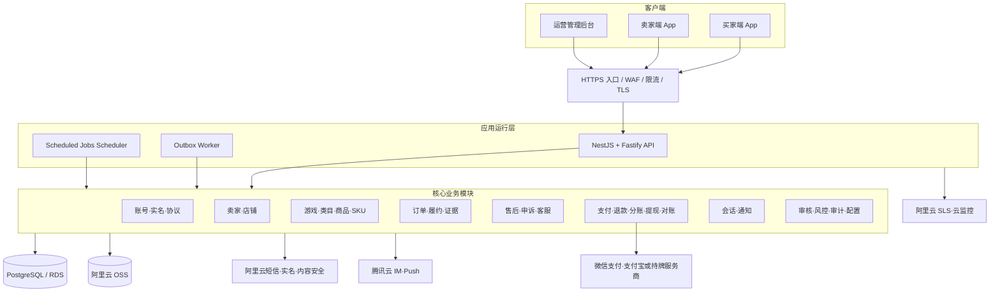
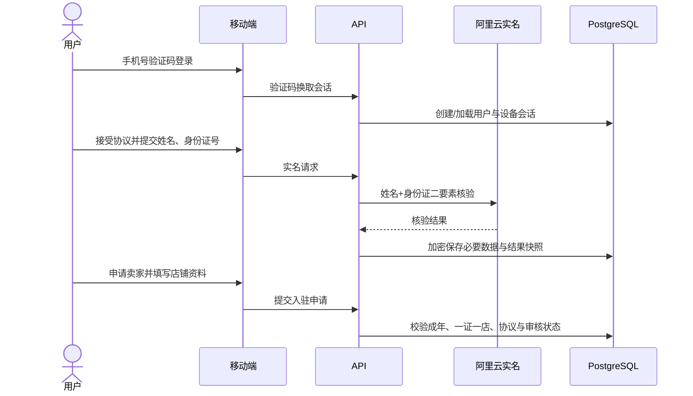
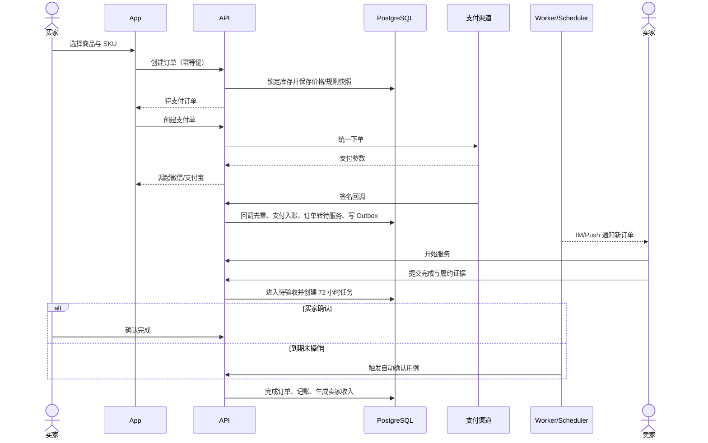
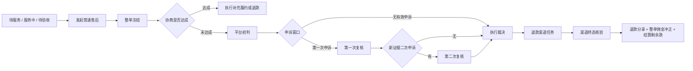
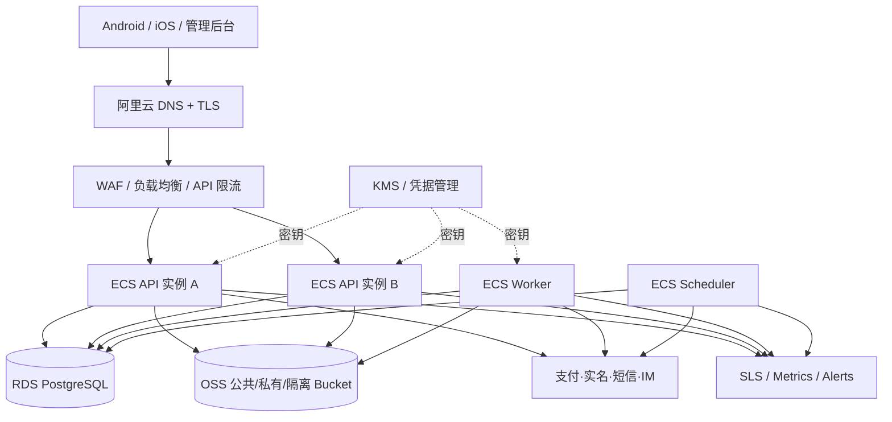

# 熊崽电竞综合技术架构 V2.0

> 文档性质：产品、研发、测试、运维、客服、财务和合规共同使用的技术架构基线  
> 基线日期：2026-10-02  
> 适用范围：用户端 App、管理后台、API、异步任务、数据库、文件、消息、支付、退款、结算、提现、风控及生产部署  
> 目标读者：技术负责人、前后端工程师、测试工程师、运维工程师、第三方渠道对接人员  
> 状态：开发评审稿；“已实现”以当前仓库代码为准，“正式目标”以本文目标架构为准

## 1. 文档结论

熊崽电竞应建设为一个面向中国大陆市场的、覆盖多款游戏和多种虚拟服务商品的 C2C 交易平台。第一阶段支持：

- 和平精英；
- 三角洲行动；
- 王者荣耀；
- 无畏契约。

系统采用“模块化单体 API + 独立 Worker + 独立 Scheduler + PostgreSQL 单一事实源”的架构。当前阶段不拆微服务，不先引入 Kafka，也不把 Redis 作为交易正确性的依赖。支付、退款、结算、提现、订单状态和售后判责全部以 PostgreSQL 中的持久化记录为准。

客户端以 Android/iOS 原生体验的 Expo React Native App 为主；管理后台为 React Web。生产基础设施以阿里云为主，聊天和推送使用腾讯云，支付与提现只能接入具备相应资质且书面确认支持自然人卖家业务的持牌渠道。

这不是一个“前端展示项目”。正式上线的核心是五条闭环同时成立：

1. 商品审核、下单、支付和履约闭环；
2. 证据、售后、申诉、退款和客服闭环；
3. 佣金、卖家收入、提现和渠道对账闭环；
4. 实名、协议、内容安全、数据安全和审计闭环；
5. 监控、备份、发布、回滚和应急闭环。

当前仓库已经具备较完整的本地业务骨架和数据库基础，但真实支付、真实提现、腾讯云 IM、腾讯云推送、阿里云生产存储、自动内容审核、生产部署与监控仍是上线阻断项。因此，技术团队必须同时维护以下三个视角：

| 视角 | 定义 | 使用方式 |
|---|---|---|
| 当前实现 | 仓库中已经存在并可测试的代码 | 评估可复用能力，禁止冒充已上线 |
| 正式目标 | 本文描述的生产架构 | 新开发、接口设计和采购的统一方向 |
| 待确认项 | 产品、法务、渠道或运营尚未冻结的事项 | 通过配置/版本化隔离，不得写死猜测值 |

## 2. 资料基线与冲突处理

### 2.1 资料优先级

遇到资料冲突时，按以下优先级处理：

1. 负责人最新明确决定；
2. 《熊崽电竞用户端 App PRD V3.5 开发评审稿》；
3. 《熊崽电竞完整交易售后体系 V3.1》；
4. 《熊崽电竞平台业务总纲 V2.1 简明版》；
5. 《熊崽电竞第三方服务清单 V1.7》；
6. 当前代码、数据库迁移和自动化测试，用于判断“现在做到了什么”；
7. 更早的 PRD、商业问答、技术架构和原型，仅作历史背景。

代码不自动高于新规则。代码与最新规则不一致时，代码代表待改造现状；已经创建的历史订单继续使用订单自己的规则快照。

### 2.2 已解决的主要冲突

| 旧口径 | 当前统一口径 |
|---|---|
| 首发只做和平精英陪玩 | 首发四款游戏，平台定位为综合游戏商品与服务交易市场 |
| 有预约、卖家接单/拒单 | V3.1 新订单直接购买，支付后进入待服务；无预约、无接单/拒单 |
| 平台内服务倒计时/暂停 | V3.1 新单不使用旧式计时器与暂停机制；仅保存规则规定的期限 |
| 退款只按退款部分调整佣金 | 只要发生真实订单退款，整单平台佣金归零 |
| 意见反馈进入客服工单 | 意见反馈为独立模块，不自动创建售后或冻结订单 |
| HTTP 轮询聊天为正式方案 | 当前可作为本地/过渡实现，正式目标为腾讯云 IM |
| MinIO/R2 可直接作为生产存储 | MinIO 只用于本地；正式生产统一使用阿里云 OSS |
| 买家钱包/充值 | 不建设买家钱包，不允许形成自建资金池 |
| 人脸或活体认证 | 第一阶段仅姓名+身份证二要素，不做人脸、活体、视频和摄像头采集 |

## 3. 产品边界

### 3.1 平台角色

同一个 App、同一个登录账号包含两个业务身份：

- 买家身份：浏览、购买、付款、接收服务、验收、售后和评价；
- 卖家身份：申请开店、发布商品、履约、提交证据、处理售后、查看收入和申请提现。

一个自然人实名主体最多拥有一家店铺。买家公开资料与卖家店铺资料可以不同，但后台必须关联到同一实名主体。买家首次下单前完成实名和成年校验；卖家在入驻流程中完成实名和成年校验。

### 3.2 商品范围

正式商品模型不能写死为“陪玩”。至少要支持以下目标类目：

- 合规陪玩；
- 教学与指导；
- 符合游戏规则的代练；
- 游戏币、道具、卡密和合规充值；
- 后续经合规评估批准的其他虚拟服务。

暂不开放账号交易和实物商品。外挂、盗号盗物、黑卡、来源不明资产、赌博以及违反游戏规则或法律法规的业务必须禁止。

账号租赁只做能力预留，不能作为普通商品直接上线。启用前必须分别确认游戏规则、账号登录/找回机制、实名风险、纠纷处理和专用交易规则。

### 3.3 首期不做

- 购物车、拼单、砍价、分销；
- 预约单、卖家接单/拒单；
- 买家充值、买家余额钱包；
- 直播、公开语音房、实时音视频 RTC；
- 排行榜、幸运转盘；
- 地图定位；
- AI 功能；
- 第三方账号登录；
- 邮件系统；
- 邀请返利和推广分佣。

这些功能不得以“隐藏入口但代码默认开启”的方式进入生产。

## 4. 架构原则

### 4.1 核心原则

1. **交易正确性优先。** 金额、订单、退款、售后和提现必须服务端裁决。
2. **规则版本化。** 每个订单绑定创建时的交易规则、退款规则、佣金规则和协议快照。
3. **账务不可覆盖。** 原始账务分录不可修改，通过冲正和调整分录纠错。
4. **外部调用可重放。** 支付、退款、提现、短信、推送和内容审核均按至少一次语义设计。
5. **客户端不决定状态。** App 只能提交意图，服务端验证角色、状态、时限和版本后执行。
6. **敏感数据最小化。** 只采集业务必要信息，显示、日志、导出和客服权限均分级。
7. **模块化先于微服务化。** 先清晰划分边界和依赖，再根据数据决定是否拆分进程。
8. **第三方可替换。** 业务层只依赖 Provider 接口，不直接散落厂商 SDK。
9. **生产禁用 Mock。** staging/production 启动时发现 Mock Provider、测试密钥或样例数据应直接失败。
10. **所有关键动作可审计。** 谁在何时对什么对象执行了什么动作，前后值、依据和结果都可追溯。

### 4.2 为什么暂不拆微服务

当前团队和业务仍处于规则落地、渠道接入和上线准备阶段。过早拆微服务会增加分布式事务、服务发现、链路追踪和运维成本，但不能解决当前最关键的渠道资质与业务闭环问题。

保留模块化单体，直到满足一个或多个明确触发条件：

- 单一模块容量或发布频率显著高于其他模块；
- 团队出现独立模块所有权和独立值班能力；
- PostgreSQL 单库或单部署单元成为有数据证明的瓶颈；
- 安全或合规要求必须进行物理隔离；
- 供应商回调或消息吞吐需要独立扩缩容。

## 5. 总体系统架构



买家端和卖家端在产品上是两个工作区，在技术上复用同一个移动端应用、认证会话和基础组件。权限由服务端主体身份与资源关系决定，不能仅依赖客户端当前选中的身份模式。

## 6. 当前实现与正式目标

| 能力 | 当前仓库实现 | 正式目标 | 状态 |
|---|---|---|---|
| 移动端 | Expo/React Native，具备主要页面和本地联调能力 | Android+iOS 同一代码基线，生产签名与商店发布 | 部分完成 |
| 管理后台 | React Web 基础和部分业务能力 | 覆盖审核、客服、财务、风控、配置与审计 | 部分完成 |
| API | NestJS 11 + Fastify 5 + Zod | 生产多实例、统一鉴权、限流和可观测 | 骨架完成 |
| 数据库 | PostgreSQL + Drizzle，已有较完整业务表和 11 个迁移文件 | 阿里云 RDS PostgreSQL、备份/PITR、权限隔离 | 本地完成、生产未完成 |
| 异步事件 | Outbox/Inbox/幂等基础，Worker 当前为 LoggingPublisher | 真实推送、IM、渠道事件发布和失败处置 | 骨架完成 |
| 定时任务 | 数据库任务队列，支持订单、收入和生命周期任务 | 多实例安全认领、告警、人工补偿和停机顺延 | 部分完成 |
| 文件 | 预签名上传、公开/私有/隔离桶、MinIO 本地实现 | 阿里云 OSS、KMS/IAM、审核、重编码、生命周期 | 骨架完成 |
| 支付 | Mock/本地流程 | 微信支付+支付宝或持牌聚合渠道 | 未接入 |
| 退款 | 本地业务与账务逻辑 | 渠道退款回调、查询、补单、对账 | 未联调 |
| 提现 | 本地流程和 Provider 边界 | 同名微信/支付宝到账，渠道状态为准 | 未联调 |
| 实名 | 手工/模拟状态 | 阿里云姓名+身份证二要素 | 未接入 |
| 聊天 | HTTP 轮询、文本为主 | 腾讯云 IM：文本、图片、短语音、订单卡片 | 未接入 |
| 推送 | 站内通知骨架 | 腾讯云 Push + APNs + Android 厂商通道 | 未接入 |
| 内容安全 | 规则与隔离边界 | 非 IM 内容用阿里云，IM 内容用腾讯云 | 未接入 |
| 可观测 | JSON 日志和请求上下文基础 | SLS、指标、追踪、告警和业务看板 | 未完成 |
| 部署 | 本地进程与本地依赖 | ECS/RDS/OSS/SLS/KMS、CI/CD、灰度和回滚 | 未完成 |

结论：当前系统适合继续做本地集成测试和业务规则实现，不能因页面可操作或 Mock 返回成功就认定具备生产上线条件。

## 7. 代码与部署单元

### 7.1 Monorepo 结构

| 路径 | 职责 | 依赖规则 |
|---|---|---|
| `apps/mobile` | 买家端、卖家端、登录、设备能力 | 只依赖公开契约和移动端基础库，不读取数据库实现 |
| `app/admin` | 管理后台 | 调用 `/admin-api/v1`，不绕过权限访问数据库 |
| `apps/api` | HTTP 接口、认证入口、Provider 回调入口 | 编排应用服务，不堆积领域规则 |
| `apps/worker` | Outbox 消费、异步投递、重试 | 不直接复制 API 规则，通过应用层用例处理 |
| `apps/scheduler` | 到期任务、对账调度、生命周期任务 | 只负责认领和触发，领域判断位于应用/领域层 |
| `packages/contracts` | DTO、错误码、状态/动作契约 | 不依赖数据库和具体厂商 SDK |
| `packages/auth` | JWT、角色、权限和安全上下文 | 对业务模块只暴露主体与授权结果 |
| `packages/application` | Unit of Work、幂等、Outbox、任务、账务引擎 | 领域用例和跨模块编排中心 |
| `packages/database` | Drizzle Schema、迁移、数据库客户端 | 不承载 HTTP 或页面逻辑 |
| `packages/observability` | 日志、请求上下文、脱敏 | 被所有运行单元复用 |

### 7.2 必须修正的依赖问题

Scheduler 当前部分处理器反向依赖 `@xiongzai/api`。正式目标必须将可复用处理逻辑下沉到 `packages/application` 或对应领域包，让 API、Worker 和 Scheduler 都作为入口适配器调用应用层，禁止后台任务依赖 HTTP 层。

### 7.3 进程职责

- API：处理短事务、校验、查询和创建异步任务；不在请求中执行长时间重试。
- Worker：投递 Outbox 事件、调用异步第三方、执行可重试副作用。
- Scheduler：认领到期任务并调用应用用例；不使用客户端时间做裁决。
- 管理后台：只发起管理动作，任何退款、解冻、驳回和打款仍由服务端事务执行。

## 8. 领域模块设计

### 8.1 账号、身份与协议

职责：

- 手机号登录与验证码；
- Access Token/Refresh Token；
- 设备会话、退出和风险控制；
- 买家/卖家双身份；
- 姓名+身份证二要素实名；
- 18 岁以上校验；
- 隐私政策、用户协议、买家规则、卖家规则的版本接受记录；
- 注销、导出、删除和账号生命周期。

关键约束：

- 身份证号等高敏数据加密保存，同时使用不可逆 HMAC 索引用于一证一店校验；
- 前台、客服列表和普通日志只显示脱敏值；
- 实名供应商返回结果与平台内部业务状态分离；
- 买家公开资料、卖家店铺资料和法定实名资料是三个不同数据对象；
- Access Token 短期有效，Refresh Token 可轮换且可撤销；移动端存入系统安全存储。

### 8.2 卖家与店铺

职责：卖家申请、入驻审核、一证一店、店铺资料、营业状态、违规状态、收款账户验证。

卖家不缴纳保证金。风控不能依赖“扣保证金”解决问题，必须通过订单资金冻结、收入负债、提现审核、证据与处罚体系控制风险。

### 8.3 游戏、类目、商品与 SKU

商品模型采用“公共主表 + 类目配置 + 受控扩展字段”：

- 游戏：`games`；
- 服务类目：`categories`；
- 类目字段定义：`category_attribute_definitions`；
- 商品：`products`；
- SKU：`product_skus`；
- 商品属性值：结构化 JSONB 或独立值表；
- 审核记录和版本：独立不可覆盖记录；
- 库存和可售状态：服务端原子扣减/恢复。

公共字段包括卖家、游戏、类目、标题、说明、封面、交付方式、价格、履约期限、库存和审核状态。不同游戏的段位、区服、平台、交付要求等通过类目定义表达，禁止每增加一个游戏就复制一整套表和接口。

涉及资金、搜索、权限和状态判断的字段必须结构化，不能全部塞进 JSONB。商品通过审核后才可售；修改关键字段应形成新版本或重新审核。

### 8.4 订单与履约

订单保存下单时快照，包括：

- 商品、SKU、价格、卖家展示信息；
- 游戏与类目；
- 佣金比例；
- 交易规则版本、退款规则版本、协议版本；
- 履约期限与证据要求；
- 买卖双方主体标识。

订单创建后不得因为卖家修改商品而改变历史订单内容。所有金额使用最小货币单位整数（分），禁止浮点数。

### 8.5 售后、申诉与客服

普通售后与客服特殊申诉是不同对象：

- 普通售后：发生在待服务、服务中、待验收阶段，按 V3.1 冻结整单；
- 客服特殊申诉：交易终结后出现严重问题，由客服核验，不复用普通退款入口；
- 意见反馈：产品建议或普通意见，不绑定订单、不冻结资金、不创建售后。

售后记录包括双方诉求、证据、协商、平台初判、复核、申诉窗口、执行任务和完整审计轨迹。任何新证据必须记录上传人、上传时间、来源、哈希和审核状态。

### 8.6 支付、账务、退款、结算与提现

支付模块只接受渠道最终状态或主动查询核验结果，不以客户端“支付成功”页面作为到账依据。

内部账务采用复式记账：

- 每个交易有唯一业务幂等键；
- 每笔凭证借贷平衡；
- 原分录不可更新或删除；
- 退款和纠错通过冲正/调整分录处理；
- 业务余额是分录聚合或经过校验的缓存，不是随意修改的数字；
- 提现申请先冻结可提现余额，终态由渠道回调或查询确定。

V3.1 佣金规则：

```text
无真实退款：平台佣金 = 实付金额 × 10%，按分取整；卖家收入 = 实付金额 - 平台佣金
发生任意真实订单退款：整单平台佣金 = 0；卖家最终收入 = 实付金额 - 累计退款金额
支付手续费：由平台承担，不向买家或卖家另行收取
```

如果佣金已经入账或卖家已提现，退款时仍要生成冲正和卖家负债，不能覆盖旧收入记录，也不能让同一退款重复冲正。

### 8.7 消息与通知

消息分三类：

- 交易会话：买卖双方围绕订单沟通；
- 客服会话/工单：用户与平台客服沟通；
- 系统通知：订单、售后、资金、审核和安全事件。

正式交易聊天由腾讯云 IM 承载，目标支持文本、图片、短语音和订单卡片。平台数据库仍需保存会话与订单关联、消息索引、风险审核结果、举报状态和争议证据归档，不应把全部业务真相只放在 IM 厂商中。

### 8.8 文件与内容安全

文件按安全级别分为：

- 公开：商品封面、公开头像；
- 私有：实名材料、售后证据、履约录像；
- 隔离：尚未审核、命中风险或来源异常的文件。

统一流程：申请上传 → 服务端校验业务权限 → 获取短期预签名地址 → 客户端直传 → 回调/确认 → 元数据校验 → 内容审核/重编码 → 转为可用 → 生命周期清理。

第一版恶意文件防护至少包含白名单、大小限制、MIME 与魔数校验、隔离桶和图片重编码。高风险文件不得直接使用用户提供的文件名、Content-Type 或公开 URL。

## 9. 交易规则版本与状态模型

### 9.1 多维状态

不得用一个 `status` 字段表达全部含义。至少分为：

| 维度 | 示例含义 |
|---|---|
| `order_status` | 待付款、待服务、服务中、待验收、已完成、已关闭 |
| `payment_status` | 未支付、处理中、已支付、部分退款、已退款、失败 |
| `after_sale_status` | 无售后、处理中、待补证、待裁决、申诉中、已解决 |
| `finance_status` | 未结算、冻结、可提现、提现中、已提现、负债 |
| `fulfillment_status` | 未开始、履约中、已提交证据、补充履约、终止 |

对外页面状态由这些维度计算，不允许前端自行拼接或通过颜色判断权限。

### 9.2 规则版本

`orders.rule_version` 是订单处理路由的核心字段：

- `legacy`：历史预约/接单等旧流程；
- `V3.1`：新交易售后规则；
- 后续版本：只能新增，不覆盖历史语义。

订单创建时还应绑定精确的策略版本 ID，而不仅是字符串标签。规则发布后不可修改原版本；修订需要创建新版本和生效时间。旧订单不自动迁移。

当前仓库迁移 `0010_order_rule_version.sql` 已增加 `rule_version`，账务和售后部分逻辑已经按 `V3.1` 与 `legacy` 分流。这是正确方向，但仍需要把所有状态、按钮、到期任务、客服动作和测试场景统一纳入规则版本路由。

### 9.3 动作驱动，而非状态直写

外部接口只提供业务动作，例如：

- 创建订单；
- 发起支付；
- 卖家开始服务；
- 卖家提交履约证据；
- 买家确认完成；
- 买家延长验收；
- 发起售后；
- 补充证据；
- 接受/拒绝方案；
- 提起复核；
- 执行退款。

服务端根据规则版本、当前多维状态、操作者角色、截止时间和资源版本计算是否允许。禁止提供通用的 `PATCH /orders/:id/status`。

### 9.4 状态转换实现

每个动作在同一数据库事务内完成：

1. 加载订单及关联售后/资金状态；
2. 校验操作者和规则版本；
3. 校验动作是否在当前状态允许；
4. 使用 `version` 做乐观并发控制，必要时加行锁；
5. 更新主状态；
6. 写入状态日志、审计日志和账务分录；
7. 创建或取消 Scheduled Job；
8. 写入 Outbox 事件；
9. 提交事务后由 Worker 发送通知或调用外部系统。

## 10. 核心业务流程

### 10.1 注册、实名与开店



### 10.2 商品发布

1. 卖家选择游戏和类目；
2. API 返回该类目的字段定义与校验规则；
3. 卖家填写商品、SKU、价格、库存和履约期限；
4. 文件进入隔离区并完成安全与内容审核；
5. 商品进入人工/自动审核；
6. 审核通过后发布；关键字段变更触发重新审核；
7. 下单时复制商品与规则快照。

价格由卖家自主决定，平台不强制价格区间，但明显错误或风险价格应进入审核与风控队列。

### 10.3 下单、支付与履约



V3.1 新订单支付成功后直接进入待服务，不存在卖家接单/拒单。买家可在规则允许时延长验收一次 24 小时；默认验收窗口为 72 小时。服务端保存绝对截止时间，App 只负责展示。

### 10.4 履约证据

- 每单至少 5 张有效履约截图；
- 实付金额大于等于 200 元时，还需连续录屏；
- 文件元数据、哈希、上传主体和时间必须可核验；
- 证据提交成功后不可静默替换；补充材料创建新记录；
- 客户端压缩不应破坏关键文本和时间信息；
- 争议证据按合规要求至少保留 180 天，删除需经过业务与法务策略判断。

### 10.5 售后、退款与佣金冲正



退款的业务决定和渠道实际退款是两个阶段。退款申请获批后先形成待执行任务；只有渠道回调或主动查询确认成功，才更新真实退款金额并入账。外部结果不明确时保持处理中并触发查询，不允许猜测成功或失败。

发生任何大于 0 的真实订单退款时，只执行一次整单佣金归零。最终卖家收入为实付减累计退款；如果卖家余额不足，差额进入负债并限制提现。

### 10.6 提现

1. 卖家绑定并验证本人同名微信或支付宝收款账户；
2. 服务端校验可提现余额、实名一致性、风控状态和频率；
3. 数据库事务内冻结余额并创建提现单；
4. Worker 调用持牌渠道；
5. 回调验签并去重；不确定结果主动查询；
6. 成功后转出冻结资金，失败后解冻，人工处理保留审计；
7. 日终按平台账、渠道账和银行/机构结算单对账。

“允许申请提现”不代表即时到账。App 必须展示渠道处理中、成功、失败和人工核验等真实状态。

### 10.7 评价

- 评价不阻塞结算；
- 首次交易终结后 7 天内可评价；
- 不自动生成好评；
- 售后或退款后是否允许评价由订单规则版本决定；
- 评价修改、追评、举报和展示规则必须配置化并经产品冻结。

## 11. 数据架构

### 11.1 单一事实源

PostgreSQL 是订单、资金、售后、权限、审计和任务状态的唯一事实源。第三方渠道是其自身支付/退款/提现终态的事实源，两者通过回调、主动查询和对账收敛。

不使用内存变量、移动端缓存、IM 消息或日志代替数据库业务状态。

### 11.2 现有数据能力

当前 Schema 已覆盖用户、管理员、认证、文件、档案、实名、协议、卖家、商品、SKU、收藏、可售时间、订单、预约、订单日志、支付、退款、投诉、评价、账务、收入、负债、提现、对账、会话、消息、客服、通知、审计、风控、Outbox、Inbox、幂等和定时任务等对象。

历史的预约与接单相关表可以保留服务旧订单，但 V3.1 新单不得再依赖这些对象。

### 11.3 数据规范

- 主键优先使用 UUIDv7/可排序 UUID；
- 金额使用 `bigint` 分；汇率/比例使用基点或明确精度的 decimal；
- 时间统一以 UTC 持久化，界面按北京时间展示；
- 所有表包含 `created_at`、`updated_at`，关键对象包含 `version`；
- 软删除只用于需要保留审计的业务对象，不能替代合规删除任务；
- 枚举进入数据库前必须考虑历史兼容；外部供应商状态保存原值与规范化值；
- JSONB 只用于低频扩展、快照和原始回调，不承载核心金额及权限判断；
- 订单、支付、退款、提现和售后业务号建立唯一约束；
- 回调事件以供应商事件 ID、业务单号和正文摘要做复合去重。

### 11.4 敏感数据

| 数据 | 存储要求 | 展示要求 |
|---|---|---|
| 身份证号 | KMS 管理密钥加密；HMAC 索引 | 仅授权岗位可看脱敏值 |
| 姓名 | 加密或列级保护 | 默认脱敏 |
| 手机号 | 加密/HMAC 查询 | 仅显示必要位数 |
| 收款账户 | 加密；供应商 Token 优先 | 不显示完整账号 |
| 履约录像/售后证据 | 私有桶、短期签名、访问审计 | 禁止公共链接 |
| 支付回调正文 | 加密/受限存储、按需脱敏 | 普通日志不记录密钥或完整隐私字段 |

## 12. API 架构

### 12.1 命名空间

| 前缀 | 用途 | 身份 |
|---|---|---|
| `/api/v1` | 用户端接口 | 用户 Access Token |
| `/admin-api/v1` | 管理后台接口 | 管理员 Token + RBAC + MFA |
| `/callbacks/v1` | 第三方回调 | 厂商签名、时间戳、证书/密钥和重放校验 |
| `/internal/v1` | 内部服务调用 | 独立内部凭证与网络访问控制 |
| `/health` | 健康检查 | 仅暴露必要信息 |

### 12.2 统一约定

- JSON 使用 snake_case 或 camelCase 必须全项目统一；现有接口兼容期内通过契约转换处理；
- 写接口接受 `Idempotency-Key`；服务端保存请求摘要和结果；
- 并发更新接受资源 `version`，冲突返回明确错误码；
- 列表使用游标分页，禁止深分页作为核心交易列表方案；
- 错误返回稳定业务错误码、可展示文案、`trace_id` 和必要字段；
- 服务端响应 `server_time`，客户端倒计时只做显示；
- 文件、支付和 IM 凭证均使用短期授权，禁止向 App 下发长期 Secret；
- API 契约由 `packages/contracts` 管理并生成/校验客户端类型。

### 12.3 回调安全

每个渠道适配器必须实现：

1. 保留原始请求体；
2. 校验签名、证书或密钥版本；
3. 校验时间戳和允许偏差；
4. 防重放；
5. 事件幂等；
6. 金额、商户号和业务单号二次核验；
7. 数据库事务内更新状态并写 Inbox/Outbox；
8. 可查询渠道最终状态；
9. 支持证书轮换；
10. 保存脱敏后的审计信息。

## 13. 异步一致性与并发控制

### 13.1 Outbox/Inbox

业务状态更新与 Outbox 事件在同一数据库事务提交。Worker 使用 `FOR UPDATE SKIP LOCKED` 认领事件，投递成功后标记完成，失败指数退避并在超过阈值后进入人工处置队列。

外部回调先写 Inbox 或等价去重记录，再执行业务更新。消费者必须幂等，因为所有跨系统投递都按“至少一次”设计。

当前 Worker 的 `LoggingPublisher` 只证明队列骨架可以工作，生产必须替换为真实的 IM、Push、短信和供应商调用处理器。

### 13.2 Scheduled Jobs

定时任务至少覆盖：

- 未支付订单关闭；
- 验收提醒、72 小时自动确认和一次 24 小时延长；
- 售后协商、补证、初判、申诉和复核时限；
- 裁决执行；
- 收入解冻；
- 退款/提现状态查询；
- 对账文件拉取；
- 文件生命周期；
- 用户注销与数据处理。

任务表需要业务唯一键、计划执行时间、状态、尝试次数、锁定者、锁定到期时间和最后错误。任务执行前重新读取业务对象并校验当前状态，避免过期任务误执行。

平台故障造成用户无法操作时，必须有停机时段记录、批量顺延和通知机制，不能让任务照常关案。

### 13.3 并发场景

必须专项测试：

- 同一库存被并发下单；
- 同一订单重复支付回调；
- 买家确认与售后申请同时发生；
- 自动确认与人工确认同时发生；
- 退款回调与卖家提现同时发生；
- 同一售后重复裁决执行；
- 同一提现重复回调；
- 规则版本发布与订单创建同时发生。

解决手段以唯一约束、乐观锁、行锁、幂等键和数据库事务为主，而不是进程内互斥锁。

## 14. 第三方服务架构

### 14.1 已冻结的正式目标

| 能力 | 正式服务 | 说明 |
|---|---|---|
| 计算 | 阿里云 ECS | API、Worker、Scheduler、后台可分进程部署 |
| 数据库 | 阿里云 RDS PostgreSQL | 主数据、交易、账务、任务和审计 |
| 对象存储 | 阿里云 OSS | 生产唯一对象存储；MinIO 仅本地 |
| 短信 | 阿里云短信 | 验证码和必要安全通知 |
| 实名 | 阿里云身份二要素 | 姓名+身份证，不接人脸/活体 |
| 非 IM 内容审核 | 阿里云内容安全 | 商品、头像、评价、证据等 |
| 聊天 | 腾讯云 IM | 文本、图片、短语音、订单卡片 |
| 聊天审核 | 腾讯云 IM 相关审核能力 | 文本/图片同步；语音异步发送后审核 |
| 推送 | 腾讯云 Push | APNs 与 Android 厂商通道，保持单一推送体系 |
| 支付 | 微信支付、支付宝或持牌服务商 | 必须书面确认业务模型与自然人卖家支持 |
| 提现 | 持牌渠道 | 只到同名微信/支付宝，不支持银行卡 |
| 日志监控 | 阿里云 SLS + 云监控 | 日志、指标、告警 |
| 密钥 | 阿里云 KMS/凭据管理 | 密钥加密、轮换和最小权限 |
| DNS/证书 | 阿里云 | 域名、证书和续期 |
| 备份 | RDS 备份 + OSS 生命周期 | 数据库 PITR、对象版本/生命周期 |

### 14.2 支付渠道前置条件

签约前必须让渠道书面确认：

- 平台 C2C 业务和具体商品类目允许接入；
- 普通自然人卖家是否可作为收款/结算对象；
- 子商户或接收方开户方式；
- 分账、退款、退款后佣金处理和提现能力；
- 结算周期、保证金/风险准备要求、费率和限额；
- 投诉、风控、冻结、关停和资料补充机制；
- 回调、查询、对账单、证书轮换和沙箱能力。

未取得书面确认前，开发可以实现 Provider 接口，但不得把某一产品假定为最终可用渠道。

### 14.3 Provider 接口

至少定义：

- `PaymentProvider`；
- `RefundProvider`；
- `PayoutProvider`；
- `IdentityProvider`；
- `SmsProvider`；
- `ObjectStorageProvider`；
- `ContentModerationProvider`；
- `ImProvider`；
- `PushProvider`。

每个 Provider 返回平台统一状态，同时保留厂商原始代码、请求 ID、事件 ID和脱敏响应，便于定位与切换。

## 15. 生产部署架构



### 15.1 环境

- Local：本机 PostgreSQL、MinIO、Mock 渠道；仅开发使用；
- Test：自动化测试和临时数据库 Schema；
- Staging：真实网络拓扑、渠道沙箱、独立账号和脱敏数据；
- Production：正式域名、正式商户、最小权限、审计和告警。

各环境账号、数据库、Bucket、密钥和回调域名必须物理或逻辑隔离。生产代码启动时校验环境变量：禁止 Mock Provider、默认 JWT Secret、宽泛 CORS 和开发调试入口。

### 15.2 发布

推荐流水线：

1. 静态检查、单元测试和依赖/密钥扫描；
2. 集成测试与数据库迁移验证；
3. 构建不可变镜像，生成 SBOM；
4. 部署 Staging，跑渠道沙箱和端到端冒烟；
5. 数据库向前兼容迁移；
6. 灰度生产实例；
7. 观察技术指标与业务指标；
8. 全量或回滚应用；数据库使用前向修复，不依赖破坏性回滚。

高风险能力使用服务端功能开关，例如新支付渠道、新规则版本、新类目和自动裁决。开关本身要有权限、审计和紧急关闭能力。

## 16. 安全与合规

### 16.1 认证和授权

- 用户、管理员和内部服务使用不同 JWT Secret、Issuer/Audience；
- 管理员启用 RBAC 和 MFA；
- 高风险动作进行二次确认或双人复核；
- Cookie 写操作校验 Origin 与 `Sec-Fetch-Site`；
- 移动端使用 Bearer Token，Refresh Token 轮换；
- 资源级授权校验订单买家、订单卖家、客服分配关系和管理权限；
- 生产可信代理 CIDR 显式配置，禁止盲目信任转发头。

### 16.2 网络和应用安全

- 强制 HTTPS、HSTS 和安全响应头；
- 网关限流、验证码滥用防护、登录风控和后台 IP/设备策略；
- 数据库仅允许应用网段访问；
- OSS 私有桶默认拒绝公开访问；
- WAF、防爬和接口级速率限制；
- 依赖漏洞、密钥泄露和恶意文件扫描；
- 管理操作、数据导出和证据访问全部审计。

当前内存级并发限制不能支持 API 多实例，正式环境需改为数据库租约或受控的共享限流设施。只有在明确容量需求出现时再引入 Redis，并且 Redis 不承担最终账务状态。

### 16.3 合规事项

上线前至少完成：

- App、域名和 ICP/相关备案；
- 用户协议、隐私政策、买家规则、卖家规则、售后规则；
- SDK 清单、个人信息清单、权限说明和单独同意；
- 身份证信息的单独同意和用途限制；
- 未成年人规则和 18 岁准入校验；
- 举报、拉黑、申诉、注销和删除通道；
- 支付机构对自然人卖家与业务类目的准入；
- 财税、发票、平台佣金和卖家收入处理方案；
- 聊天与争议证据至少 180 天留存策略；
- 数据泄露和安全事件响应预案；
- 客服 09:00—24:00 与紧急值班机制的组织落实。

## 17. 可观测性与运营指标

### 17.1 技术可观测

所有请求和异步任务传递 `trace_id`、`request_id` 和业务对象 ID。结构化日志必须脱敏，至少记录：

- 接口、耗时、响应码和业务错误码；
- 数据库慢查询、连接池和锁等待；
- Outbox/Scheduled Job 堆积、重试和死信；
- 第三方请求成功率、耗时和错误分布；
- 支付/退款/提现回调延迟与签名失败；
- 文件审核和 IM 审核失败；
- App 版本、崩溃和关键页面错误。

禁止把验证码、Token、Secret、身份证号、完整手机号、收款账号、支付签名和私有预签名 URL 写入日志。

### 17.2 建议 SLO

正式 SLO 需在压测后冻结，建议初始目标：

- 核心 API 月可用性不低于 99.9%；
- 普通查询 P95 小于 500ms，写操作 P95 小于 800ms，不含第三方交互等待；
- 已确认支付回调在 60 秒内反映到订单的比例不低于 99.9%；
- Outbox 正常事件 60 秒内投递比例不低于 99%；
- 严重资金不一致告警为 0 容忍；
- 备份恢复演练按季度执行。

### 17.3 业务监控

- 注册、实名、开店、商品审核转化；
- 下单、支付成功率和渠道分布；
- 履约开始/完成时长；
- 售后率、退款率、申诉率和判责分布；
- 应收佣金、已收佣金、佣金冲正；
- 卖家可提现、冻结、负债和提现失败；
- 对账差异数量与金额；
- 内容审核命中率和人工处理时长；
- 客服首响、结案和超时率。

业务看板不能直接修改交易数据；异常处理必须通过有权限和审计的管理动作。

## 18. 备份、容灾与恢复

- RDS 开启自动备份、日志备份和时间点恢复；
- 定期创建独立快照并验证可恢复性；
- OSS 配置版本控制/生命周期，私有证据与公开图片策略分离；
- 配置、迁移和基础设施定义纳入版本控制；
- 供应商密钥存放在 KMS/凭据管理，不随代码备份；
- 至少按季度执行数据库恢复、对象恢复和渠道故障演练；
- 形成支付回调中断、IM 故障、OSS 故障、数据库只读和渠道结果未知的运行手册。

在正式压测和业务评估前，先采用以下待验证目标：RPO 不高于 5 分钟，RTO 不高于 60 分钟。最终数值由业务负责人、技术负责人和云服务能力共同确认。

## 19. 测试架构

### 19.1 测试分层

| 层级 | 重点 |
|---|---|
| 单元测试 | 状态转换、金额计算、权限、期限和错误码 |
| 数据库集成测试 | 事务、唯一约束、锁、账务平衡、迁移 |
| API 集成测试 | 鉴权、幂等、并发、回调、防重放 |
| Provider 合约测试 | 支付/退款/提现/实名/短信/OSS/IM/Push 统一语义 |
| App 端到端测试 | 买家、卖家、客服和财务主路径 |
| 渠道沙箱测试 | 回调乱序、重复、延迟、失败、结果未知 |
| 安全测试 | 越权、注入、上传、日志泄露、密钥和后台操作 |
| 灾难恢复测试 | 备份恢复、任务重放、渠道补单和回滚 |

### 19.2 强制业务场景

- V3.1 新单不出现预约、接单或拒单；
- Legacy 旧单仍按旧规则完成；
- 72 小时验收与一次 24 小时延长；
- 售后期间阻止自动确认、结算和不允许的履约动作；
- 部分退款和全额退款均使整单佣金归零；
- 重复退款回调不会重复冲正佣金；
- 已提现后退款形成正确负债；
- 交易终结后普通退款入口关闭，特殊问题进入客服；
- 评价窗口为首次终结后 7 天且不自动好评；
- 200 元及以上订单校验录屏，所有订单至少 5 张有效截图；
- 回调签名错误、金额不符、商户号不符全部拒绝；
- 平台停机导致的时限顺延可审计；
- 样例数据、Mock 成功和开发入口不进入生产包。

交易模块还必须完整执行 V3.1 的 K01—K37 验收场景，不能用少量 Happy Path 代替。

## 20. 分阶段实施路线

### 阶段 A：规则和代码基线统一（P0）

- 冻结 V3.1 生效日期、旧单分流和所有待确认字典；
- 完成订单规则版本路由；
- 移除 V3.1 新单中的预约、接单、拒单和旧式计时器；
- 完成所有动作矩阵、按钮权限和定时任务；
- 完成四游戏与通用类目模型；
- 将 Scheduler 对 API 的反向依赖下沉；
- 完成账务、售后和并发测试。

验收门槛：本地完整自动化与人工场景通过；Legacy 与 V3.1 可并存。

### 阶段 B：真实渠道接入（P0）

- 阿里云短信与二要素实名；
- 阿里云 OSS、内容安全、KMS；
- 微信支付、支付宝或最终持牌渠道的支付/退款/查询/对账；
- 同名微信/支付宝提现；
- 腾讯云 IM、聊天审核与 180 天争议归档；
- 腾讯云 Push、APNs 和 Android 厂商通道；
- 所有 Provider 的回调验签、幂等、主动查询和证书轮换。

验收门槛：渠道沙箱端到端和异常场景通过，资质与合同书面确认。

### 阶段 C：生产基础设施（P0）

- ECS、RDS、OSS、域名、证书、VPC 和访问控制；
- CI/CD、镜像、迁移、灰度、回滚和功能开关；
- SLS、指标、告警、值班和运行手册；
- 备份、PITR、RPO/RTO 和恢复演练；
- WAF、限流、安全头、可信代理与秘密管理；
- 移动端签名、隐私清单、商店素材和发布流程。

验收门槛：Staging 仿真、生产演练、合规检查和上线清单全部签字。

### 阶段 D：体验与增长（P1）

- 搜索、筛选、收藏、店铺和评价展示；
- 聊天中的商品卡片、订单卡片；
- 独立意见反馈；
- 推荐排序与经营分析，但不引入黑箱自动判责；
- 性能优化和端侧体验完善。

### 阶段 E：受控扩展（P2）

- 新游戏和新类目；
- 账号租赁专用规则评审；
- 根据真实容量决定是否引入 Redis、消息队列或拆分服务；
- 经法律、游戏规则和渠道评估后再开放新的交易形态。

## 21. 当前上线阻断项

以下任一项未完成，都不应宣称“可以正式上线”：

1. 支付/退款/提现渠道尚未获得适配本业务的书面确认；
2. 真实支付、退款、提现、对账未完成端到端联调；
3. 阿里云 OSS、IAM/KMS、内容审核和私有文件策略未上线；
4. 腾讯云 IM、Push 和争议证据归档未上线；
5. Staging/Production、CI/CD、网关、WAF、限流和安全响应头未完成；
6. 集中日志、指标、追踪、告警和值班流程未完成；
7. 备份、PITR、RPO/RTO 和恢复演练未完成；
8. 移动端正式签名、商店资料、隐私清单与 SDK 披露未完成；
9. V3.1 状态、时限、申诉和旧单分流尚未全量通过；
10. 合同、协议、自然人卖家准入、财税和客服运营机制尚未签字确认。

## 22. 工程实施要求

### 22.1 Definition of Done

一个交易类需求只有同时满足以下条件才算完成：

- PRD 需求编号和 V3.1 规则编号可追溯；
- API 契约、数据库迁移、权限和审计已经实现；
- 幂等、并发、失败重试、结果未知和补偿路径已处理；
- 管理后台具有必要的查询和人工处置能力；
- 单元、集成、端到端和人工验收通过；
- 日志、指标和告警已加入；
- 隐私、内容安全和数据保留已评审；
- 文档和运行手册已更新；
- 生产环境不存在 Mock、示例成功或硬编码密钥。

### 22.2 代码评审重点

- 是否绕过应用服务直接写订单状态；
- 是否使用浮点金额；
- 是否修改原始账务分录；
- 是否只在客户端校验权限或时限；
- 是否缺少规则版本和历史快照；
- 是否把第三方“请求成功”误当成业务终态；
- 是否缺少回调验签、幂等和主动查询；
- 是否记录敏感数据或预签名 URL；
- 是否引入跨模块反向依赖；
- 是否让定时任务在当前状态已经变化后继续执行。

## 23. 架构决策记录（ADR 摘要）

| 编号 | 决策 | 理由 |
|---|---|---|
| ADR-001 | 采用模块化单体 + Worker + Scheduler | 降低分布式复杂度，同时保留清晰模块边界 |
| ADR-002 | PostgreSQL 为业务单一事实源 | 支持事务、约束、账务与任务一致性 |
| ADR-003 | 订单规则永久版本化 | 新旧交易规则并存，历史订单不迁移 |
| ADR-004 | 账务采用追加式复式记账 | 可审计、可对账、可正确冲正 |
| ADR-005 | 不建设买家钱包 | 降低资金池、合规和账务风险 |
| ADR-006 | 生产使用阿里云主基础设施 | 与第三方服务清单 V1.7 一致，统一运维边界 |
| ADR-007 | 腾讯云负责 IM 和 Push | 使用成熟通信与推送通道，避免自建实时系统 |
| ADR-008 | IM 与非 IM 内容审核分工 | 聊天走腾讯链路，其余平台内容走阿里云，避免重复和责任不清 |
| ADR-009 | MinIO 仅用于本地 | 生产统一 OSS 策略、IAM、KMS 和生命周期 |
| ADR-010 | 暂不引入微服务/Kafka/RTC/AI | 当前收益不足以覆盖复杂度和合规成本 |
| ADR-011 | Redis 非交易正确性依赖 | 优先数据库事务与租约；出现可测容量需求再引入 |
| ADR-012 | 支付提现必须使用持牌渠道 | 平台不自建清结算资金池，降低监管和资金风险 |

## 24. 代码交接索引

程序员开始开发前，应按以下顺序阅读：

1. `docs/熊崽电竞-用户端App-PRD-V3.5-开发评审稿.md`：页面、操作和 P0/P1 范围；
2. `员工执行文档/V3.1/熊崽电竞完整交易售后体系-V3.1.docx`：交易、售后、时限、判责和验收；
3. `员工执行文档/V2.1/熊崽电竞平台业务总纲-V2.1-简明版.docx`：业务模式和经营边界；
4. `outputs/third-party-interface-v17/熊崽电竞-第三方服务清单-简单版-V1.7.xlsx`：正式供应商和接入决策；
5. 本文：总体架构、模块边界和落地路线；
6. `docs/阶段10-真实渠道接入与发布准备审计-V1.0.md`：生产阻断项；
7. `packages/database/src/schema.ts` 与 `packages/database/migrations`：数据现状；
8. `packages/application`、`apps/api`、`apps/worker`、`apps/scheduler`：当前服务端实现；
9. `apps/mobile` 和 `app/admin`：客户端与后台实现；
10. `apps/api/tests`：当前可执行的业务证据。

以下文档保留参考价值，但不得覆盖上述新口径：

- `docs/熊崽电竞-技术架构设计-V1.0.md`；
- `docs/熊崽电竞-本地完整测试版技术架构-V2.0.md`；
- `docs/熊崽电竞-技术架构说明-V1.0.md`；
- 早期单游戏、预约接单或仅陪玩的 PRD 与商业问答。

## 25. 交付给程序员的执行结论

研发应以“先统一规则版本和领域状态，再接真实渠道，最后完成生产化”为主线。不要从页面逐个补接口，也不要先拆微服务。第一优先级是让订单、售后、账务和异步任务在 V3.1 下形成可重复验证的闭环，同时保证历史订单不被破坏。

短期技术里程碑应是：

1. 完成四游戏通用商品模型与 V3.1 动作矩阵；
2. 完成交易/售后/财务全场景自动化和人工验收；
3. 完成真实支付、退款、提现、OSS、实名、IM 和 Push 适配；
4. 完成 Staging、生产安全、监控、备份和发布体系；
5. 由产品、研发、测试、客服、财务、法务和运营共同签署上线清单。

在这五项完成前，系统可以称为“本地完整测试版”或“预发布开发版”，不应称为“已具备正式运营条件”。
